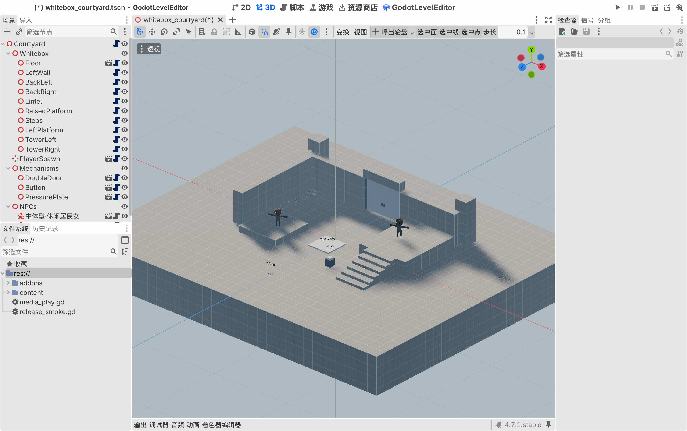
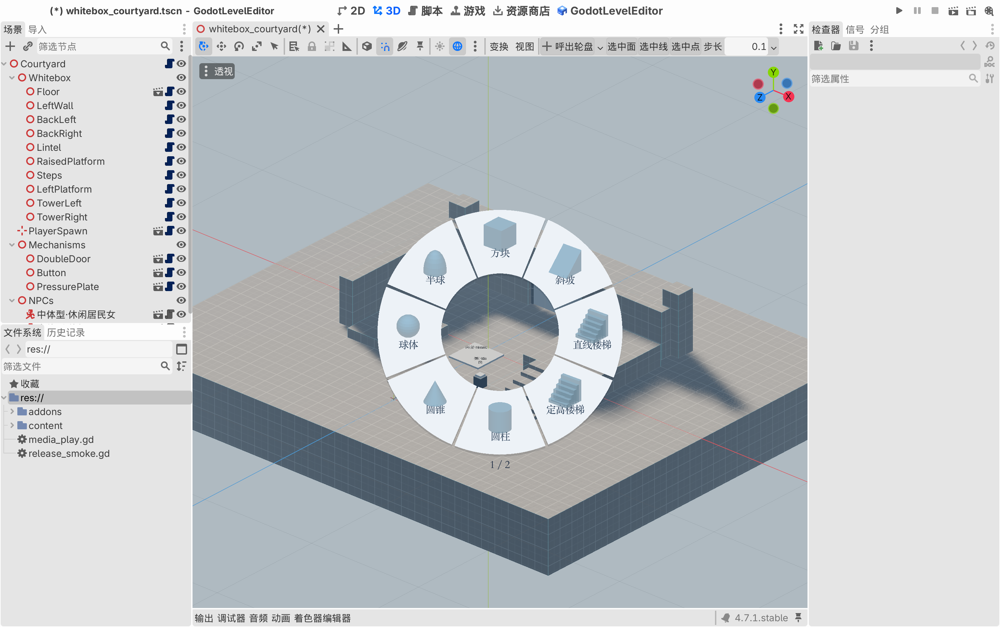
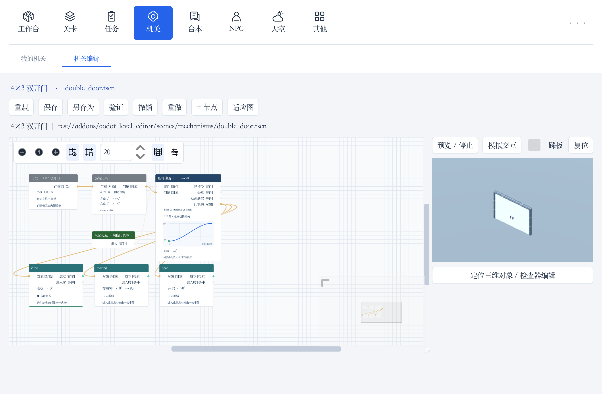
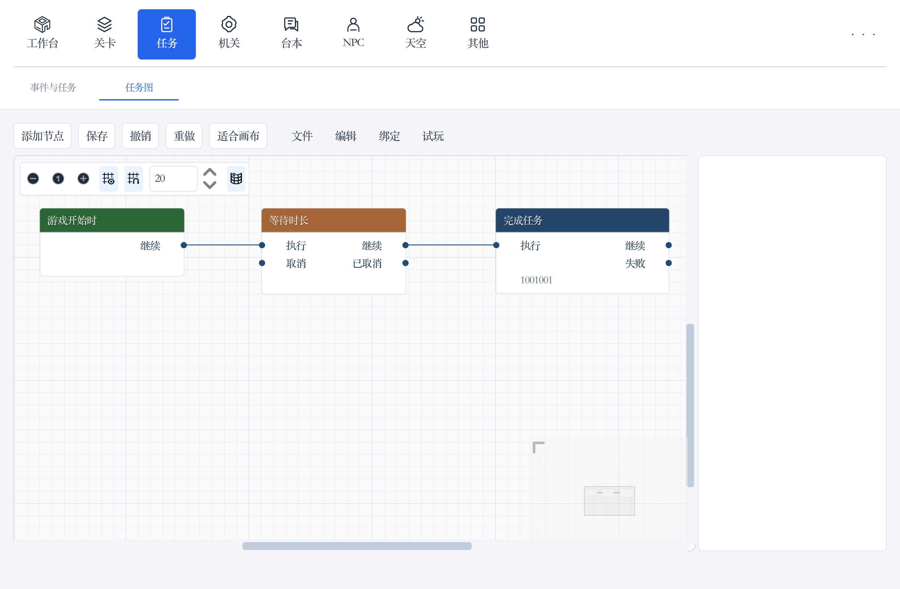
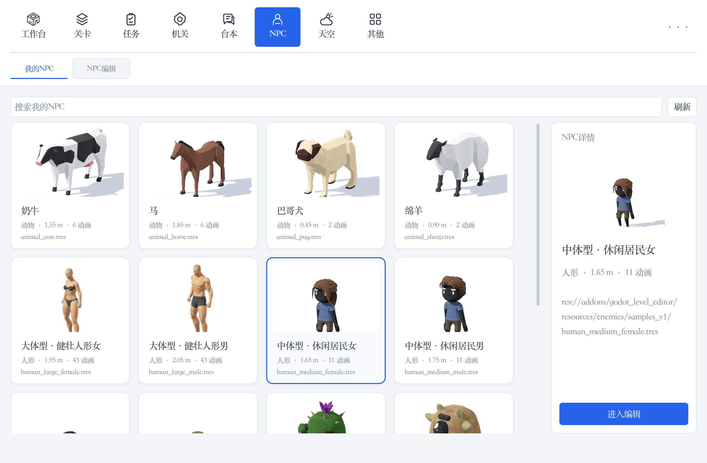
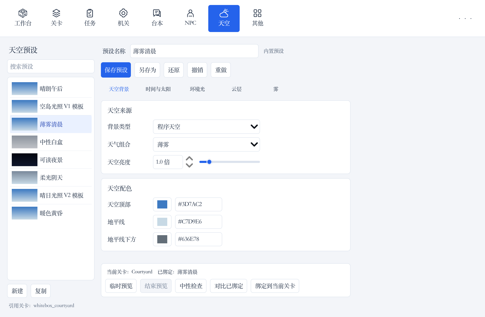
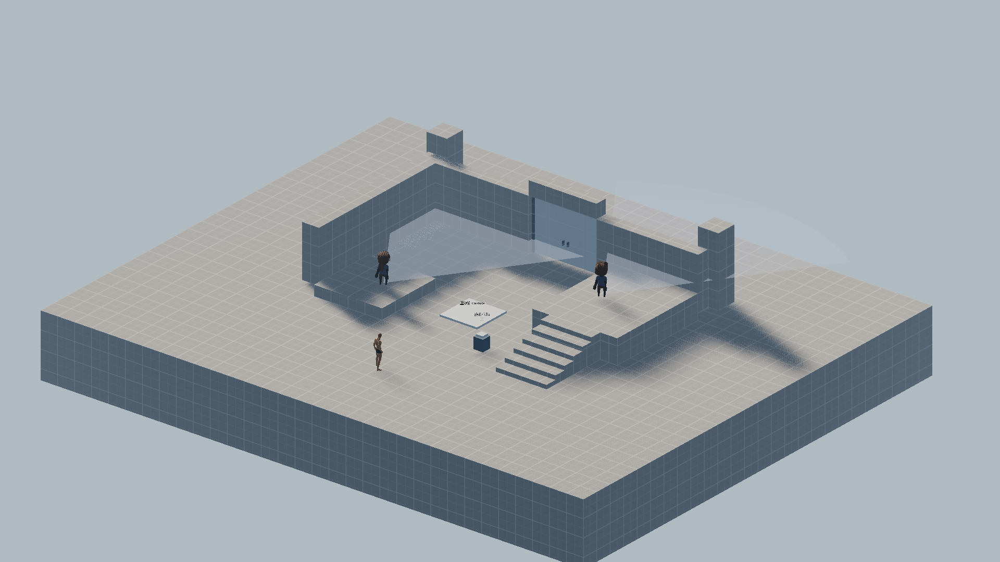

# GodotLevelEditor

[中文](README.md) | [English](README.en.md)

**A Godot toolkit for new level designers with no coding experience to build and play whitebox levels.**

Godot 4.7.1 editor plugin with a quick-add wheel, whitebox and face/edge/point tools, mechanisms, NPCs, dialogue, tasks and sky editing. It includes a player, third-person camera, HUD and basic playtesting. Maps use Godot's native scene tree, 3D viewport, save commands and F6.

[Download](https://github.com/Lanyi021102/GodotLevelEditor/releases/latest) · [English Wiki](https://lanyi021102.github.io/GodotLevelEditor/en/) · [中文 Wiki](https://lanyi021102.github.io/GodotLevelEditor/)

**0.3.0** adds whitebox terrain, player 3C presets, vehicle presets and a performance timeline, alongside native viewport measurements, per-instance NPC conversations and Excel conflict handling. [Changelog](docs/wiki/changelog.en.md)



## Features

### Block out spaces and place objects

Build in the native scene tree and 3D viewport. Use the wheel to place whitebox shapes, mechanisms and NPCs, then adjust faces, edges, points and step sizes. Maps remain ordinary Godot scenes.



Use **Quick Add → Terrain** to place peaks, draw rivers and drag out plateaus. Nearby peaks preview their connecting ridge, and the terrain controls save with the level. [Terrain guide](docs/wiki/guides/levels.md#terrain)

### Vehicle presets

Place a kart, motorcycle or hovercraft under **Quick Add → Vehicles** in the 3D viewport. Edit its model, seat and driving settings and save a reusable preset. [Vehicle guide](docs/wiki/guides/vehicles.md)

### Connect mechanisms and tasks

Five independent mechanisms are included: double door, single door, pressure plate, button and lift. Edit mechanism states and actions with nodes; use task graphs for triggers, delays and completion.





### Performance timeline

Capture shots and stage NPC movement and animation in Level Editing, then trigger the sequence from a level or task graph. See [Performance timeline](docs/wiki/guides/levels.en.md#performance).

### NPCs, dialogue and sky

Browse 13 sample NPCs and configure models, animations and state machines. Dialogue and events use Excel workbooks owned by your project. The sky editor previews lighting, fog and presets.





### Save and play

A default player, third-person camera and HUD are included. In an empty project, enable the addon and press Play to control the character. Use F6 to playtest the current level and assess its scale and routes.

Use **玩家** (Player) to edit character abilities, camera, inputs and animations, then apply the saved preset to a level. See [Player 3C presets](docs/wiki/guides/player.md).



These are real UI captures and rendered frames from release 0.1.0 in an isolated test project. The screenshot courtyard and the author's maps and workbooks are not included in the installation ZIP. The plugin UI currently uses Chinese labels; the Wiki provides English instructions.

## Install

1. Download `GodotLevelEditor-VERSION.zip` from [Releases](https://github.com/Lanyi021102/GodotLevelEditor/releases).
2. Copy its `addons/godot_level_editor` folder into your Godot 4.7.1 Standard project.
3. Wait for import, then enable **GodotLevelEditor** in **Project Settings → Plugins**. Enable only this entry; it manages its internal modules.

The ZIP contains five mechanisms, 13 sample NPCs, models, animations, lighting and runtime components. It excludes the author's maps, task/dialogue data and development records. GitHub's automatically generated **Source code** archives are development snapshots and can contain authored maps; download the named plugin ZIP to install.

In an empty project without a main scene, the addon creates a start scene. Press F5 or the normal Play button to control the included character. Existing main scenes are preserved. See [installation and updates](docs/wiki/plugin-install.en.md).

## Development project

Open the root `project.godot` with Godot Project Manager. On macOS, `启动项目.command` is also available. F5 runs the main scene; F6 runs the current scene. Open the separate tool window from the top **GodotLevelEditor** button or **Project → Tools → 打开 GodotLevelEditor**.

```text
addons/godot_level_editor/   Addon, built-in assets, empty template and runtime
content/                    Authored maps, workbooks, task graphs and assets
project.godot               Ordinary Godot project settings
icon.svg                    Development project icon
docs/                       Wiki, interfaces and verification records
tools/                      Development checks, packaging and Wiki tools
.github/workflows/          Automated builds and publishing
```

Only `addons/godot_level_editor/` enters the installation ZIP. GitHub and the local project share this layout; packaging does not relocate resources.

## Create a map

Open **GodotLevelEditor → 工作台 → 新建关卡** (Workspace → New Level). Use Godot’s **Scene → Save As** under `content/scenes/levels/` or another project folder outside the addon. Resume the last map from Workspace. In My Levels, **打开场景** returns to the native 3D viewport and **编辑常驻逻辑** opens the map’s logic. Try the [button and door exercise](docs/wiki/tutorials/button-door.en.md#wire-button) in your own project.

Use the native scene tree, 3D viewport, save, duplicate and F6 commands. The toolbar's **呼出轮盘** opens quick-add. Whitebox, face/edge/point tools and step settings remain available. In the separate window, use **关卡 → 我的关卡** (Levels → My Levels) to browse and open map files, and **关卡 → 关卡编辑** (Level Editing) for the current scene's permanent logic. Native saving registers a stable level ID for task assignment.

The development main scene is `content/scenes/main.tscn`; maps are in `content/scenes/levels/`, Excel workbooks in `content/tables/`, and task graphs in `content/resources/task_graphs/`. Existing level, task, object and resource IDs were preserved during migration. All folders use English names; Chinese UI text, sheet names and existing filenames may remain.

Controls: WASD to move, Shift to run, Space to jump, F to interact. Move the mouse to look; hold right-click to zoom, V to swap shoulders, middle-click to recenter. Esc releases the mouse; click the game to resume. Basic playtests do not save persistent progress.

## Releases and licensing

Pushing a `plugin-vX.Y.Z` tag runs GitHub Actions to package the addon, verify installation, updates and playtesting in clean projects, then publish a Release with the ZIP and SHA-256 checksum. Ordinary source pushes do not create Releases. Manual workflow runs create test artifacts. See [build and release](docs/wiki/development/plugin-release.en.md).

Original code uses [MIT](LICENSE). Third-party Quaternius models and animations retain their original CC0 licenses and source evidence. See [third-party notices](addons/godot_level_editor/THIRD_PARTY.md).

[Feature map](docs/wiki/features.en.md) · [Migration and verification record](docs/cleanup/plugin_2026-11-17/validation.md)
