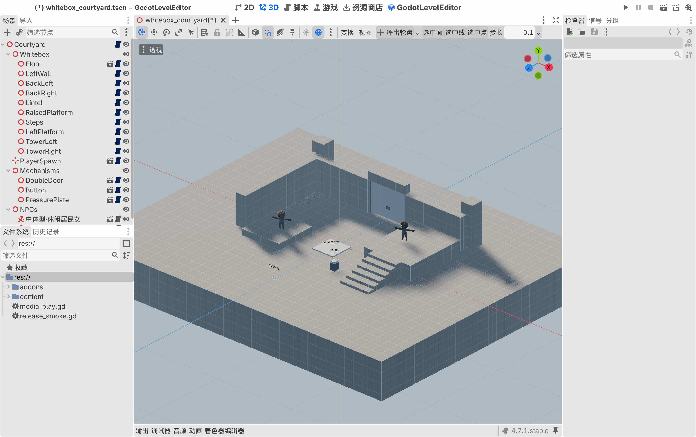
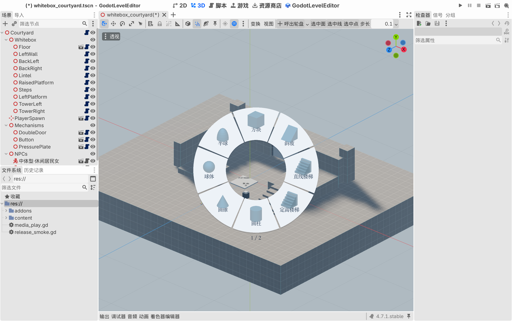
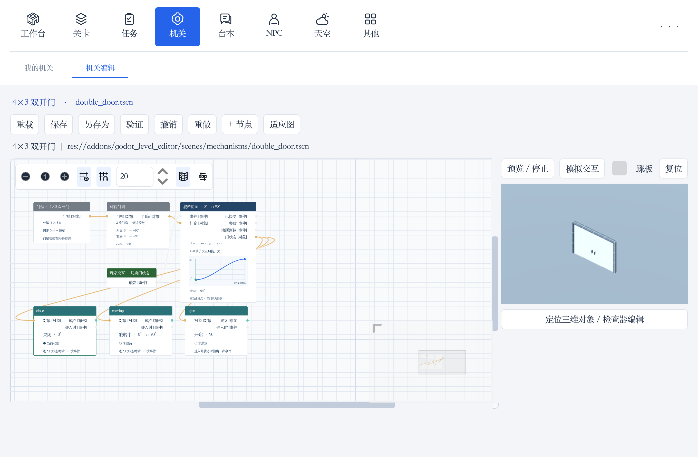
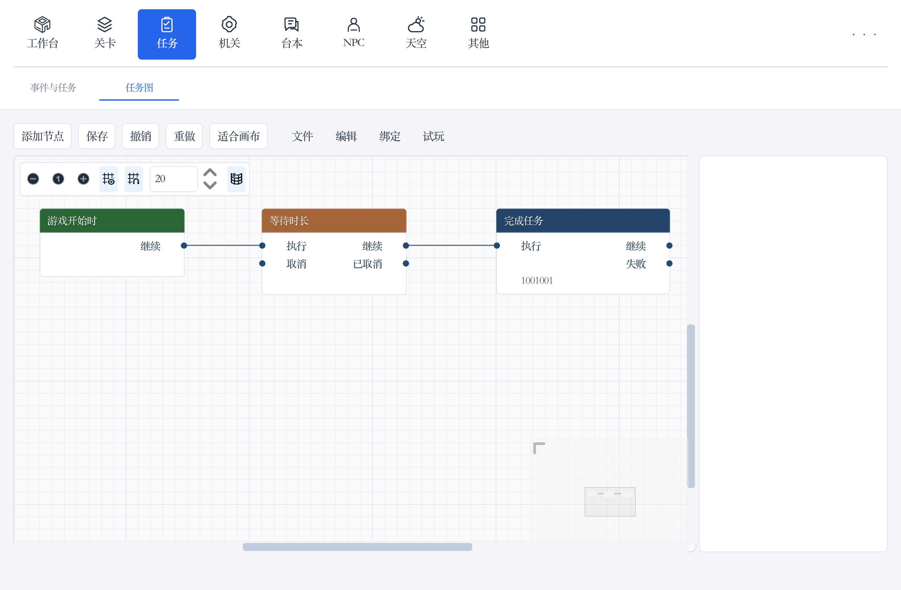
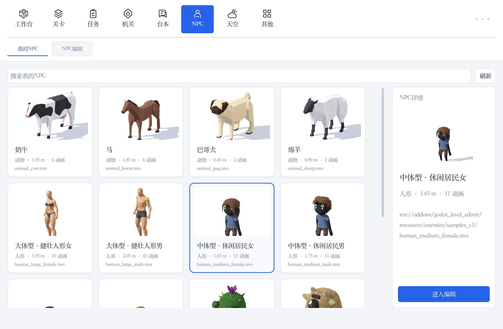
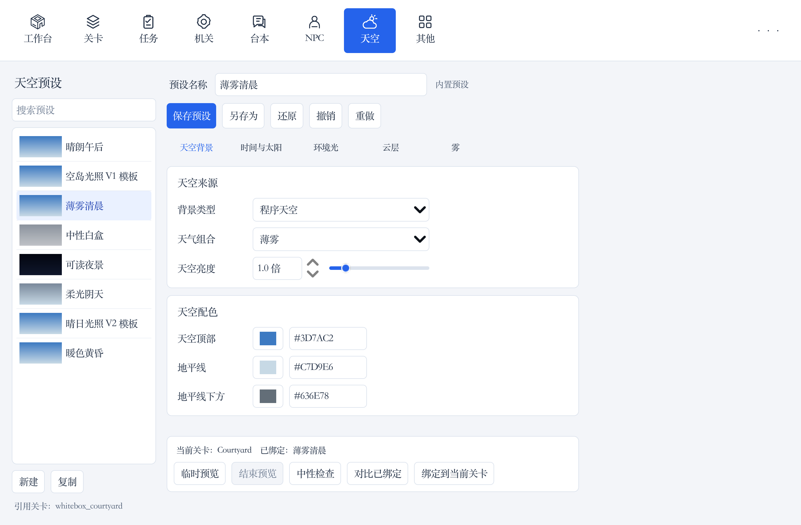
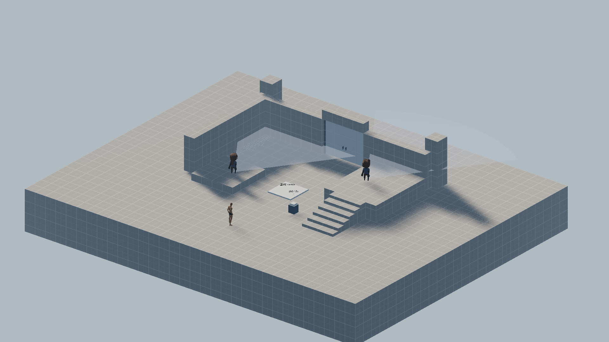

# GodotLevelEditor

[中文](README.md) | [English](README.en.md)

**面向零代码基础的关卡设计新人，方便制作和试玩白盒关卡。**

Godot 4.7.1 编辑器插件。包含关卡轮盘、白盒与点线面辅助、机关、NPC、台本、任务、天空编辑器，以及角色、第三人称镜头、HUD 和基础试玩。地图使用 Godot 原生场景树、3D 视口、场景文件、保存和 F6 运行。

[下载插件](https://github.com/Lanyi021102/GodotLevelEditor/releases/latest) · [中文 Wiki](https://lanyi021102.github.io/GodotLevelEditor/) · [English Wiki](https://lanyi021102.github.io/GodotLevelEditor/en/)



## 功能一览

### 白盒与快速放置

在原生场景树和 3D 视口搭建空间，使用轮盘放置白盒、机关与 NPC；保留点、线、面编辑和尺寸步长。地图直接保存为 Godot 场景。



### 机关与任务连线

内置双开门、单开门、压力板、按钮、升降台。通过节点编辑机关状态与动作，用任务图组织触发、等待和完成流程。





### NPC、台本与天空

包含 13 个示例 NPC，支持模型、动画和状态机；台本和事件使用项目自己的 Excel 配表。天空编辑器提供光照、雾和预设预览。





### 保存后直接试玩

插件包含默认玩家、第三人称镜头与 HUD。空工程启用后，按播放即可操控角色；自己的关卡用 F6 试玩，查看空间尺度和动线。



以上图片均为 0.1.0 插件在独立测试工程中的实际界面和渲染画面。截图用庭院不随插件发布，作者地图与配表也不进入安装包。

## 安装插件

在 [Releases](https://github.com/Lanyi021102/GodotLevelEditor/releases) 下载 `GodotLevelEditor-版本号.zip`，将其中的 `addons/godot_level_editor` 放入自己的 Godot 工程。等待导入后，在“项目设置 → 插件”启用 **GodotLevelEditor**。只需启用这一项；内部模块由它管理。

安装包包含五种独立机关、13 个示例 NPC、模型动画、光照和运行组件，不包含作者地图、个人任务／对白及开发验证资料。GitHub 自动生成的 Source code 是开发工程快照，其中可以包含作者地图；它与插件安装 ZIP 不同。

空工程首次启用会建立起始场景；直接按 F5 或点播放即可操控默认角色。已有工程主场景保留。

完整步骤见 [插件安装与更新](docs/wiki/plugin-install.md)。

## 打开开发工程

使用 Godot 项目管理器打开根目录 `project.godot`；macOS 也可双击 `启动项目.command`。F5 运行主场景，F6 运行当前关卡。独立编辑窗口由顶部 GodotLevelEditor 或“项目 → 工具 → 打开 GodotLevelEditor”打开。

```text
addons/godot_level_editor/   插件本体、内置素材、空白模板、运行组件
content/                    作者作品：地图、配表、任务图和个人素材
project.godot               普通 Godot 工程设置
icon.svg                    开发工程图标
docs/                       Wiki、接口和验证记录
tools/                      开发检查、自动打包及 Wiki 工具
.github/workflows/          GitHub 自动构建与发布
```

只有 `addons/godot_level_editor/` 进入插件 ZIP。GitHub 源码与本地使用同一插件目录结构，无需发布时搬运或改写资源路径。

## 新建与编辑地图

在 Godot 文件系统中找到 `addons/godot_level_editor/templates/empty_level.tscn`，右键选择“新建继承场景”，使用 Godot“场景 → 另存为”保存到 `content/scenes/levels/`，或工程中其他自选目录。不要直接覆盖插件内置模板。

使用原生场景树与 3D 视口编辑。工具栏“呼出轮盘”、白盒、点线面和步长继续可用。使用 Godot 原生保存、复制和 F6 试玩；独立窗口通过“关卡 → 我的关卡”浏览和打开地图，通过“关卡 → 关卡编辑”编辑当前场景的常驻逻辑。首次保存关卡时登记稳定 ID，供任务选择所属关卡。

默认作品入口是 `content/scenes/main.tscn`。地图在 `content/scenes/levels/`，配表在 `content/tables/`，任务图在 `content/resources/task_graphs/`。迁移保留已有关卡、任务、对象 ID 与资源 UID。

WASD 移动，Shift 跑步，空格跳跃，F 交互；鼠标转动镜头，右键拉近，V 换肩，中键回正。Esc 释放鼠标，点击游戏画面恢复操作。基础试玩不保存长期进度。

## 发布和许可

推送 `plugin-vX.Y.Z` 标签后，GitHub Actions 自动打包、在空工程验证安装／更新／试玩，再创建 Release 并附上 ZIP 与 SHA-256 校验文件。普通源码推送不会创建 Release。也可在 Actions 手动试打包，仅生成构建产物。见 [插件构建与发布](docs/wiki/development/plugin-release.md)。

原创代码采用 [MIT](LICENSE)，第三方 Quaternius 角色与动画保留各自 CC0 许可及来源证据。详见插件内 `THIRD_PARTY.md`。

[在线 Wiki](https://lanyi021102.github.io/GodotLevelEditor/) · [功能地图](docs/wiki/features.md) · [迁移与验证](docs/cleanup/plugin_2026-11-17/validation.md)
