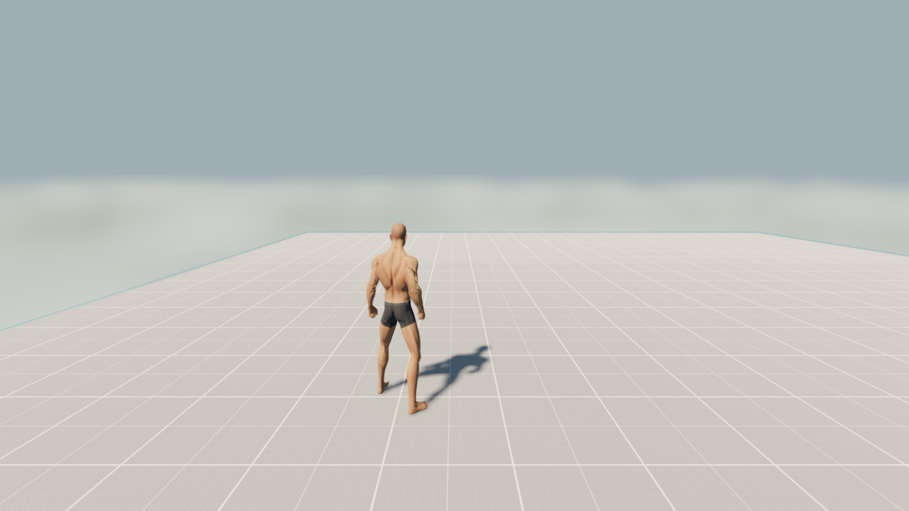

# 个人白盒编辑器转型 · 2026-11-12

用户确认：保留第三人称角色、移动、跑步、跳跃、镜头和 F 交互；删除特色玩法；保留全部编辑器及其运行组件，清除主入口预设玩法。

## 结果

- 删除 Timeline 单例与环形录像、回溯／快进、时间暂停、分身生成及回放、交互录像、轨迹线、能量兼容层和能力解锁；移除 Q/E/R/T 输入映射与 HUD 暂停按钮。
- 删除对应脚本、UID 和专用时间线／分身测试入口。角色与守卫场景不再挂 Rewindable；机关和世界不再自动注册时间线。
- 主入口仍为 scenes/main.tscn，改用 scenes/levels/whitebox_world.tscn。工作区为 20 × 20 m 米制网格平台，使用现有白盒、房间与世界组件，没有预设谜题、守卫、任务或剧情；persist_progress=false，不读写用户长期存档。
- 保留关卡与世界、机关、敌人状态机、台本与任务四套编辑器；保留原连续世界、房间、机关、台本与任务资源及光照 V1/V2。3C 测试场继续用于基础角色和交互测试。
- 保留 HUD 原生场景、Root、主题与世界显示兼容入口，可继续在 2D 视口制作界面。

## 接口与兼容

game_session 仅绑定玩家与镜头并处理掉落复位，不再提供时间、录像或分身方法。掉落复位会恢复试玩开始时的临时机关状态；没有历史状态浏览。

组件的 tl_capture/tl_restore 仍供编辑器预览、关卡指令、状态保存和复位使用。保留接口不等于保留时间线。旧资源中的稳定 ID、定义版本与连线保持；clone/crouching 等旧条件可加载，但基础玩家没有相应能力。has_item 使用角色道具接口，无接口返回 false，不再查询 Abilities。

SaveSystem 保留世界与任务进度，忽略旧 abilities 字段。用户已有存档没有删除。需要长期进度时，可自行在根节点开启 persist_progress，并配置自己的世界或任务。

台本与任务编辑器在另一个已存在的聊天中同时升级，模块文件由该聊天维护。本次只解除其 Timeline 依赖，并提供 tools/narrative/session_fixture.tscn，保留原世界和 Narrative 供独立验证，不将预设剧情重新放回主入口。并行升级的运行验收由该聊天记录，本轮不将其尚未完成的验收计为通过。

## 本轮验证

Godot 4.7.1。先无界面导入及相关测试，再实际 Forward+ 渲染并目视检查。

| 检查 | 通过／失败 |
|---|---|
| 编辑器导入、主入口启动 | 无脚本错误 |
| 基础试玩集成 | 12／0 |
| 第三人称镜头集成 | 24／0 |
| 光照及 V1 保留 | 14／0 |
| 机关组件／图执行 | 48／0 |
| 关卡世界 | 82／0 |
| 关卡 V2 | 98／0 |
| 节点呈现 | 131／0 |
| 敌人组件／状态机 | 45／0 |
| 关卡真实编辑器操作 | 35／0 |
| 机关真实编辑器画布 | 33／0 |
| 敌人真实编辑器画布 | 42／0 |
| 实际画面与镜头姿态截图 | 5／0 |

基础集成实际测试走跑、跳跃落地、F 驱动拉杆开门、掉落复位、旧能力快捷键失效、无特殊单例、主入口没有预设玩法及独立测试存档。画布检查覆盖节点、连线、保存重载、撤销及实际调试消息等既有能力。测试过程改写的机关样例已从本轮开始前的备份恢复，未保留测试编辑。

对已有房间、机关、关卡定义、敌人定义、材质和光照资源抽取本轮保护清单，共 23 个文件；逐文件 SHA-256 与开始前一致。日志及保护核对结果见 [验证文件夹](whitebox_2026-11-12/)。

## 备份

完整工程源文件备份（含开始前未提交修改，不含 .git/.godot）：

`/Users/lanyi/branch_cleanup_backups/whitebox_conversion_20261112_163229/before.zip`

保护文件原始哈希同目录 protected_manifest.json。未提交或推送此次修改。
