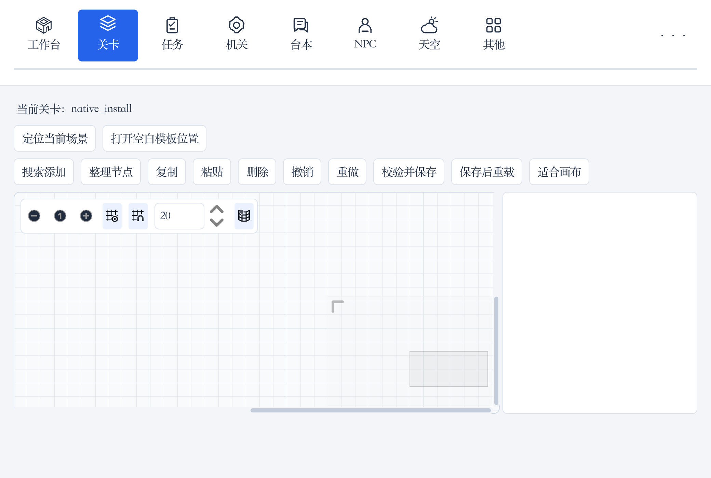
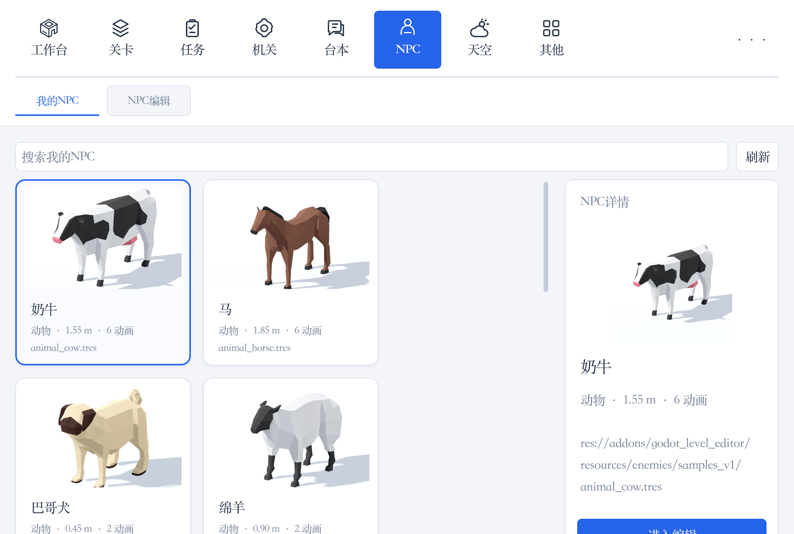
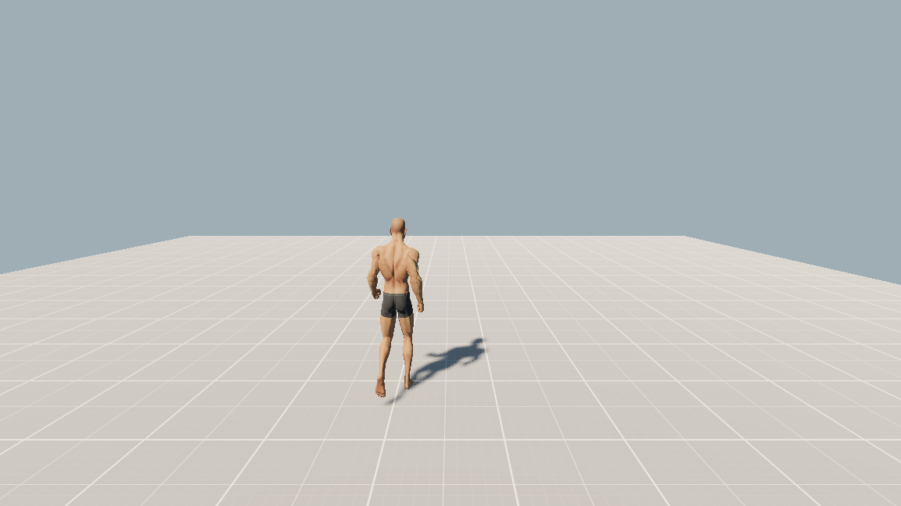

# 完整插件迁移与验证 · 2026-11-17

当前开发工程在副本中整理，切换前备份为 `/Users/lanyi/branch_cleanup_backups/before_plugin_20261117_145408.tar.gz`。迁移表保存在 `tools/release/layout-migration.json`，身份检查结果在同目录 `migration-check.json`。

插件本体统一在 `addons/godot_level_editor/`；作者地图、配表、任务及个人资源在 `content/`。地图使用原生场景树、3D、文件系统、保存和 F6，保留轮盘、白盒与点线面。旧地图卡片目录改为当前场景常驻图；原生保存登记任务所需关卡 ID。安装 ZIP 只含插件，不包含作者地图。

空工程首次启用且没有主场景时，生成空白起始场景并配置 F5，运行时自动生成可操控角色、第三人称镜头及 HUD。已有主场景保留。

## 实际验证

- 迁移检查：604 个文件归位；40 份作者场景／图文件的稳定 ID 与场景 UID 保持，150 份脚本 UID 保持，差异为 0。Excel 路径迁入项目的 `content/tables/`，四份工作簿按路径映射之外的 XML 内容保持一致，原作者数据保留。
- Godot 4.7.1：原工程新目录完成全新 headless 导入，无脚本或资源错误。
- 安装 ZIP 解压到空工程：56 项通过，含主场景／已有按键／宿主同名服务保留、13 个 NPC、五种机关、原生场景另存、关卡 ID、已打开任务索引刷新，以及文件移动回调保持 ID 和更新路径。
- 替换整个插件目录模拟更新：49 项通过；项目中的三份 Excel 和地图文件共四个文件哈希不变。
- 真正未设置主场景的空工程：首次启用自动创建起始场景；原生 F5 启动无错误，运行检查确认玩家响应移动输入，角色、镜头、HUD、13 个 NPC 与五种机关全部加载。
- Metal Forward+ 实际渲染：50 项通过，含当前场景关卡图、NPC 目录及禁用主插件后清除四个后端。默认玩家画面已检查。
- 中文目录审计：当前源码目录无非 ASCII 文件夹；发布构建及 ZIP 验证均检查目录命名。中文界面、文档、工作表与原用户文件名保留。
- Wiki 构建与链接／搜索检查通过；安装说明已在实际浏览器检查导航、正文和表格排版。

文件移动采用临时验证夹具和原生文件系统通知回调测试，未将其声称为鼠标完成重命名。旧版自制地图目录测试仅为历史资料，本版以原生场景和安装验证为当前依据。

运行日志在 `dist/verification/`，构建产物不提交；本记录保留编辑器、NPC 和默认试玩截图。部分进程退出仍报告一个 ObjectDB 实例泄漏警告；dummy 渲染下提示 SSIL／体积雾需要 Forward+。未出现脚本或资源加载错误，未验证 Windows GUI。

角色模型迁移时发现二进制快照内嵌旧贴图路径，已转换为带显式依赖的 `adapted_human.tscn`；玩家模型只变更资源存储与引用，没有变更作者地图身份。

## 命名与兼容

沿用“关卡”“NPC”“机关”“天空”“呼出轮盘”等名称，未添加装饰前缀。稳定对象／任务／关卡 ID 和脚本 UID 保留。原创代码 MIT；第三方素材保留原许可。用户作品不由插件升级覆盖。

## 实际画面

