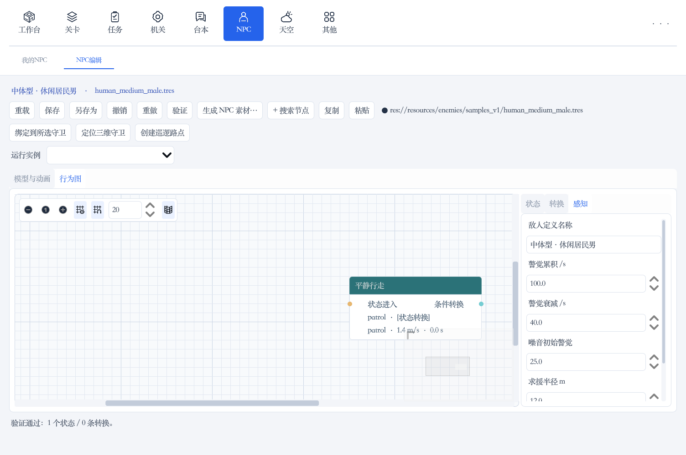

# 项目冗余与过时内容检查

日期：2026-11-16。当前工程按个人白盒编辑器维护。本次清理重复生成物、无效界面入口和过时说明，未按文件名称或“没有文字引用”批量删除用户作品。

## 归档内容

归档位置：`/Users/lanyi/branch_cleanup_backups/project_hygiene_20261116_171522/`。`manifest.json` 逐项记录原路径、归档路径、原因及字节数；文件条目另有 SHA-256。

| 内容 | 数量 | 处理 |
|---|---:|---|
| 已完成测试留下的完整 Godot 工程副本 | 6 份，约 1.21 GB | 移到工程外；原验证日志、截图和结论保留 |
| 旧 Wiki 交付包 | 1 份，约 118 MB | 工程外归档，可从源码重建 |
| 当前 Wiki 构建产物 `site/` | 1 份，约 100 MB | 最终 Wiki 检查后归档，保留 `.gdignore`；后续构建自动重建 |
| 文档图片的 `.import` 旁文件 | 195 个 | `docs/.gdignore` 已排除文档导入，归档失效旁文件；图片原件保留 |
| 未打开、无引用的机关画布测试产物 | 2 对，共 4 个文件 | 归档 `.canvas_test_*` 场景及图资源 |
| Finder 缓存 | 1 个 | 归档根目录 `.DS_Store` |
| 无进程占用的 Git 临时对象 | 1 个，约 23.7 MB | 归档后执行保留全部对象的压缩 |

这里只减少工程目录内的重复内容。工程外归档仍占用磁盘，可用于恢复；归档不是彻底释放这些文件的磁盘空间。精确字节数以归档清单为准。

## 保留内容与依据

- 检查开始时记录的 `scenes/`、`resources/`、`assets/` 和 `配表/` 共 266 个资源文件逐个比较 SHA-256，全部保持一致，见 [资源保护结果](protected_resources.json)。
- 正式关卡工作簿中的关卡及其任务引用保留，包括随机名称、带“测试”字样的用户作品；不以命名判断是否过时。
- 原生 Godot 当前打开的 `native_drag_probe_76531.tscn` 保留，虽然名称看似临时产物。当前打开的关卡、脚本和文档也没有作为残留归档。
- 当前角色继承的基础场景、NPC 使用的内部 actor 与 `legacy_guard.tres`、原模型、动画、纹理、许可保留。
- 全部编辑器及运行组件、可编辑 HUD、基础第三人称操作、试玩、光照 V1 基线、现用 V2 与天空预设保留。
- `tl_capture / tl_restore`、旧资源兼容字段、CSV 迁移读取保留。这些仍服务于复位、保存或旧资源读取，不代表恢复已删除玩法。
- `.godot/` 导入缓存与编辑器状态没有清空；原生 Godot 未被重启。正在运行的 Wiki 服务及 `.venv-wiki/` 保留。MkDocs 预览服务使用独立临时构建目录，归档根 `site/` 不移走它正在提供的页面。

## 过时界面与说明

NPC 感知参数中的“暴露能量惩罚”已无运行调用，现从参数界面移除。旧 `expose_penalty` 字段保留：NPC 定义的参数字典照常序列化，GuardAI 使用 `@export_storage` 保持旧场景数据但隐藏原生检查器入口。其他五个感知参数继续可编辑，重绘不修改资源或草稿状态。

放置组件的新资源默认说明改为当前玩家组契约，不再要求 `is_clone()`。稳定字段、资源路径和状态保存接口不变。其他旧玩法文字仅修正注释。

清理索引改为当前白盒保留边界，2026-11-02 的原说明移入明确标注的[历史记录](../2026-11-02.md)。角色导入说明和 NPC 当前指南同步修正。新增与修改文字沿用自然中文名称，未更改用户作品名称、稳定 ID 或协议字段。



## Git 压缩

压缩前 `.git/` 文件逻辑大小为 435,877,189 字节，压缩后为 300,591,091 字节。其中 23,724,032 字节为已归档临时对象，剩余约 111.6 MB 为重新打包收益。

执行命令：

```sh
git -c gc.reflogExpire=never -c gc.reflogExpireUnreachable=never -c gc.worktreePruneExpire=never gc --no-prune
```

前后 4,919 个唯一对象全部存在，refs 与符号 HEAD 相同，`git fsck --connectivity-only --no-dangling` 返回 0。没有提交、重置工作区、过期 reflog、推送或删除历史。

## 验证

Godot 检查在工程外独立副本运行，未借用或重写当前原生编辑器的导入与布局状态。

| 检查 | 实测结果 |
|---|---|
| Headless 编辑器导入 | 返回 0，无脚本解析错误 |
| 场景及资源加载、依赖路径 | 140 个资源，无加载失败、无缺失依赖 |
| 当前白盒运行测试 | 12 项通过 |
| NPC 运行测试 | 45 项通过 |
| 清理兼容与界面测试，Headless | 11 项通过 |
| 清理兼容与界面测试，Metal 实际渲染 | 11 项通过；检查五个感知参数与旧字段存储 |
| 用户资源哈希保护 | 266 个文件一致 |
| Wiki | 严格构建通过；18 个当前页面、1,187 个本地链接、49 个图片引用通过，158 条搜索记录，0 错误 |

Metal 退出时仍有 `Can't use get_node() with absolute paths from outside the active scene tree` 和 1 个 ObjectDB 泄漏诊断；Headless 退出时有 debugger 未附着与 ObjectDB 诊断。测试项均通过，未将退出诊断记为已修复。本次没有逐一试玩全部用户关卡，也没有把目录减量当作启动耗时或帧率提升的测量结果；验证副本原本就在忽略目录内。

文档浏览器连接两次超时，未完成网页外观检查；不把链接检查等同于浏览器验收。NPC 界面截图已实际查看。

日志在归档目录 `validation/`，只读盘点结果见 [清理后清单](audit_after.json)。新增工具：

```sh
python3 tools/cleanup/audit_project.py --output /tmp/project-audit.json
godot --headless --path . --script res://tools/cleanup/check_resources.gd
```

盘点工具不自动删除。动态加载、工作簿和二进制资源不能仅凭文字引用判断是否使用。编辑器专项测试位于 `tools/cleanup/editor_audit_test.gd`，通过独立副本中的套件测试入口运行，没有增加生产插件启动工作。

## 恢复

依据工程外 `manifest.json` 中的路径，按需把 `archived/` 内的文件移回原位。改过的源码与说明原件另存于 `source_before/`，对应哈希在 `source_before.json`。恢复前比较当前文件，避免覆盖其他聊天或用户随后保存的新内容；不整体覆盖工程。归档不包含一次新的 Git 提交。
