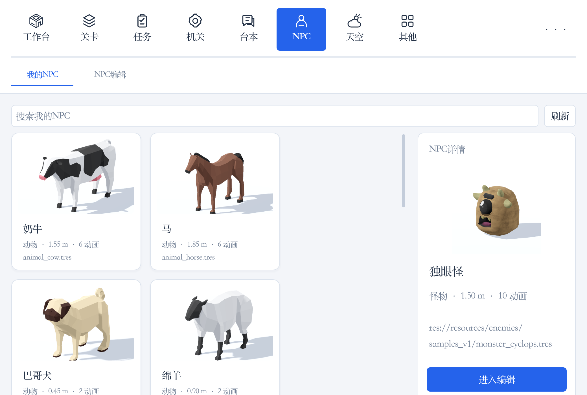
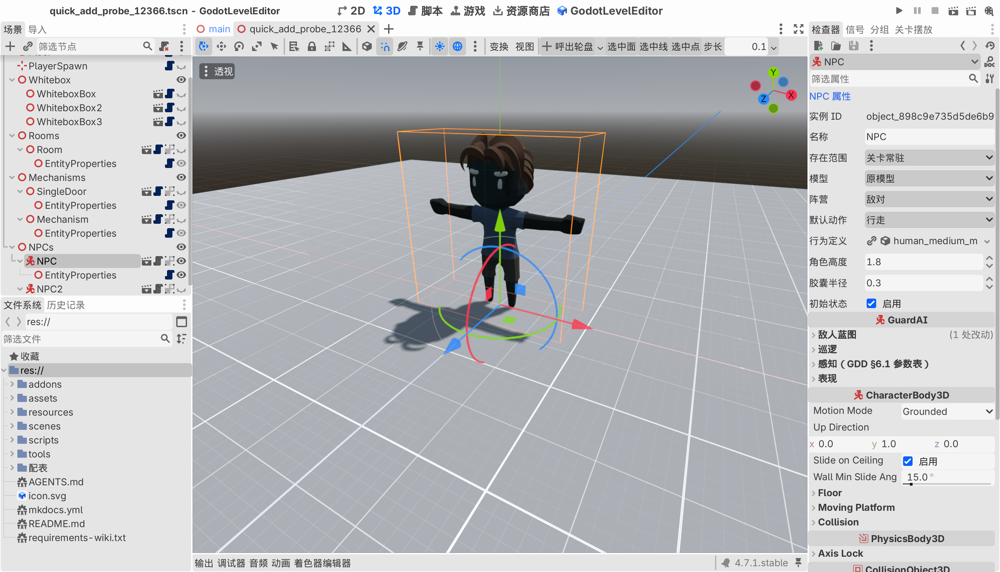

# 旧 NPC 素材清理验证

2026-11-16。清理 NPC 素材入口、重复旧守卫与默认胶囊。

- 删除 `resources/enemies/new_enemy.tres`；与旧守卫仅资源 UID 和画布滚动不同。
- 旧守卫定义、角色构造器和调试样例分别移至插件运行目录与 tools 测试夹具；更新引用，保留用户场景内容与 ID。
- 原始备份在项目外：`/Users/lanyi/branch_cleanup_backups/npc_legacy_20261116_155615`。
- 首批 13 个示例、原始模型、玩家模型、白盒和物理碰撞保留。

## 实际检查

Godot 4.7.1；编辑器操作在项目隔离副本运行，避免改写用户关卡与编辑器布局。

| 检查 | 结果 |
|---|---:|
| 13 个示例、替换外观与旧对话交互 | 150 通过，0 失败 |
| 守卫运行兼容与内部夹具 | 45 通过，0 失败 |
| 任务与对话节点 | 90 通过，0 失败 |
| 模型导入、撤销与生成场景 | 19 通过，0 失败 |
| 无界面轮盘放置与存盘 | 110 通过，0 失败 |
| 无界面素材目录 | 72 通过，0 失败 |
| Metal 素材目录及实际编辑器 | 72 通过，0 失败 |
| Metal 放置、人物拾取与存盘 | 112 通过，0 失败 |

无界面编辑器导入检查通过；旧路径未残留于 addons/scripts/tools/scenes/resources 的文本依赖。3 份引用旧定义的存量场景与清理前备份逐字比较，仅修改资源依赖路径，内容、节点和 ID 不变。当前目录恰好 13 份 NPC 定义。

已人工查看实际目录与放置截图：新目录无旧守卫条目；原生检查器模型字段为原模型；默认人物完整显示并可被选中。

截图中的阵营和动作经过测试中的实例字段编辑，不代表示例源资源的初始参数。

### 诊断边界

个别编辑器退出仍报告既有 `Plugin is not attached to debugger`、1 个 ObjectDB 泄漏警告。第一轮副本扫描另记录到其他聊天正在改动的 `tools/mechanisms/test_canvas.gd:14` 类型推断错误；该文件不属于本次 NPC 清理，未修改。后续 NPC 目录与最终 Metal 轮盘检查无脚本错误。详细计数见 [results.json](results.json)。

Wiki 最终检查通过：17 个当前页面、1108 个本地链接、49 处图片引用、150 条搜索记录，0 错误。全工程最终 headless 编辑器导入正常退出，无脚本错误；仅保留既有 ObjectDB 退出警告。构建仍提示历史接口文档中已有的锚点信息，不属于当前 Wiki 链接错误。

`git diff --check` 对本次代码与测试文件通过。
