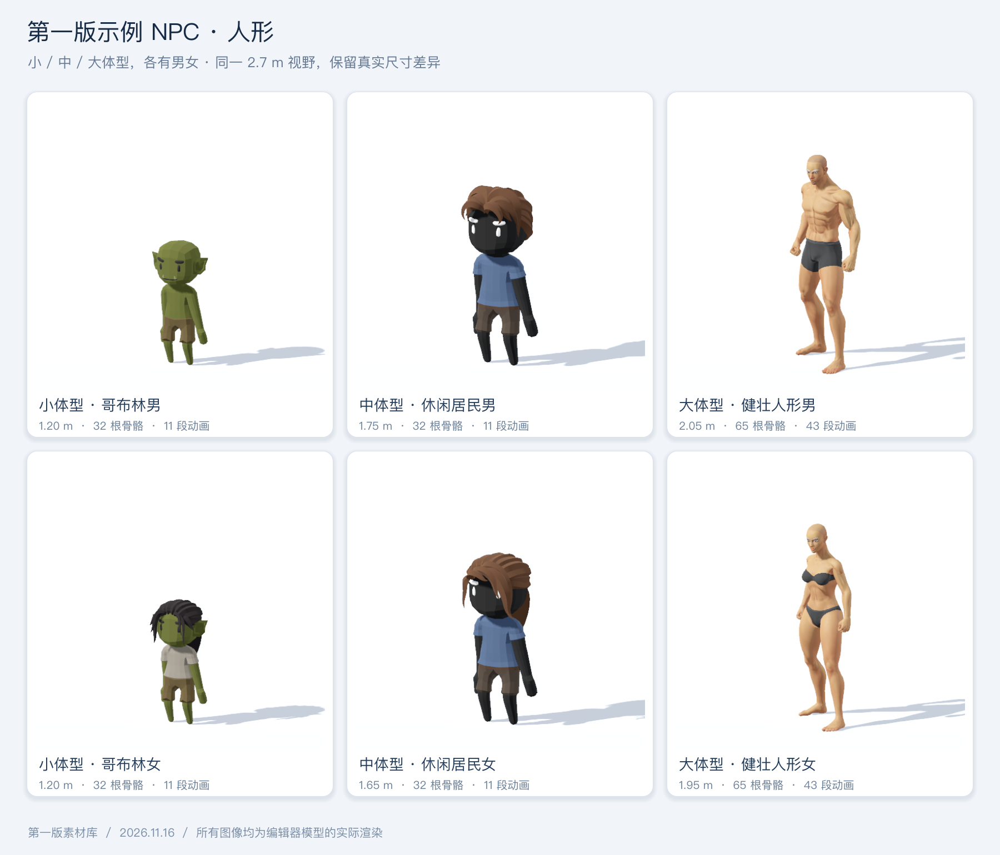
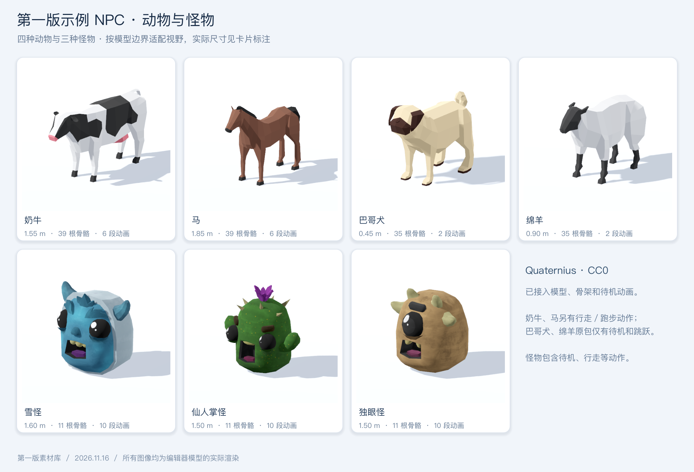

# 示例 NPC V1 验证 · 2026-11-16

环境：macOS、Godot 4.7.1、headless 与 Metal Forward+。功能检查在独立副本 `/tmp/branch-npc-v1-check-dbMF07` 进行；最终当前工程另做 headless 编辑器启动检查。没有往默认入口、用户关卡或工作簿放置示例。

## 交付资源

- 6个人形：小体型哥布林男女、中体型休闲居民男女、大体型健壮人形男女；六个独立源模型。
- 4动物：奶牛、马、巴哥犬、绵羊。
- 3怪物：雪怪、仙人掌怪、独眼怪。
- 每个都有骨架、真实可选动画、定义、可放置场景及缩略图；完整动作清单与路径在 `resources/enemies/samples_v1/catalog.json`。
- 模型、动画和许可按具体原作者 CC0 发布或原包许可选择；资料在 `assets/characters/npc_samples_v1/`。Pug／Sheep只有待机和跳跃；没有为缺失动作伪造走跑绑定。

## 本次结果

| 检查 | 结果 |
|---|---|
| 13个样例加载、骨架、真实骨骼动画、尺寸、足底、碰撞、默认平静行为、轮盘发现、保存重读 | 145通过，0失败 |
| 尺寸适配与姿态：旋转／非1倍根变换、小尺寸、4／8权重、骨骼名称／索引、骨骼挂件、真实Pug／Sheep | 32通过，0失败 |
| 我的NPC目录、13模型打开、动作清单、缩略图、中文／原名搜索、轮盘中文名称 | headless 71通过，0失败；Metal 71通过，0失败 |
| 既有模型／动画配置与旧NPC兼容回归 | 15通过，0失败 |
| 既有NPC状态机与巡逻运行回归 | 45通过，0失败 |
| 实际渲染 | 13张缩略图、2张组合图，0失败；另外保存了真实目录与模型编辑页面 |
| Wiki实际浏览器 | 桌面1440px、窄屏390px均无横向溢出，全部模型预览图加载成功 |
| Wiki全站链接检查 | 已执行；NPC指南无链接错误。当前另有4条门教程链接缺少目标，详见下文 |

结构化结果在 `results.json`，浏览器测量在 `browser_layout.json`。运行日志在本目录的 `runtime.log`、`visual_fit.log`、`editor_headless.log`、`editor_metal.log`、`appearance_regression.log`、`enemy_regression.log` 与 `capture.log`；日志按工程约定不纳入Git。

最终Wiki检查报告4条缺失链接，均指向同时变动的门教程资料：`docs/mechanism_editor/doors_v2_2026-11-16/validation.md` 与 `双开门_moving.png`，出现在版本记录、维护索引和旋转门教程。没有修改这些页面或伪造验证附件；本批NPC指南、素材预览及其本地链接没有报错。完整检查输出保留在本目录 `wiki_check.log`。

## 实际画面

- [我的NPC目录](npc_catalog.png)
- [模型与动画编辑](npc_editor.png)
- [Wiki桌面](wiki_desktop.png)
- [Wiki窄屏](wiki_mobile.png)

人工复查确认网格和原贴图实际可见，Pug／Sheep尺寸与贴地正确，小／中人形待机不再单臂横伸，动物与怪物自然静止，不套用人形展开姿态。

## 修正与兼容

旧FBX的静态网格边界与真实蒙皮形体不一致，Pug与Sheep最明显。现在NPC专用适配用CPU蒙皮边界作一次缩放与贴地；没有每帧GPU读回，也没有修改玩家的CharacterModel。旋转骨架的根位移先换到组件坐标，只保留真实垂直步态，消除水平根位移。导入快照使用有效根节点名称，避免原生编辑器反复报告空名称。

四个旧人形的Idle缺失右臂通道，导入副本补充了中立下垂旋转；原FBX不改。怪物显式恢复了随包贴图。原始下载和派生快照清楚分开。

编辑器退出时仍可能出现此前已有的 debugger 脱离及1个ObjectDB泄漏诊断；功能运行与最终Metal素材渲染无新增脚本错误。未进行独立游戏导出发布测试；资源以原生PackedScene引用保存，原始素材目录由`.gdignore`排除重复导入。

当前操作指南见 [NPC素材与动画](../../wiki/guides/npc-samples.md)，公共字段见 [模块接口](../INTERFACES.md)。
