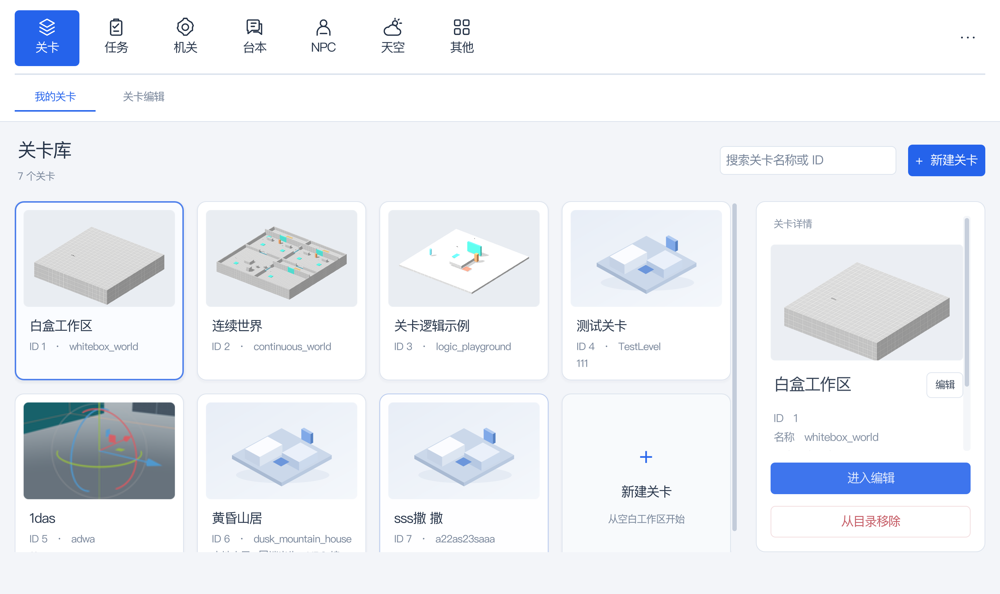
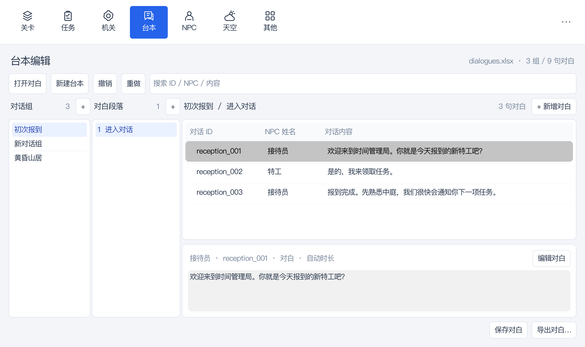
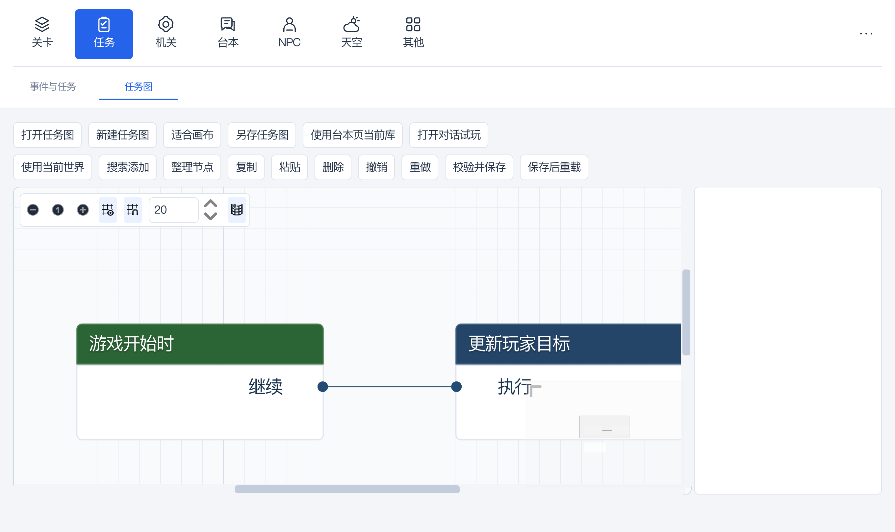

# Mac 显示适配、导航与界面更新

日期：2026-11-16。Godot 4.7.1，macOS，Metal / Forward+。

## 已实现

- 独立窗口按当前屏幕系统缩放显示。Mac Retina 读取 2×；明确设置的 Godot 编辑器显示比例优先。字体、图标、间距与命中区域统一缩放，避免字体单独放大后被控件裁切。窗口及弹窗随比例适配，窗口限制在屏幕可用范围内。
- 正文基础字号 16 逻辑像素，图节点正文与标题使用 MSDF 系统字体，支持清晰放大。GraphEdit 仍使用原来的节点位置、连线、端口和缩放语义。
- 一级导航使用单色 SVG，上方图标、下方文字；选中时图标和文字一起变色。图标以足够分辨率加载，保持高 DPI 清晰度。
- 按钮悬停、焦点、按下和选中使用平滑背景、边框及阴影过渡；页面分层淡入。快速切换或隐藏时清理动画，命中区域不移动。
- 关卡目录增加数量、搜索与新建入口；卡片预览统一比例，缺图时使用内存白盒插图；详情可滚动，底部按钮固定可见。
- 台本按实际字体计算 ID 和姓名列宽，正文省略时保留全文提示；下方提供完整换行阅读区。搜索没有匹配项时禁用隐藏旧选中的编辑入口，编辑与撤销继续使用原流程。

## 实际验证

本机实际报告 `editor_scale=2.0`、`screen_scale=2.0`、DPI 257，屏幕 2940×1912。原生截图来自独立窗口，采用实际 2× 缩放；同一进程还模拟检查 1×、1.5×、2× 的实际窗口变换。Retina → 普通屏选择策略使用输入矩阵检查，没有把它描述成实际跨硬件移动测试。

| 检查 | 结果 |
|---|---|
| 显示专项 headless | 25 项，0 失败 |
| Mac 原生显示与渲染 | 25 项，0 失败 |
| 现有套件编辑器回归 | 78 项，0 失败 |
| 2× 原生跨窗口场景对象拖放 | 38 项，0 失败 |
| 台本独立内存检查 | 10 项，0 失败，已包含在显示专项中 |
| Wiki 构建与链接检查 | 通过，829 个本地链接，0 错误 |
| 动画独立探针 | 悬停、选中色、固定几何、分层淡入、隐藏与重挂载通过 |

检查使用专用新编辑器进程及临时／内存资源，不操作用户正在编辑的原生会话。覆盖台本全文与稳定 ID、搜索、编辑／撤销／重做和原库内容保持；覆盖 graph 端口、连线、节点位置、弹窗比例，以及快速导航最终状态。高 DPI 拖放检查先把接收节点滚入可见画布，避免把原本被裁切的字段当成有效落点。

首次扫描发现并修正了 NPC 来源检查脚本中 `Animation` 返回值的类型推断问题；只增加明确类型。现有编辑器退出仍可能报告 `Plugin is not attached to debugger`、资源扫描退出及 1 个 ObjectDB 泄漏提示；不描述为完全无警告运行。最终显示与拖放检查没有脚本解析错误。

```sh
/Applications/Godot.app/Contents/MacOS/Godot --headless --path . --editor -- --ui-display-test
/Applications/Godot.app/Contents/MacOS/Godot --path . --editor -- --ui-display-test --capture
/Applications/Godot.app/Contents/MacOS/Godot --headless --path . --editor -- --godot-level-editor-suite-test
/Applications/Godot.app/Contents/MacOS/Godot --path . --editor -- --scene-reference-test
python3 tools/wiki/wiki.py check
```

本目录保留对应日志。更新已有编辑器会话时，先保存当前工作，再重新打开项目以加载新的字体、缩放适配和主题。

## 原生截图






