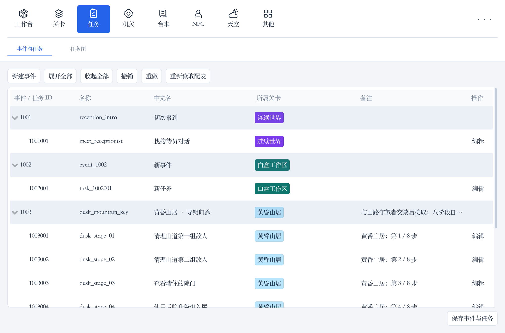
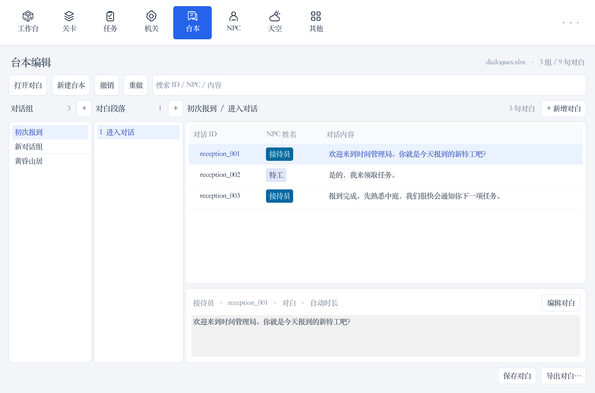

# 所属关卡与 NPC 姓名实色标签

日期：2026-11-16。Godot 4.7.1，macOS / Metal。

## 表现

所属关卡与 NPC 姓名从空心外框改为实色填充的圆角标签，使用蓝、青、紫色系的深浅色板。填充只包围文字，不铺满整列；同一关卡或完整姓名维持同色，事件与其同关卡任务保持一致。色板有限时允许复用。

根据填充的线性相对亮度，比较白字和深灰字的对比度并自动选择：深色填充使用白字，浅色填充使用深灰字。标签字色在行选中后保持，不被整行蓝字覆盖。字体、字号、字重及 MSDF 设置不变；文字继续由原生 Tree 绘制，标签沿用原生滚动裁切。没有修改配表、稳定 ID、角色运行时颜色或其他单元格。

## 验证

| 检查 | 结果 |
|---|---|
| Headless 显示检查 | 47 项，0 失败 |
| Metal 原生渲染检查 | 66 项，0 失败 |
| 深底／浅底字色 | 深底白字，浅底深灰字 |
| 全部色板的文字对比度 | 均至少 4.5 |
| 选中／普通行 | 同一标签保留相同填充及可读字色 |

同时覆盖实际 NPC 姓名保留、同关卡身份键一致、台本编辑／撤销与原库内容保持、1×／1.5×／2× 显示缩放、节点端口／连线／位置、导航命中范围，以及六类弹出层和引擎自动 tooltip 的黑边检查。原生截图已人工核对标签填充和文字效果。

退出仍有此前记录的 debugger 未附加和 1 个 ObjectDB 泄漏提示；没有新增脚本错误或检查失败。本次用户可见字段名称保持，没有新增装饰性名称。

```sh
/Applications/Godot.app/Contents/MacOS/Godot --headless --path . --editor -- --ui-display-test --capture-dir=res://docs/godot_level_editor_suite/filled_labels_2026-11-16
/Applications/Godot.app/Contents/MacOS/Godot --path . --editor -- --ui-display-test --capture --capture-dir=res://docs/godot_level_editor_suite/filled_labels_2026-11-16
```

## 实际画面




