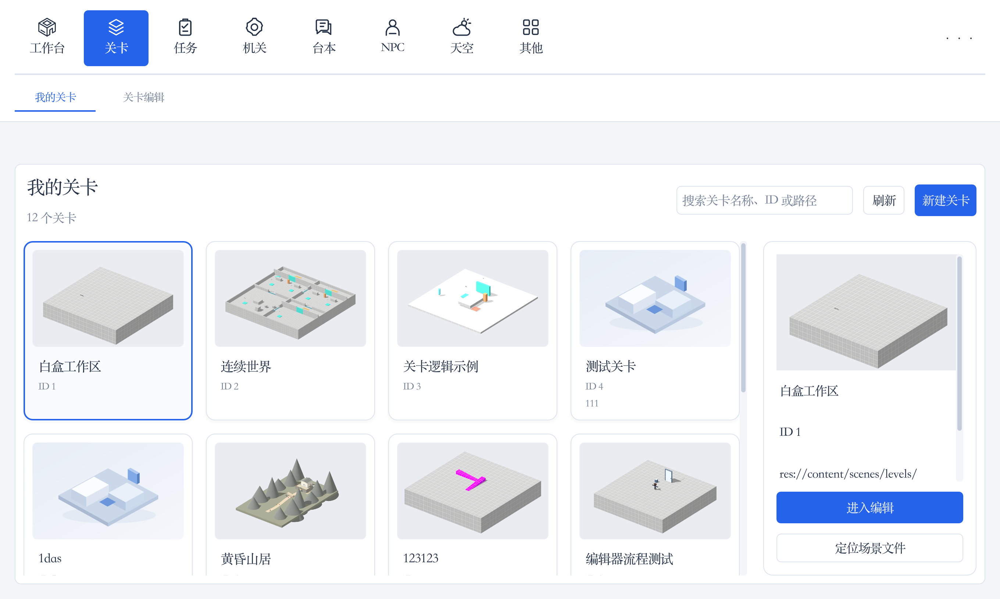
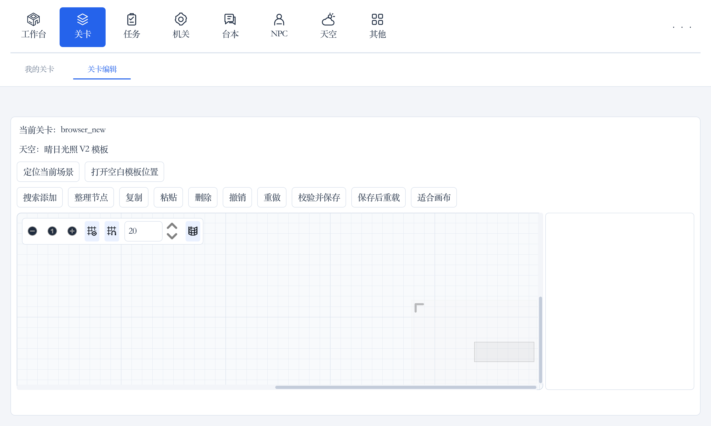

# 关卡浏览与二级菜单恢复

2026-11-17，Godot 4.7.1 stable，macOS / Apple M4。

## 当前行为

用户明确要求保留“我的关卡”作为原生地图的浏览入口。因此“关卡”现在提供“我的关卡”和“关卡编辑”两项二级菜单。此前仅恢复“关卡编辑”的阶段记录在 [早期导航验证](../level_navigation_2026-11-17/validation.md)。

- “我的关卡”读取实际 `.tscn` 文件及已有 `levels.xlsx` 元数据，支持名称／ID／路径搜索、卡片详情、双击打开、进入编辑和定位场景文件。未登记的继承关卡也可发现；仅浏览不登记 ID 或改写工作簿。
- 新建调用 Godot 的“新建继承场景”，文件尚未保存；用户通过原生另存为保存到自己的项目目录。地图、场景树、3D 编辑、保存及 F6 继续使用 Godot 原生流程。
- 原生保存更新登记信息，原生文件系统移动／删除通知同步浏览结果，移动保留已有 ID。插件目录、工具、隐藏目录、普通非关卡场景和缺失文件不作为卡片显示。
- “关卡编辑”继续绑定当前场景的常驻图。切换页面及旧单页窗口补齐浏览页时，保留同一图控件、草稿和 UndoRedo。浏览详情与当前关卡信息显示实际天空预设。
- 封面读取保存后的鸟瞰 PNG，缺图使用默认图片，不同时排队 Godot 通用场景预览。右侧详情可滚动，进入编辑和定位按钮固定可见。

入口、按钮和提示沿用“我的关卡”“关卡编辑”“新建关卡”“进入编辑”“定位场景文件”等现有术语，无新增装饰性资源名。

## 实际检查

全部在独立临时工程中执行，开发副本与空白安装副本使用各自的 `.godot` 和用户数据目录。未启动、关闭或清理作者原工程的编辑器；每次运行前后比较原工程 `content/` 全部文件哈希，结果一致。

| 检查 | 结果 | 证据目录 |
|---|---|---|
| 开发副本 headless 浏览／窗口升级 | 27 项通过，退出 0 | `.validation/structure-qa-2026-11-17/level-browser/headless-upgrade/` |
| 空白安装副本最终 headless 浏览 | 29 项通过，退出 0，无脚本错误 | `.validation/structure-qa-2026-11-17/level-browser/consumer-final/` |
| 开发副本实际 Metal 渲染 | 30 项通过，退出 0，无脚本或渲染错误；截图人工检查 | `.validation/structure-qa-2026-11-17/level-browser/metal-final/` |
| 二级导航重复点击及跨分类切换 | 18 项通过，退出 0 | `.validation/structure-qa-2026-11-17/level-browser/navigation-final/` |
| 中英文 Wiki 构建、当前链接及搜索检查 | 通过；42 页、2607 个本地链接、100 处图片引用，0 错误 | `python3 tools/wiki/wiki.py check` |

浏览测试包含：首次按需创建、真实文件与未登记继承地图发现、自定义目录、排除模板和非关卡、只读浏览、单击详情与双击原生打开、真实天空引用、首次保存登记、搜索及空结果、切页保留草稿与撤销、旧窗口升级后重做、Save As 独立 ID 及原地图内容保持、图副本重新绑定、真实磁盘移动／删除后的通知同步、新建未保存继承场景、模板哈希保持、原生另存后的继承关系与详情同步。实际渲染另检查右侧两个操作按钮在窗口可见范围内。

文件移动与删除用临时文件的真实磁盘操作加原生 FileSystemDock 通知验证，没有在作者地图上执行破坏性操作。本专项覆盖浏览与导航，不替代 F6 游戏玩法检查。保存缩略图完整时序与其他模块集成由 [结构回归记录](../../qa/structure_2026-11-17/validation.md) 记录。

部分 headless 运行（含最终空白安装副本）在编辑器退出时输出 `Plugin is not attached to debugger`；最终 Metal 浏览日志未出现此提示。空白安装副本使用 Compatibility，日志还提示 SSIL 和体积雾需要 Forward+；实际开发副本使用 Metal Forward+。`--headless --editor --quit` 导入阶段存在 Godot 的 `Scan thread aborted` 退出警告，实际测试阶段已等待文件扫描完成。本轮没有脚本错误；最终 Metal 日志无空图像或其他渲染错误。

## 复现命令

```bash
python3 tools/godot_level_editor_suite/run_level_navigation_test.py --browser --consumer --output .validation/level-browser-consumer
python3 tools/godot_level_editor_suite/run_level_navigation_test.py --browser --render --output .validation/level-browser-render
python3 tools/godot_level_editor_suite/run_level_navigation_test.py --output .validation/level-navigation
python3 tools/wiki/wiki.py check
```

运行器默认新建独立工程。`--project` 只接受本运行器创建的 `godot-navigation-qa-*` 临时工程，禁止复用作者原工程。

## 实际界面

截图来自开发工程的独立副本。卡片中的作者地图只用于浏览，测试保存操作仅针对临时测试场景。




