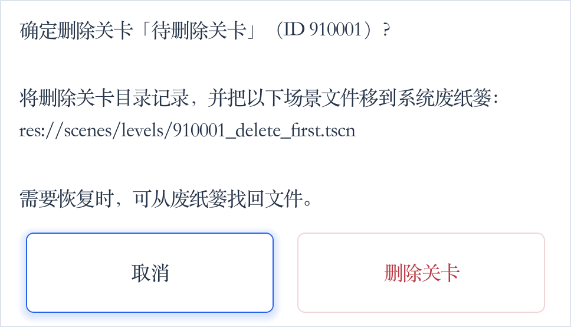

# 删除关卡及场景文件

2026-11-16，Godot 4.7.1 stable，macOS / Apple M4。用户要求删除关卡时也删除对应 `.tscn`，并增加确认。本轮修改覆盖此前只移除目录记录的行为。

## 用户操作

在“我的关卡”选择关卡，点击“删除关卡”。确认框显示关卡名称、ID、完整资源路径，并明确提示移到系统废纸篓。默认聚焦“取消”；取消不改动数据，确认才执行。文件从工程中移走后，可从系统废纸篓找回；目录行不会自动恢复。



有任务或显式场景／资源引用时停止并显示来源；事件配表不能读取时停止。原生场景或当前关卡图有未保存修改时要求先保存或关闭，避免静默丢失草稿。打开的已保存场景自动关闭，再完成删除。

## 实现边界

- 对话框冻结目标 ID 与路径，切换卡片不改变本次目标。确认时重读目录，路径变化则要求重新确认；最新的其他行与备注保持。
- 只移走确认框中的 `.tscn`。机关、NPC、台本、图片、外部图资源不连带删除，ID 不回收。成功时保留旧行 JSON 元数据于 `user://level_archive/<id>.json`。
- 目录先写入成功再调用 `OS.move_to_trash`。目录失败不动场景，移走文件失败时恢复目录记录；回滚失败另行显示具体错误。
- 依赖扫描覆盖项目内可扫描的 `.tscn/.tres/.scn/.res` 显式路径与可解析 UID；跳过隐藏、`.gdignore` 和软链接目录。代码中动态拼接的路径不属于该检查。
- 缩略图队列在捕获前复核目录，已删除目标跳过，避免加载不存在的场景。发布前的目录复核继续保留。

用户可见用词沿用“删除关卡”“取消”，不新增装饰性名称或改变资源标识。

## 验证

测试仅在临时完整副本及私有 user 数据中进行，未删除原工作区任何关卡。先 headless 导入，再运行测试；不使用原工程 `.godot` 或关闭其他聊天的编辑器。

```bash
python3 tools/godot_level_editor_suite/run_level_preview_test.py --test delete --output .validation/level-delete-2026-11-16/headless-final
python3 tools/godot_level_editor_suite/run_level_preview_test.py --test delete --output .validation/level-delete-2026-11-16/render-final --render
python3 tools/level_editor/run_qa_identity_delete.py --output .validation/level-delete-2026-11-16/qa-regression
python3 tools/wiki/wiki.py check
```

- 删除专项 headless：18 项通过。覆盖确认内容与取消焦点、取消无副作用、任务引用、事件表损坏、其他场景引用、目录写入失败、文件删除失败回滚、过期路径确认、冻结选择、关闭打开标签、保存期间的其他备注修改、元数据归档、已删除目标的缩略图队列，以及未保存修改保护。
- 删除专项 Metal：18 项通过，真实确认框已渲染并人工查看。包含旧窗口保留原 `confirmed` 连接时仍采用冻结目标的脚本重载兼容检查。原工作区关卡及工作簿 SHA-256 前后一致。
- QA-02 / QA-10 回归：57 项通过，继续验证原生复制身份、撤销保存重开，以及引用、缺失／损坏／错误版本事件表时停止删除。成功删除使用专门的临时关卡，确认 `.tscn` 已移走。
- 删除专项完成后退出阶段仍有 `Plugin is not attached to debugger` 和单个 ObjectDB 退出警告。目录不可写与文件移走失败为主动失败测试；具体结果以完成标记、零失败汇总和源码保护清单为准。

原始日志、工程副本路径及文件哈希检查结果位于 `.validation/level-delete-2026-11-16/`，最终 Metal 日志位于 `verified/`。Wiki 检查输出在该目录 `wiki-check.txt`。中间的测试配表作用域问题和另一聊天清理素材期间的旧测试引用错误不作为最终通过依据。

接口见 [套件合同](../INTERFACES.md)，操作见 [关卡指南](../../wiki/guides/levels.md#copy-delete)。
