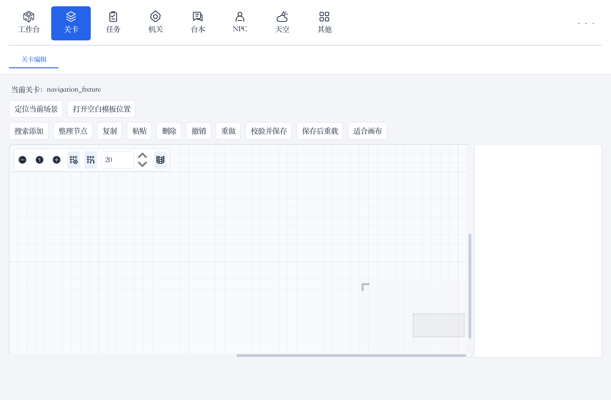

# 关卡二级导航修复

> 本页记录先前只恢复“关卡编辑”的阶段。用户随后明确保留“我的关卡”浏览入口，当前行为与追加检查见 [关卡浏览验证](../level_browser_2026-11-17/validation.md)。下面结果保留为当时实测。

2026-11-17，Godot 4.7.1 stable，macOS / Apple M4。

## 原因与变更

迁移为原生地图工作流后，套件仍向 `native_level_panel` 提供二级导航的 `mode_bar`，但该面板没有创建任何按钮，导致“关卡”下方只剩空行。

本次在该栏创建唯一的“关卡编辑”按钮，使用既有二级导航样式和选中状态。一级关卡入口、二级按钮及兼容的 `open_tab("关卡图")` 均回到当前原生场景的常驻逻辑。切换到任务／工作台时沿既有导航逻辑隐藏；返回时恢复。不重建关卡卡片目录，不改任务、关卡、对象 ID 或场景内容。

“关卡编辑”沿用既有界面名称，未新增装饰性名称。操作说明及 README 已同步中英两种语言。

## 验证方法

`tools/godot_level_editor_suite/run_level_navigation_test.py` 将插件、作品和开发工具复制到临时工程，独立 `.godot` 与 user 数据；只在副本替换已有 lazy-startup 测试钩子，保持正常按需创建页面的路径。测试使用插件空白模板的临时继承场景及一个普通 Node3D 场景，不打开原工程的测试实例，不改作者地图。

```sh
python3 tools/godot_level_editor_suite/run_level_navigation_test.py --output .validation/level-navigation-2026-11-17/headless
python3 tools/godot_level_editor_suite/run_level_navigation_test.py --output .validation/level-navigation-2026-11-17/render --render
python3 tools/wiki/wiki.py check
```

## 结果

- 修复前：同一 headless 专项 16 项中 8 项失败，直接复现空二级栏、无按钮／选中状态及返回后入口缺失。
- 修复后 headless：17 项通过，无 GDScript 错误，完成标记及退出码检查通过。
- 修复后 Metal：17 项通过，并实际渲染确认按钮可见、位置与选中样式正常。新增一项验证已打开的空二级栏在再次点击“关卡”时自动修复。
- 覆盖按需启动、首次打开关卡页、按钮点击与重复点击、切换任务／工作台后返回、旧关卡图导航、非关卡场景提示及重新绑定有效关卡。
- 逻辑图内容、干净状态及临时关卡文件哈希保持；作者 `content/` 全部文件 SHA-256 在测试前后一致。
- headless 完成后的退出阶段报告 `Plugin is not attached to debugger`，最终 Metal 未报告此错误；两者均无 GDScript 错误。该退出提示与导航断言分开记录。

原始日志、临时工程路径和保护清单位于 `.validation/level-navigation-2026-11-17/`；最终 headless 日志为 `headless-final/`，Metal 日志为 `verified/`，Wiki 检查输出为同目录 `wiki-check.txt`。视觉检查使用图语义、节点位置及干净状态判断内容保持，画布首次布局产生的滚动位置变化不作为内容修改。

## 实际界面



当前操作见 [关卡指南](../../wiki/guides/levels.md)，接口见 [套件合同](../INTERFACES.md)。
