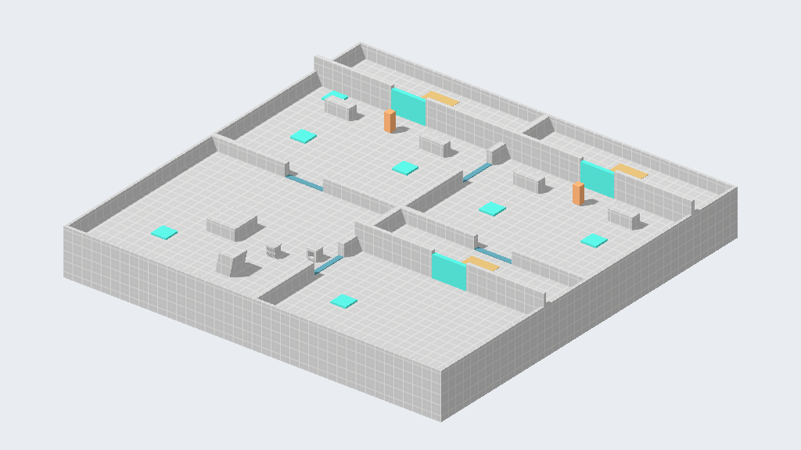
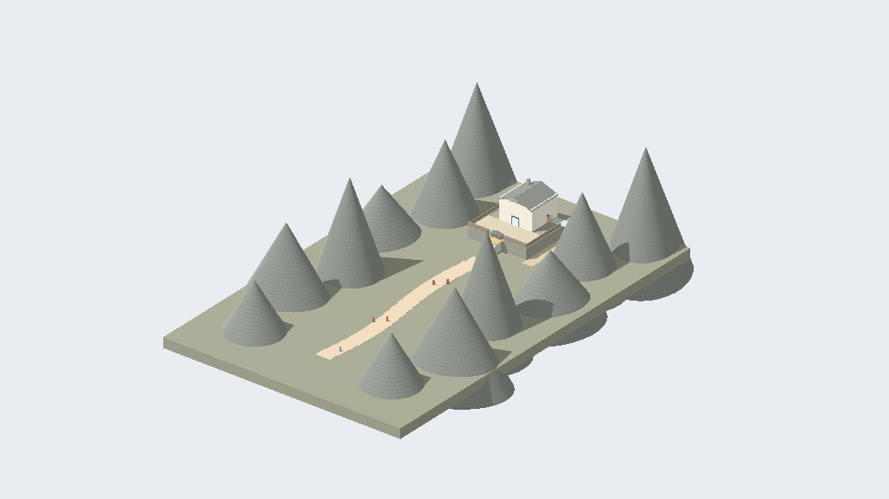
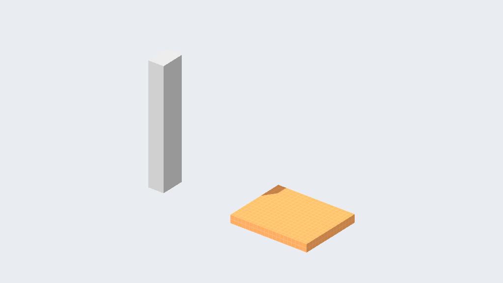
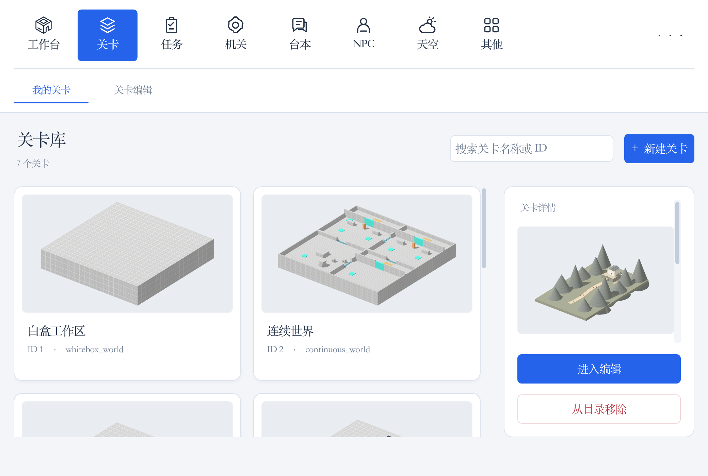

# 保存关卡后生成鸟瞰缩略图

2026-11-16，Godot 4.7.1 stable，macOS / Apple M4，实际渲染使用 Metal Forward+。

## 本次变化

原有离线截图工具接入关卡保存流程：原生 Cmd/Ctrl+S、关卡页“保存场景”、“保存全部”所触发的原生场景保存，以及新建关卡成功后，生成固定斜俯视角的 PNG。图片使用实际模型范围自动取景，独立世界与中性光照；不截图编辑器、不移动编辑视口。目录卡片及详情直接刷新。

范围仅为登记在关卡工作簿中的关卡场景；其他场景和图资源保存不会触发。原自定义图片文件保留，新预览写入以稳定 ID 命名的专用文件。没有新增用户可见命令、节点或装饰性名称，沿用“关卡”“缩略图”“保存场景”等用词。

## 验证方式

`tools/godot_level_editor_suite/run_level_preview_test.py` 复制所需工程到临时目录，独立 `.godot` 和 user 数据，先 headless 导入，再串行运行专项编辑器检查。测试钩子仅替换副本中的离线捕获入口。测试自己的关卡、配表和失败路径也只在副本中创建。

```bash
python3 tools/godot_level_editor_suite/run_level_preview_test.py --output .validation/level-preview-2026-11-16/headless
python3 tools/godot_level_editor_suite/run_level_preview_test.py --output .validation/level-preview-2026-11-16/render --render
python3 tools/wiki/wiki.py check
```

## 实际检查

- headless：8 项通过，包含原生保存信号、自动取景八角边界、白盒生成网格与普通高远模型的范围，以及跳过空白图生成和元数据改写。
- Metal：18 项通过。真实原生保存自动生成 1024×576 PNG 并写回预览路径；捕获前后已保存场景内容与编辑相机变换一致；卡片与选中详情使用同一新图，迟到的原生预览回调无法覆盖。
- 修改地板颜色和远处高塔位置后连续保存，仅发布最新一次结果；生成期间对备注的独立修改保留。非目录场景不触发。
- 故意将输出目录指向普通文件之下，得到预期的目录写入错误和警告；旧图片哈希、原目录预览路径保持。该条错误属于主动失败测试。
- 新建关卡自动生成；生成中关闭服务清理队列并取消捕获。
- 完整目录 7 个关卡副本全部生成鸟瞰图。补测发现编辑器空闲／失焦时等待 `frame_post_draw` 可能不返回；现于读取图像前调用 `RenderingServer.force_draw(false)`，完整目录已生成并拍摄卡片截图。
- 原工作区关卡源文件与工作簿的 SHA-256 前后相同；没有运行原工程的测试实例或复用原 `.godot`。
- 导入和退出日志有单个 ObjectDB 退出警告；Metal 完成 18 项汇总后的退出阶段还报告 `Plugin is not attached to debugger`。最终专项没有 GDScript 错误，完成标记和进程退出码均检查通过。截图文件通过真实渲染生成后人工查看，不使用示意图冒充实测。

原始日志、命令与副本路径位于 `.validation/level-preview-2026-11-16/`，最终 Metal 日志为 `render-verified/`。Wiki 检查结果见同目录 `wiki-check.txt`。中间的重绘等待超时、未完成的渲染，以及测试启动期间一次旁支工具脚本扫描错误均保留追溯，不作为最终通过依据。

## 实际生成效果

“连续世界”的固定角度和中性光照：



“黄昏山居”的取景容纳建筑、山体与远处路径：



普通模型、白盒及高远物体在修改后仍完整入画：



关卡库与选中关卡详情使用新生成的图像：



## 边界

缩略图用于识别三维布局，主动省略关卡天空、雾、景深、标牌和二维覆盖。最终气氛仍以试玩为准。服务不替用户保存未提交的三维修改；只呈现最后保存的场景。依赖工具脚本延迟构建的视觉以副本完成短暂构建后的结果为准。

接口见 [套件合同](../INTERFACES.md)，用户操作见 [关卡指南](../../wiki/guides/levels.md#level-thumbnail)。
