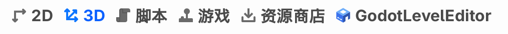
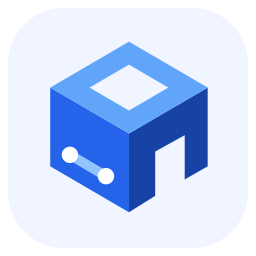

# Logo 替换验证 · 2026-11-16

设计为 Open Room：蓝色等轴房间、侧面门洞与两节点连线。项目图标、Godot 顶部 GodotLevelEditor 入口、Wiki 页头及 favicon 统一采用该标志。品牌源与维护约定见 `assets/branding/README.md`。

## 本次改动

- 保留 `project.godot` 的 `res://icon.svg` 引用和原图标 UID，替换旧分支图形。
- 套件 `_get_plugin_icon()` 读取透明的 `assets/branding/mark.svg`，按编辑器缩放倍率栅格化，替换默认拼图。
- Wiki `docs/wiki/assets/logo.svg` 同步应用版；现有 MkDocs logo / favicon 配置继续使用。
- 不改关卡、场景内容、图数据、配表或导航布局。

## 验证

1. Godot 4.7.1 headless 专项检查：应用版 SVG 输出 256 × 256，紧凑版输出 16 × 16 和 32 × 32；透明背景、应用图标绑定、顶部来源与 Wiki 文件一致性均通过。见 `resources.log`。
2. `python3 tools/wiki/wiki.py check`：14 页、781 个本地链接、36 个图片引用和 110 条搜索记录通过。见 `wiki.log`。实际浏览器检查首页，页头新标志显示正常。
3. 主工程 `Godot --headless --path . --editor --import --quit` 最终复查通过：套件脚本编译、图标导入及编辑器初始化无解析错误。退出仍有一个 ObjectDB 泄漏警告。此检查不代表全部玩法回归测试；最新输出见 `import.log`。

4. 独立临时副本实际 Metal 检查通过：原生顶部入口唯一且可见，编辑器倍率为 2，实际图标为 32 × 32，像素与按 2 倍栅格化的 `mark.svg` 完全一致。副本仅补齐 `inspect_source.gd` 的 `Animation` 类型与 `asset_workspace.gd` 中 `preview` 的 `String` 类型，避免并发未完成代码妨碍显示检查；用户关卡与工作簿未写入。退出时仍有既有机关插件 `remove_resource_format_saver` 条件错误与一个 ObjectDB 泄漏警告。见 `editor-logo.log`。

检查期间遇到的机关 `entry`、世界 `reference` 及套件 `preview` 类型声明已由并发修改补齐；本次 Logo 工作未修改这些业务文件。

完整编辑器截图：[Metal 实际渲染](editor-logo.png)。
