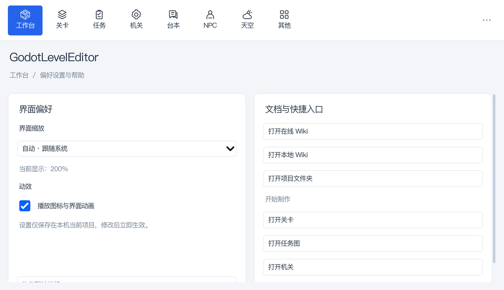

# 工作台与导航图标动画验证

2026-11-16，Godot 4.7.1，macOS / Metal。

## 实现与范围

新增最左侧品牌“工作台”，保留原先全部编辑器入口。工作台提供界面比例、动画偏好、恢复默认、Wiki 和快捷制作入口；设置写入本机 EditorSettings 项目 metadata。图和 XLSX 不增加字段。

八个一级图标分别使用轻浮、弹动、短转和摇摆手势；选中约 0.44 秒、切走约 0.24 秒。点击已选中入口也播放一次，状态更新与点击同帧去重。单色颜色同步，动画仅改变图形子层，不改变文本位置、按钮命中区域或 GraphNode 结构。

快速切换、关闭窗口和关闭动画均停止旧 Tween 并恢复准确静止姿势。关闭后重新启用动画仍可正常播放。

## 检查

| 检查 | 结果 |
|---|---|
| 专项 headless | 49 项，0 失败 |
| 原生窗口与实际渲染 | 49 项，0 失败 |
| 既有套件回归 | 78 项，0 失败 |
| Wiki 构建与链接 | 通过，0 错误 |

专项覆盖所有图标进入、退出、重复点击、恢复姿势、单色颜色、固定按钮范围，及快速切换、隐藏、偏好切换、缩放即时应用和本机保存。检查在专用编辑器进程执行，结束恢复原有缩放与动画偏好，比较原任务图语义哈希保持。Wiki 入口校验本地目标及 HTTPS 地址配置，测试不启动外部浏览器或本地服务。

既有套件的页面数／一级入口数断言随授权新增的工作台更新，继续检查原有模块保留。退出日志仍可能含既有 debugger 未附加及 1 个 ObjectDB 泄漏提示；不声称完全无警告退出。

```sh
/Applications/Godot.app/Contents/MacOS/Godot --headless --path . --editor -- --navigation-icon-test
/Applications/Godot.app/Contents/MacOS/Godot --path . --editor -- --navigation-icon-test --capture
/Applications/Godot.app/Contents/MacOS/Godot --headless --path . --editor -- --godot-level-editor-suite-test
python3 tools/wiki/wiki.py check
```

## 原生截图与动图



下图为原生窗口逐帧导出的循环预览；实际界面仅在选中／切走／点击时播放一次：


