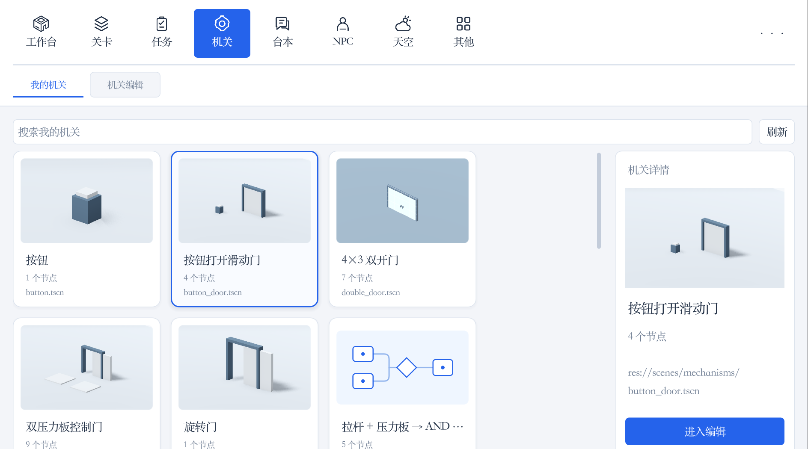
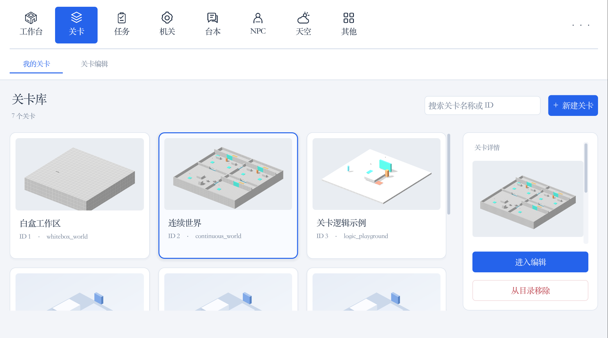

# 编辑器页面切换性能验证

日期：2026-11-16。Godot 4.7.1.stable；Apple M4，Metal 4.0 / Forward+。

## 原因与修改

此前每次点击机关或 NPC 一级分类，都会同步执行 `reload_catalog()`：递归扫描素材、读取定义、为机关实例化场景、销毁并重建所有卡片，随后再次解码封面。机关读取还使用 `CACHE_MODE_IGNORE_DEEP`，重复加载资源依赖。窗口已经显示时仍重复 show / grab_focus / 刷新旧页，导航对未变化的按钮也重复设置字体。

现在重复导航复用目录和卡片；文件通知只标记待检查，目录可见时才核对相关文件内容。没有相关变化则直接保留卡片、搜索和选择；实际变化和手动刷新仍从磁盘读取。普通机关目录通过 SceneState 读取元数据，不实例化；继承场景保留兼容回退。关卡、机关和 NPC 的卡片与详情共用内容感知封面缓存，最多 64 张、最长边 768 像素，并在插件退出时清空。

额外修复动态按钮延后绑定时的失效对象错误：同帧已经释放的按钮通过弱引用跳过，保留有效按钮的动画与显示适配。

本轮保留同期加入的关卡自动封面服务、卡片 `set_preview` 及其过期预览保护；没有回退或覆盖这些改动。测试中的创建、保存、删除在 `.validation/navigation_performance_20261116/project` 副本执行，没有操作原工程的用户场景或配表。

## 前后测量

通过 `--navigation-performance-test` 对七类导航分别重复 12 次，在进入目标分类前切到“其他”。下表为同步 `pressed` 回调的中位耗时，单位毫秒；两次均使用实际 Metal 渲染，不包含整个页面绘制和动画完成时间。

| 分类 | 优化前 | 优化后 |
|---|---:|---:|
| 机关 | 248.296 | 1.107 |
| NPC | 348.192 | 1.001 |
| 关卡 | 11.152 | 1.963 |
| 任务 | 2.355 | 1.188 |
| 台本 | 2.663 | 1.108 |
| 天空 | 2.811 | 1.340 |
| 工作台 | 2.359 | 1.024 |

原始采样另存 `measurements.json`，最终生产代码与测试脚本摘要在 `source_sha256.json`。headless 也确认机关 / NPC 原先约 228 / 287 ms 的同步开销消失。

本测试使用程序化触发按钮，下一帧耗时还受窗口焦点、编辑器后台节流、系统负载和资源扫描影响。最终 Metal 的机关 / NPC 下一帧中位等待约 24 ms，关卡约 36 ms；任务页曾有单次约 163 ms 等待。没有把这些数值描述为总加载耗时或保证所有帧无卡顿。首次加载、实际素材修改、打开大场景和生成预览仍可能耗时。

## 回归与实际显示

- 新增专项：headless 与 Metal 各 23 项、零失败。覆盖目录卡片复用、隐藏页延后处理、无关文件通知、保留搜索与选择、同秒同大小修改、新增／删除 NPC、外部机关图失效、继承机关、PNG 重写／删除、卡片与详情共用纹理、临时按钮释放后不再错误绑定。
- 原有独立编辑窗口回归：headless 78 项、零失败。包含草稿切换确认、取消保留修改、机关保存冲突、新建资源、防止覆盖、搜索、保存后标题更新、原生场景切换与目录 CRUD。
- 实际 Metal 截图核对关卡、机关和 NPC：封面、占位图、中文标题、选择边框、详情栏和入口正常，无空白页或布局回退。
- Wiki 执行 `python3 tools/wiki/wiki.py check`，同步 FAQ、版本记录、套件 README 与 INTERFACES。
- 本次新增用户可见说明沿用现有中文名称和术语，没有新增资源显示名或装饰前缀。

## 保留的诊断与使用边界

退出时仍可见 `Plugin is not attached to debugger` 和 1 个 ObjectDB 实例泄漏警告；优化前的采样也有同样诊断。动态按钮的 `Cannot convert argument 1 from Object to Object` 已在最终回归中消失。最终专项无脚本解析错误或功能检查失败。

升级后保存工作并重新打开项目一次，让新的文件系统通知连接生效。无需清理 `.godot/`；首次导入及大型场景加载不在本次重复导航优化的计时保证内。
