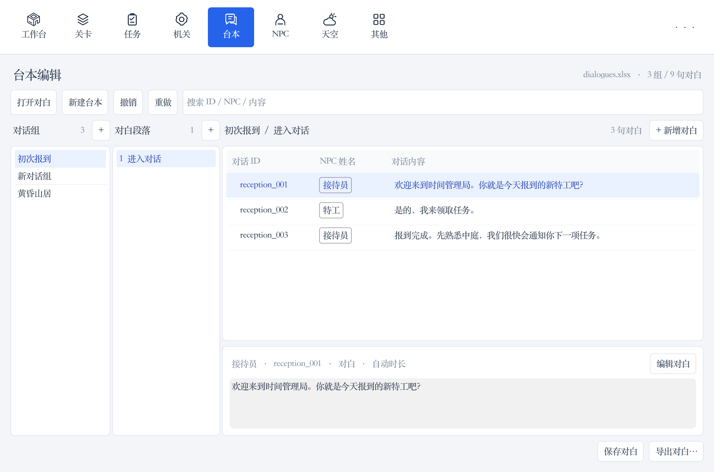
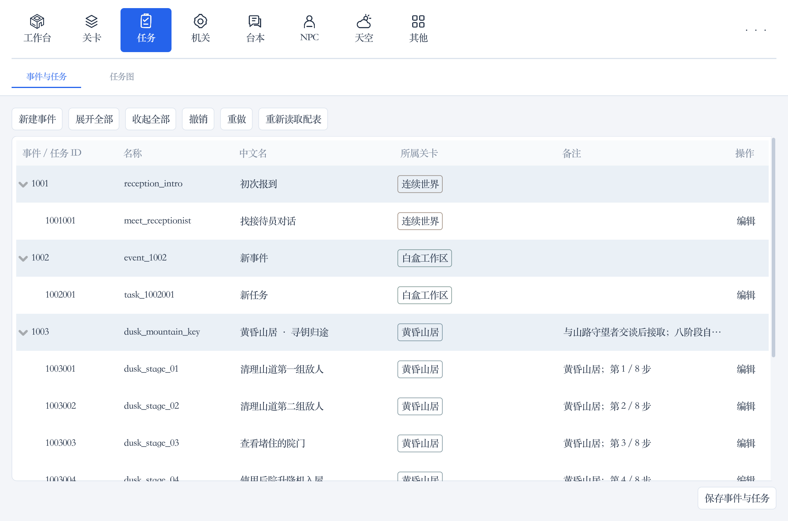
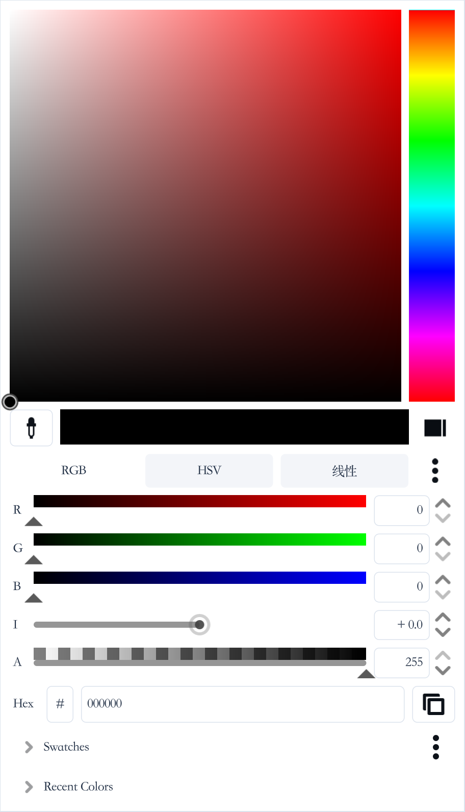

# 弹窗黑边与字段外框

日期：2026-11-16。Godot 4.7.1，macOS / Metal。

## 当前表现

共享浅色主题下的提示框、右键菜单、下拉菜单、颜色选择器、确认弹窗和文件选择器，外层面板完整覆盖所有像素，不再留下透明圆角。Popup 在加入树时同步设置原生窗口与 Viewport 的不透明背景，覆盖 Godot 在同帧自动生成的 tooltip。外沿使用细浅灰边框；内部按钮、卡片和页面的原有圆角保留。没有更改项目的透明窗口开关、全局清屏颜色或游戏窗口背景。

“所属关卡”和“NPC 姓名”改为紧贴文字的低饱和颜色细外框，没有身份文字色或实心底色。正常及选中状态的文字继续由 Tree 原生绘制；姓名／关卡键沿用既有稳定分配。同标识同色，色板有限时允许复用。自定义绘制使用 Tree 的滚动内容画布，边框不会覆盖表头或滚动条；模式切换保留原文字。没有修改配表、ID 或原有角色颜色。

## 检查

| 检查 | 结果 |
|---|---|
| 显示、字体、外框和自动 tooltip 的 headless 检查 | 45 项，0 失败 |
| Metal 原生渲染检查 | 64 项，0 失败 |
| 自动 tooltip 与六类弹出层 | 实际打开；四角均为不透明浅色像素 |
| 套件整体编辑器回归（独立工程副本） | 78 项，0 失败 |
| Wiki 链接、图片与搜索检查 | 16 页、1005 个本地链接，0 错误 |

显示检查还覆盖 1×／1.5×／2× 缩放、宋体常规／粗体字形、台本编辑与撤销、原台本内容保持、同关卡任务键一致，以及节点端口／连线／位置和导航命中范围保持。原生检查包含引擎自动创建的真实悬停 tooltip；文件选择器使用实际 EditorFileDialog。

整体回归在 APFS 独立复制的工程中执行，测试新增／删除的资源与场景切换不会写入用户工程。通过目录选择、资源创建、编辑保存、草稿确认、撤销及原有模块接口检查。

退出仍有既有 debugger 未附加及 1 个 ObjectDB 泄漏提示；未将其标为无警告退出。新增／修改的用户可见文字沿用既有“所属关卡”“NPC 姓名”等名称，没有增加装饰性名称或修改作者资源名。

```sh
/Applications/Godot.app/Contents/MacOS/Godot --headless --path . --editor -- --ui-display-test --capture-dir=res://docs/godot_level_editor_suite/popup_frames_2026-11-16
/Applications/Godot.app/Contents/MacOS/Godot --path . --editor -- --ui-display-test --capture --capture-dir=res://docs/godot_level_editor_suite/popup_frames_2026-11-16
```

## 实际画面









