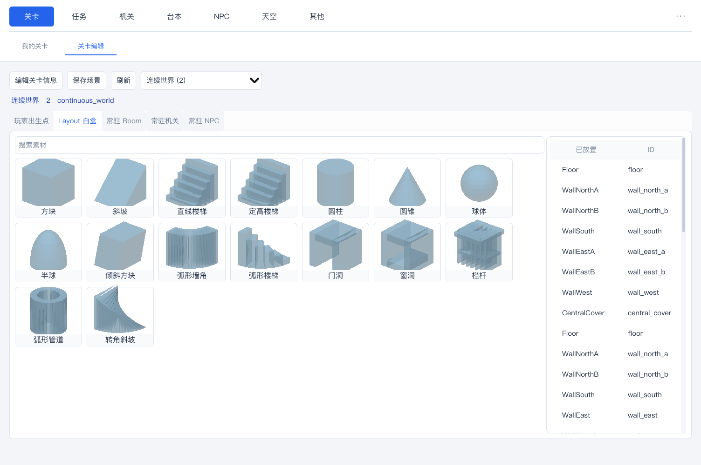

# 箱庭关卡工作流 · 2026-11-15

## 行为与兼容

- 一个箱庭对应一个完整的大关卡 `.tscn`，内部空间直接在原生 3D 视口搭建。
- 关卡编辑只保留玩家出生点、Layout 白盒、常驻 Room、常驻机关、常驻 NPC 五类仓库，移除房间接驳图子页。
- 原生侧栏移除接驳点卡片、起始房间与打开节点图按钮。旧 `open_tab("关卡图")` 调用进入关卡编辑，不切换素材分类。
- 新建 Room 文件、按钮创建的 Room 和原生拖放的 Room 均使用 `uses_topology=false`。纯检测区世界不再要求 `start_room_id`。
- 旧连续世界、房间、接驳图、稳定 ID 与运行接驳行为保持兼容；没有覆盖用户场景、配表或光照资源。任务、机关与 NPC 逻辑图保留。
- 并行天空和轮盘聊天的改动保留；此处只修改它们共用文件中的上述关卡相关入口及校验。

## 验证结果

Godot 4.7.1，macOS：

| 检查 | 结果 | 记录 |
|---|---|---|
| 套件 headless 编辑检查 | 56/56 | [editor_headless.log](editor_headless.log) |
| 套件 Metal 实际渲染 | 64/64 | [editor_metal.log](editor_metal.log) |
| 独立关卡试玩及主入口 | 15/15 | [standalone.log](standalone.log) |
| 旧关卡 V2 回归 | 97/98 | [legacy_v2.log](legacy_v2.log) |
| 旧关卡 V2 复核 | 同一项失败 | [legacy_v2_retry.log](legacy_v2_retry.log) |
| 还原本次运行校验改动的独立对照 | 同一项失败，97/98 | [legacy_v2_before_change.log](legacy_v2_before_change.log) |

独立试玩包含无起始房间、无连线的多个 Room 校验与实际玩家进入检测；原有移动、跳跃、镜头、HUD、出生点及掉落复位保持有效。`git diff --check` 通过。

旧 V2 失败项为 `restored trigger becomes active after a real exit and reentry`。本次唯一的世界运行改动是放宽纯检测区的起始房间校验；将该改动还原到临时独立脚本后仍复现同一失败，未将它计入通过项，也未扩大本次修改去改变状态恢复逻辑。临时对照文件已清理。

编辑器退出时仍有既有 `Plugin is not attached to debugger` 及单个对象泄漏提示，历史 `navigation_hierarchy_2026-11-15/headless.log` 和 `visual_refresh_2026-11-15/editor_metal.log` 已有相同提示；正常编辑检查均通过。

## 实际界面

已查看以下 Metal 截图：五个分类完整显示，关卡编辑不再出现接驳连线画布。

