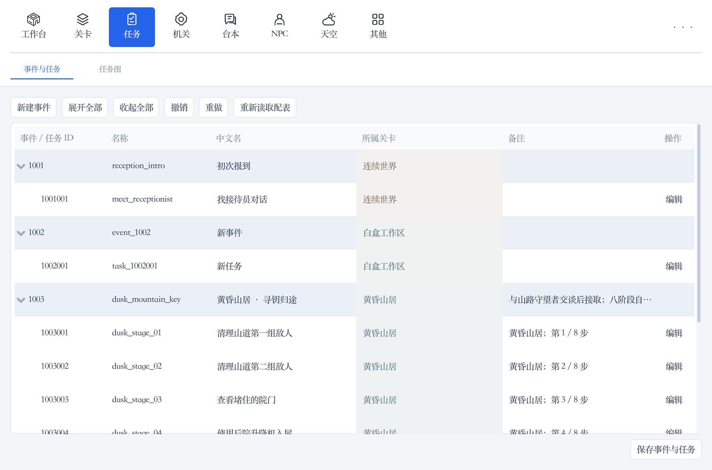
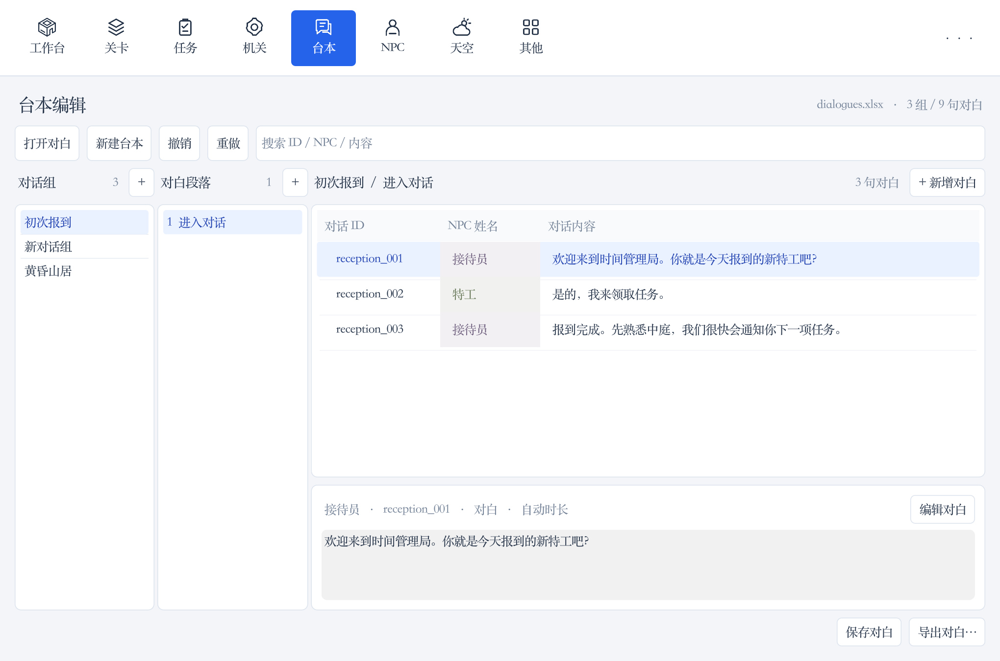
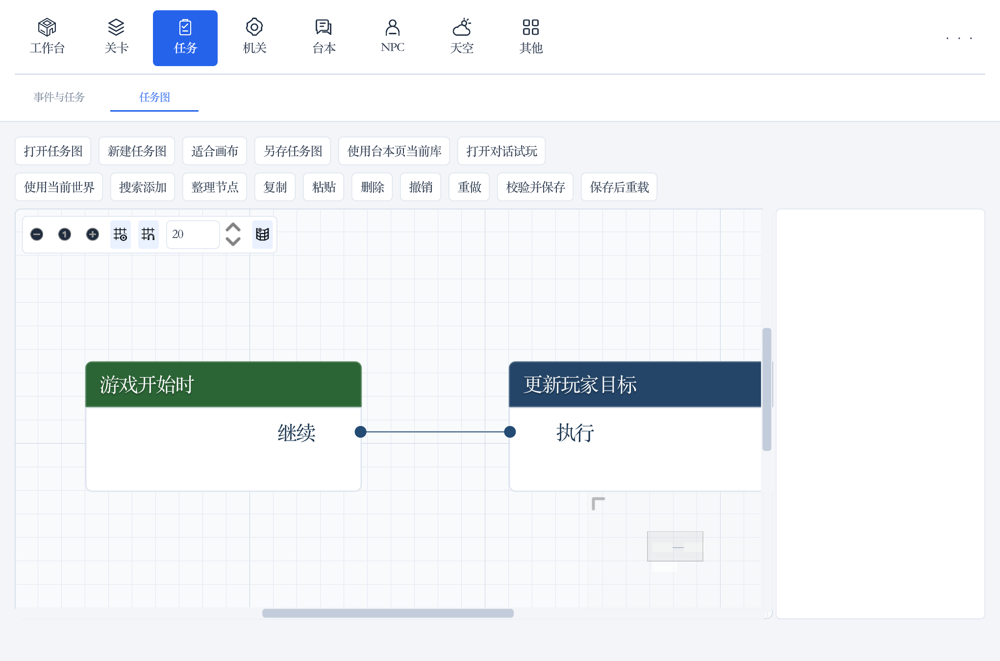

# 宋体、字形与两列配色

日期：2026-11-16。Godot 4.7.1，macOS / Metal。

## 字体

编辑器主题、导航常规／粗体、轮盘、曲线文字及项目默认／HUD 字体统一到宋体。保留原字号、颜色、MSDF／普通渲染模式、显示缩放和动画。宋体字体文件从操作系统读取，不在工程内打包系统字体数据。Windows／其他平台按本机 SimSun、Noto Serif CJK 或思源宋体等名称寻找对应字体；本次原生渲染实测平台是 macOS。

本机 Songti.ttc 有多个字形面，首面为 Black，覆盖 8159 字符；常规面和粗体面覆盖 32965 字符。初始运行发现，加载后修改面索引会继续返回首面的名称与字形覆盖；改为在供应字体数据之前选面，实际返回 Regular／400 和 Bold／700。通过独立符号字体回退补齐勾号、箭头等字符。

扫描 addons、scripts、resources、scenes 和配表文本／XLSX XML，未发现 UTF-8 解码失败、U+FFFD 替换字符或非法控制字符。扫描时使用的 894 个非 ASCII 字符在实际常规、粗体字体中均有字形；没有批量替换作者的名字、台词或任务内容。

## 配色

仅对所属关卡和 NPC 姓名两列应用柔和深色文字、接近白色的浅底。关卡稳定 ID 决定色板项，NPC 完整姓名决定稳定散列；同一标识同色。事件及其同关卡任务采用同色。多关卡事件将 ID 去重排序后形成键，空绑定不强行配色。原有选择行高亮和其他单元格保持。

配色完全是 TreeItem 显示覆盖，不修改 XLSX 或原有角色颜色。

## 验证

| 检查 | 结果 |
|---|---|
| 显示专项 headless | 29 项，0 失败 |
| 宋体及配色原生渲染 | 29 项，0 失败 |
| 套件编辑器回归 | 78 项，0 失败 |
| HUD 任务文字与完成动画 | 18 项，0 失败 |
| 当前非 ASCII 字形覆盖 | 常规／粗体均无缺字 |

包含字体真实字形及字重、原有 MSDF、显示缩放、节点端口／连线／位置、台本编辑撤销、同关卡颜色一致，以及原库内容保持。响应式侧栏检查使用外框的实际配置最小宽度；内部正文允许原有 280 逻辑像素侧栏扣除边距后的 240 像素，不为更换字体而改布局。

编辑器退出仍可能记录既有 debugger 未附加和 1 个 ObjectDB 泄漏提示；不声称无警告退出。对应日志保留在本目录。

```sh
/Applications/Godot.app/Contents/MacOS/Godot --headless --path . --editor -- --ui-display-test
/Applications/Godot.app/Contents/MacOS/Godot --path . --editor -- --ui-display-test --capture --capture-dir=res://docs/godot_level_editor_suite/songti_colors_2026-11-16
/Applications/Godot.app/Contents/MacOS/Godot --headless --path . --editor -- --godot-level-editor-suite-test
/Applications/Godot.app/Contents/MacOS/Godot --headless --path . tools/hud/test_task_tracker.tscn
```

## 实际画面






