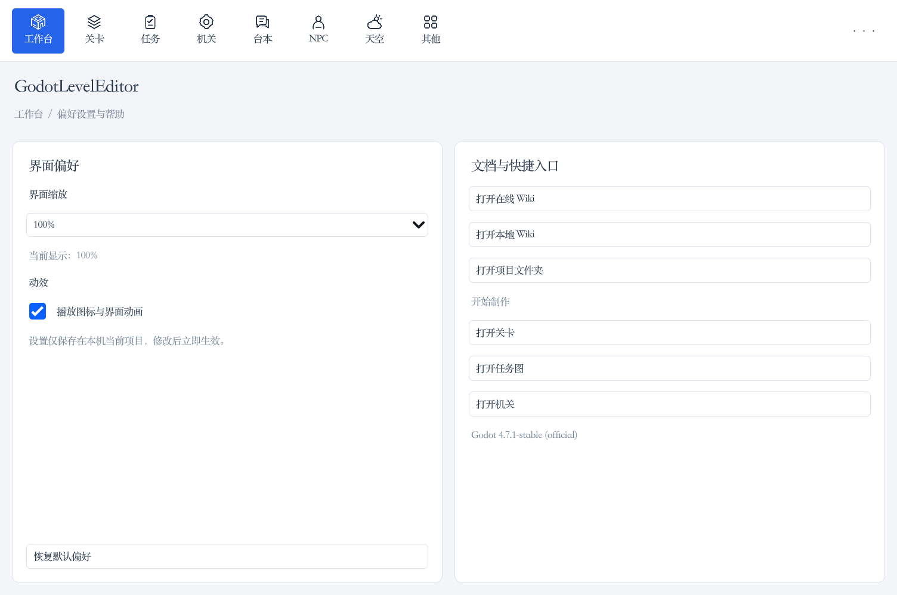
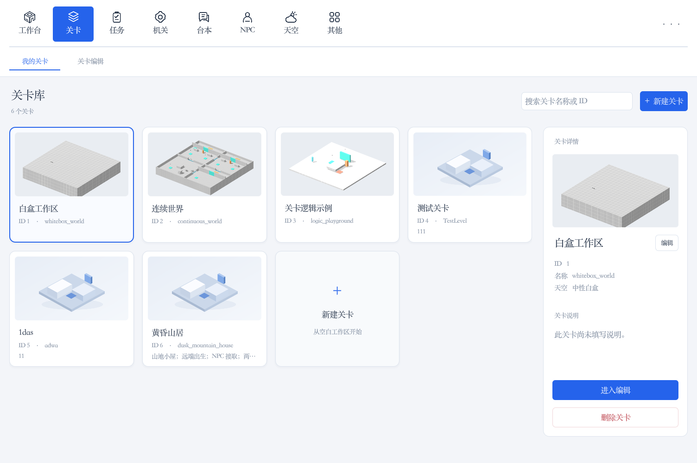
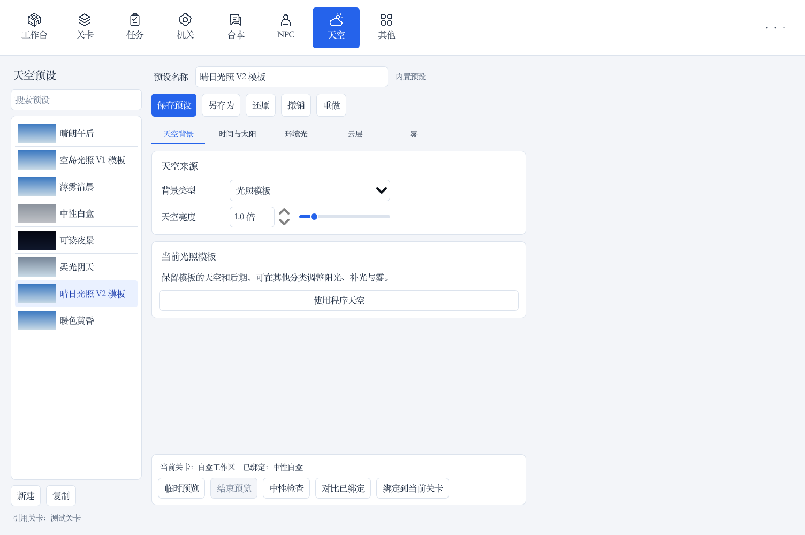

# Godot 插件启动优化验证

日期：2026-11-16。Godot 4.7.1.stable.official.a13da4feb，Apple M4 / Metal 4.0 / Forward+。

## 发现与修改

启动卡顿的主要来源不是四个原生插件的注册函数，而是套件随后无条件执行的 `_build_workspace()`：即使独立窗口隐藏，也会构建所有页面、把所有原生面板重新托管到带宋体主题的窗口、扫描机关与 NPC、解码封面、建立关卡和天空界面。实际 Metal 计时中，这个集中初始化约 4.63 s；headless 两次约 4.89 / 5.19 s。面板重挂时的主题与布局更新也是可见开销，不能只用“读取图片”解释。

本次改为：

- 启动先注册入口、关卡封面和导出服务；四个已有后端、原生三维轮盘、调试、场景保存保护保持即时可用。
- 首次明确打开独立窗口时建立导航和工作台。各分类首次访问才创建或托管页面，此后保持同一页面、草稿与撤销记录。
- 机关 / NPC 目录把纯元数据保存在 `.godot/godot_level_editor_suite/`；输入内容和目录实现脚本一致时，不重复加载全部定义与模型。失效、损坏、删除缓存或手动刷新时自动重建。
- 保存、退出、事件表刷新和封面更新兼容尚未访问的空页面。原生已打开的机关 / NPC 在第一次建立目录包装器时同步状态。

只修改套件初始化、目录缓存及对应测试和说明；没有更改游戏数据格式、场景、工作簿、稳定 ID、角色、光照或运行玩法。测试在 `.validation/startup_20261116/` 内的独立副本执行。

## 前后性能

`run_startup_profile.py` 复制工程和已有导入缓存，只在副本中为方法注入计时。继承方法使用独立别名，避免改变 `super._ready()` 的派发；存在脚本错误的早期探针运行不计入测量。就绪定义为原生编辑器初始化后经过首轮 10 个处理帧，包含引擎、脚本、恢复场景等启动工作，不是单个函数的 CPU 时间。

| Metal 实测项目 | 优化前 | 优化后 |
|---|---:|---:|
| 到原生编辑器首轮稳定帧 | 7.76 s | 2.62 / 2.75 s |
| 启动时集中创建套件全部页面 | 4.63 s | 不执行 |
| 首次明确打开窗口 | 启动时已预建 | 0.54 / 0.50 s |

按本机上述采样，启动到首轮稳定帧约减少 65%。原始计时保存在 `measurements.json`，最终生产代码和测试脚本摘要保存在 `source_sha256.json`。

这包含按需准备的取舍：第一次访问某分类仍有一次开销。测量中关卡约 0.65–0.75 s，机关约 0.31–0.37 s，NPC 首次无目录缓存约 0.90 s、有缓存约 0.55 s（含面板托管与主题更新），天空约 0.31–0.32 s；重复访问复用现有控件。没有把延后工作描述为完全消失，也不保证其他硬件、首次导入或大型场景具有相同秒数。

## 验证

- 启动专项 `--startup-lazy-test`：headless 最终 26 项、Metal 25 项，均零失败。验证默认不建窗口、不建未访问页面，原生工具与保存保护已注册，保存 / 试玩准备不触发 UI，首次打开与重复打开、天空先打开时保持关卡中文名、各页独立初始化、目录缓存命中、新增与同秒同大小修改失效、缓存往返保持根目录与子目录顺序、损坏缓存重建、原后端托管及页面复用。目录顺序的最后一项为序列化专项，以 headless 追加验证。
- 原有套件回归：headless 78 项零失败；Metal 加 `--capture` 为 88 项零失败，包含草稿切换、保存冲突、卡片导航、新增与防覆盖、关卡目录、图连接与端口、页面大小及窄窗口。
- 渲染回归使用副本中的 100% 参考比例。最初沿用复制来的 150% 偏好时，原测试的像素尺寸与模拟点击断言不符合其 100% 前提，出现 14 项失败；调整副本参考比例后全部通过，没有为此修改原工程的偏好。先在复制的 150% 偏好下核对五个实际页面，再以 100% 参考比例运行最终 25 项并重新截图。
- 试玩窗口专项与 Wiki 检查的最终结果见本记录末尾。
- 本次新增用户说明沿用“工作台、关卡、机关、NPC、台本、天空、刷新”等现有名称，没有引入装饰性命名。

其余实际截图保存在同目录的 `机关.png` 和 `敌人.png`。

## 保留诊断与使用边界

部分退出仍有既有的 `Plugin is not attached to debugger` 和 ObjectDB 实例泄漏警告。多数本轮运行计数为 1，最终带实际场景和截图的启动探针曾计为 17；未定位这些退出对象的来源，不把功能检查通过视为已解决此诊断。最终功能检查没有脚本解析错误。导入、恢复场景、显卡启动和实际游戏资源加载继续由 Godot 完成。

升级后先保存当前工作，再重新打开工程一次，使入口与文件通知连接完整更新；保留 `.godot/` 可复用导入与目录缓存。

## 收尾检查

- `--godot-level-editor-suite-play-test`：15 项、零失败，实际启动并停止 F5 主场景与 F6 关卡，窗口状态、页面、鼠标焦点回调和关卡源内容保持。
- `python3 tools/wiki/wiki.py check` 通过：18 个 Wiki 页面、1165 个本地链接、49 个图片引用、153 条搜索记录，错误为零。
- Python 测量工具通过 `py_compile`，本次修改通过 `git diff --check`。最终三个生产脚本与功能测试副本一致，源码摘要检查没有漂移。
