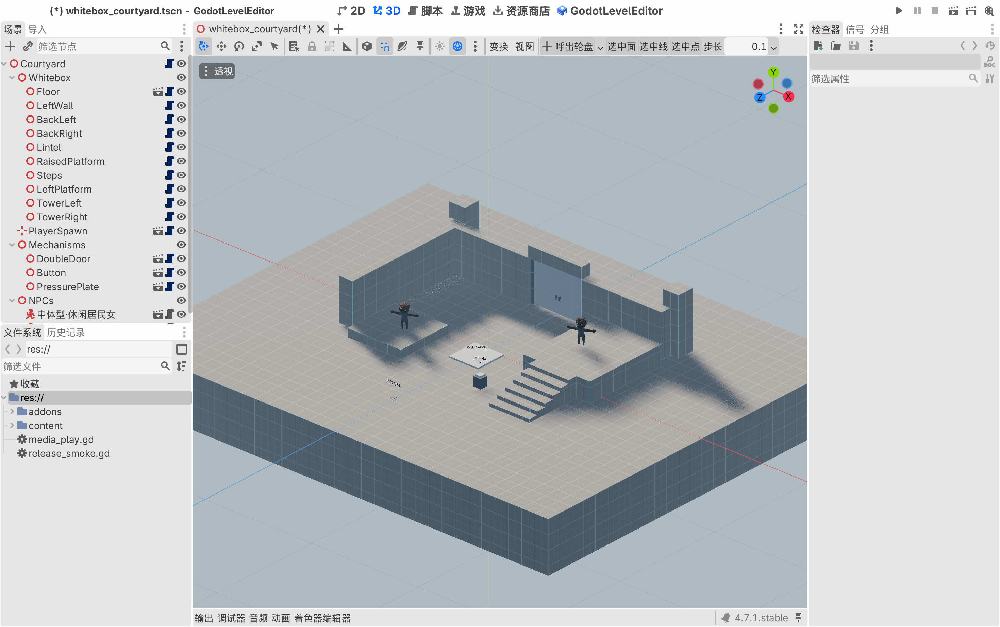
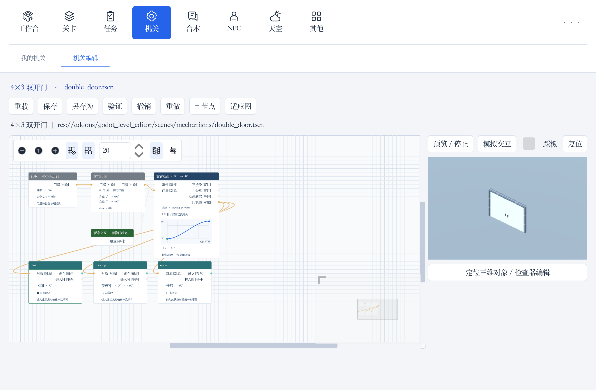

# Build your first whitebox level

GodotLevelEditor is for new level designers with no coding experience. Build spaces in Godot's native 3D viewport, connect logic with nodes, and play the result with the included third-person character.

[Download the plugin](https://github.com/Lanyi021102/GodotLevelEditor/releases/latest) · [Install and update](wiki/plugin-install.md) · [Quick start](wiki/getting-started.md)

## What you can make

| Goal | Start here |
|---|---|
| Block out a playable space | [Levels and the quick-add wheel](wiki/guides/levels.md) |
| Place doors, buttons, plates and lifts | [Independent mechanisms](wiki/tutorials/button-door.md) |
| Preview and place one of 13 NPCs | [NPC models and animation](wiki/guides/npc-samples.md) |
| Configure conversations and objectives | [Feature map](wiki/features.md) · [Dialogue modes](wiki/guides/dialogues.md) |
| Adjust sunlight, sky and fog | [Sky and environment](wiki/guides/sky.md) |
| Find a shortcut or solve a problem | [Reference](wiki/reference/glossary.md) · [FAQ](wiki/faq.md) |

## One addon, your own project

The addon lives in `addons/godot_level_editor/`. Your maps, task graphs and Excel workbooks live in your project, normally under `content/`. Plugin updates do not replace those files. All project folders use English names.

In an empty project without a main scene, enabling the plugin creates a blank start scene. Press F5 or the normal Play button to control the included character. Existing main scenes and input bindings are preserved.

## How the editors fit together

Godot's scene tree, FileSystem, Inspector, save commands and F6 handle maps. The quick-add wheel, whitebox tools and face/edge/point editing extend its native 3D viewport. The separate GodotLevelEditor window provides level logic, mechanisms, NPCs, tasks, dialogue and sky editing.

The current release includes five independent mechanisms, 13 NPC examples, the player, camera, HUD and lighting resources. The installation ZIP does not include the author's maps or authored task/dialogue data. An empty level template is included.

The plugin UI currently uses Chinese labels; English guides show the important labels alongside their translations. Original technical interfaces and dated verification records remain available from the [developer index](wiki/development/index.md).
