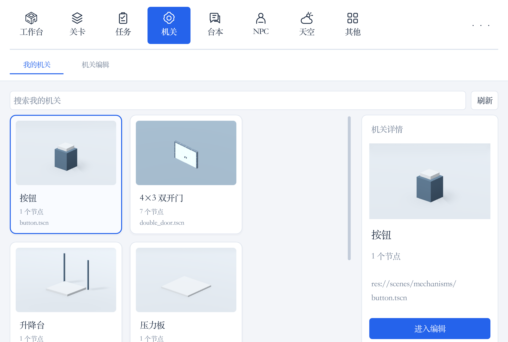

GODOT LEVEL EDITOR · WIKI

# 从第一个白盒关卡开始

摆出空间，连接机关，进入关卡试玩。这份手册帮助你找到操作入口、完成第一个案例，也记录继续开发所需的模块与接口。

Wiki V1Godot 4.7.1中文操作指南核对于 2026-11-16

[开始制作关卡](wiki/getting-started.md){ .md-button .md-button--primary }
[查看功能地图](wiki/features.md){ .md-button }

01 / 开始使用

### 第一次打开工程

认识两个编辑窗口，创建自己的关卡，摆放物件并用 F6 试玩。

[阅读快速开始 →](wiki/getting-started.md)

02 / 动手制作

### 让按钮打开一扇门

从现成组合开始，读懂状态与动作之间的连线，再放进自己的关卡。

[完成第一个案例 →](wiki/tutorials/button-door.md)

03 / 开发维护

### 找到功能对应的代码

查询模块、接口、资源位置与检查入口，在修改功能时同步更新文档。

[打开维护索引 →](wiki/development/index.md)

## 先认识编辑器的分工

**Godot 原生 3D 视口**用于摆放白盒、Room、机关和 NPC，以及修改空间位置、尺寸和实例属性。

**GodotLevelEditor 独立窗口**用于管理关卡、编辑常驻逻辑、机关图、任务、台本、NPC 状态机和天空预设。

项目已有机关图实机截图。组件绑定、触发条件和动作参数在右侧编辑，空间位置仍在 Godot 原生视口调整。

## 我想做什么

| 目标 | 从这里进入 |
|---|---|
| 创建一个可试玩的关卡 | [快速开始](wiki/getting-started.md) |
| 查找某个编辑器或功能 | [编辑器功能地图](wiki/features.md) |
| 呼出轮盘、摆放物件、调整步长 | [关卡与轮盘操作](wiki/guides/levels.md) |
| 添加按钮、门和升降台 | [使用独立机关](wiki/tutorials/button-door.md) · [机关与节点速查](wiki/reference/mechanisms.md) |
| 分清常驻逻辑、任务和素材实例 | [术语与快捷键](wiki/reference/glossary.md) |
| 排查任务不启动、物件不显示 | [常见问题](wiki/faq.md) |
| 修改或扩展功能 | [开发维护索引](wiki/development/index.md) |

!!! tip "按任务查找"
    使用顶部搜索框，输入“独立机关”“出生点”“任务不启动”“另存为”等词。搜索集中收录本 Wiki 的当前操作说明；旧专项文档从维护索引进入。

## 当前版本的范围

本项目用于个人白盒关卡制作，保留基础角色操作、全部编辑器及其运行组件。默认 F5 进入空白工作区；你正在编辑的关卡用 F6 试玩。

时间暂停、回溯、快进、分身、轨迹、能量和能力解锁已移除。旧文档中有关这些功能的段落属于历史记录。光照 V1 与用户制作的关卡、房间、机关资源继续保留，新关卡使用当前 V2 模板。

第一版覆盖上手流程、功能地图、使用独立机关和维护索引。完整任务、台本与 NPC 制作暂由功能地图链接到各模块说明；后续教程与已完成内容见 [版本记录](wiki/changelog.md)。
