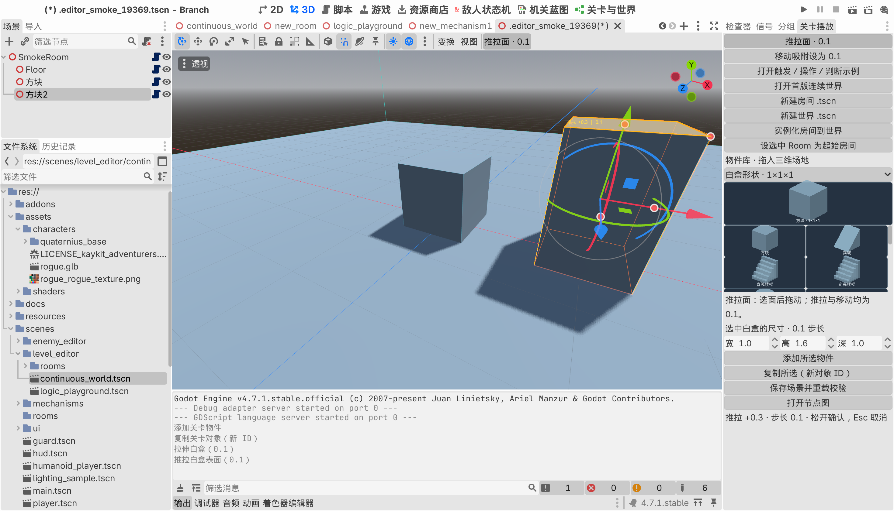

# 关卡与世界编辑器 v0.4

重新加载 Godot 项目后，右侧打开 **关卡摆放**。顶部 **关卡与世界** 是节点图工作区。

## 先试一个能操作的例子

点 **打开触发／操作／判断示例**，按 **F6** 运行当前场景：

- WASD 移动预览角色；R 重新开始。
- 走进蓝色 Room 边界：检测样例钥匙 → 打开开关 → 敌人开始巡逻 → 门升起。
- 走进红色区域：触发“击杀玩家”，角色停用、隐藏并停止碰撞。
- 节点工作区下方选择本次运行实例，可看“是／否”、执行次数和最近原因。
- 想试没有钥匙：编辑“预览玩家 → LevelAgent”的 **Unlocked Items**，清空后保存再运行。判断节点中的道具标识为 `sample_key`。

这是独立制作工具示例，不替换公共玩家，不写正式存档。

## 推拉一个面（类似 SketchUp）

1. 重载项目，在 **3D** 视口顶部或 **关卡摆放** 中点亮 **推拉面 · 0.1**。
2. 在白盒上左键选一个面：橙色高亮的是实际选中表面。按住左键沿面法线拖动，松开确认；也可以先点选，再按住该面拖动。
3. 向外拉长，向内收缩，距离按 **0.1 世界单位** 吸附。斜坡沿斜面法线推进；相邻面随共用边伸展，其他顶点留在原位。直视某个面时，用上下拖动调整距离。
4. 拖动时 **Esc 或右键** 取消；确认后可用原生撤销／重做。再次点击“推拉面”退出，使用普通移动工具。

插件把 Godot 的 **平移吸附设为 0.1 并开启**，关卡物件移动也按 0.1。若手动关闭了吸附，点 **移动吸附设为 0.1** 恢复。

推拉后的网格、尺寸、位置和对应碰撞一起存入 `.tscn`。房间实例内部的物件应打开源房间编辑，或先允许编辑该实例子节点。该工具编辑白盒的相连共面表面；曲面按网格小面选取，不执行任意布尔切割。替换了 `visual_scene` 的正式美术请回到白盒对象编辑。



## 白盒：选形状，直接拖进场地

所有默认白盒使用 [米制网格](../whitebox_grid/README.md)：1 m 粗线、0.5 m 中线、0.1 m 细线。编辑和运行共用，尺寸拉伸及面推拉不会把格子拉大；检查器的 Tint 控制底色。

“白盒形状”有 **16 种缩略图**：方块、斜坡、直线楼梯、定高楼梯、圆柱、圆锥、球、半球、倾斜方块、弧形墙角、弧形楼梯、门洞、窗洞、栏杆、管道、转角斜坡。

- 每个物件初始外包尺寸 **1×1×1**。拖缩略图或大预览图到 **3D 视口**，也可点“添加所选物件”。
- 选中白盒，拖三个面手柄拉伸，拖角点整体缩放；**尺寸与编辑器缩放按 0.1 吸附，最小值 0.1**。Godot 原生移动、旋转、缩放工具仍可用。
- 面板下方“选中白盒的尺寸”直接改宽、高、深；检查器可改楼梯步数、级高、壁厚、角度等。
- 门洞、窗洞和管道保持真实孔洞碰撞；斜坡和楼梯有对应表面碰撞。模型替换可使用 `visual_scene`，继续保留这份白盒碰撞。
- 原生拖放默认放在所选对象的同一级。**在房间源场景中直接拖放；在世界中先选 Room，按住 Shift 拖放，可放入该 Room。**
- 复制用“复制所选（新对象 ID）”；复制 Room 会保留内部物件，分配新的房间实例标识。

形状类别参考作者公开的 [Blockout Tools 类型列表](https://dmkarpukhin.com/blockout-tools/) 和[使用说明](https://dmkarpukhin.com/docs/blockout-tools/)。本项目使用独立编写的 Godot 程序化几何，没有引入该商业插件的代码或资产。

## Room 与关卡对象

将物件库切到 **关卡对象**，可拖入 Room、触发区域、玩家出生点、接驳点、开关、门、敌人等。

- **Room 是房间检测范围**。在检查器设置 Display Name 和 Bounds Size；它不会自动替你造墙或地板。世界中的“设选中 Room 为起始房间”可指定起点。
- **触发区域**用于局部机关、危险区等，Extent 控制检测大小；出生点是供总控使用的位置标记。
- **房间接驳点**控制房间间的空间通路。两端位置重合、朝向相反、宽度一致，再在房间图中连线；连线不会自动造走廊。
- “新建房间 .tscn”创建可复用房间文件；“实例化房间到世界”组装房间。原有中庭、三房与捷径样例仍可从“打开首版连续世界”进入。

## 节点：触发 → 判断 → 操作

右键或点“搜索添加”，按类别筛选，节点和端口采用中文名称：

| 类别与标题色 | 常用节点 |
|---|---|
| 判断 · 深黄色 `#94700e` | 玩家是否解锁道具、如果条件成立、同时满足两个条件、比较两个数值 |
| 触发 · 朱红色 `#a34439` | 游戏开始时、玩家进入房间时、玩家进入触发区域时、收到事件时、完成房间目标 |
| 状态 · 青绿色 `#24756e` | 检测玩家当前状态、检测机关是否开启、检测引用物件状态、记住已发生的事件 |
| 动作 · 蓝色 `#345f96` | 打开／关闭开关、敌人开始巡逻、击杀玩家、显示／隐藏物件、更新玩家目标、允许房间之间通行、请求保存进度 |
| 数据／引用 · 紫色 `#71508f` | 是／否常量、数值、引用场景物件、房间接驳点 |
| 延迟／流程 · 橙色 `#9b592b` | 发送事件：具名事件在下一物理帧送达 |

标题同时写明类别，画布上方有六色文字图例。左侧 **输入 →**，右侧 **→ 输出**，没有端口的一侧不显示方向；端口名称贴近连接点。端口和连线颜色继续表示布尔、事件、数值、对象和空间等连接类型。

选中、运行、暂停和恢复快照均保留分类色。活动用绿色边框、绿点和实际状态文字提示；一次事件／动作显示执行次数与原因，持续状态显示当前值。执行提示短暂亮起，暂停时保留；恢复快照不把历史执行误显示为新动作。完整原因可悬停查看。

[运行实例实际截图](node_colors_running.png) · [持续状态与完成事件](node_colors_states.png) · [空间引用](node_colors_topology.png)

例子：**玩家进入房间时 → 如果条件成立 → 成立：打开开关 → 敌人开始巡逻**；“玩家是否解锁道具”的结果接到判断节点的“条件”。“不成立”可接另一条操作链。

先选三维 Room 再添加“玩家进入房间时”，会自动绑定；也能在右侧参数中选择目标。选节点可定位场景对象，选场景对象可定位相应节点。“整理节点”可排开节点，支持撤销。

事件端口表示执行一次；“是／否”端口表示当前条件，二者不直接混接。动作的“继续”和“失败”分开；尚未提供玩家/敌人接口时，节点显示失败原因。

## 保存

- 图：**校验并保存**；**保存后重载**检查磁盘内容。
- 场景：**保存场景并重载校验**，会重新打开已保存场景。
- `.tscn` 保存空间物件，`.tres` 保存节点逻辑与排版。移动图节点不会移动三维对象；仅浏览和缩放画布不会阻止切图，视图可随显式保存保留。

接口与总控待办见 [INTERFACES.md](INTERFACES.md)，验证见 [PROGRESS.md](PROGRESS.md)。

```sh
/Applications/Godot.app/Contents/MacOS/Godot --headless --path /Users/lanyi/branch res://tools/level_editor/test_v2.tscn
/Applications/Godot.app/Contents/MacOS/Godot --headless --path /Users/lanyi/branch res://tools/level_editor/test_level_editor.tscn
/Applications/Godot.app/Contents/MacOS/Godot --headless --editor --path /Users/lanyi/branch -- --branch-level-smoke
```
