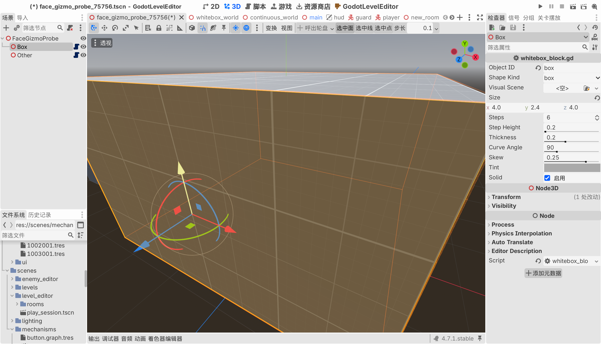
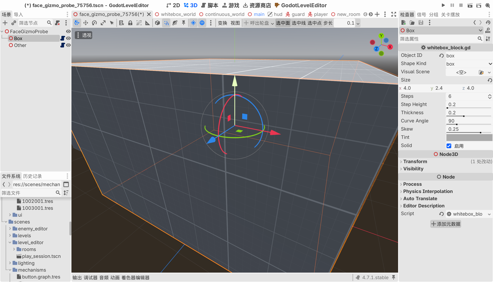

# 面中心操作轴 · 2026-11-15

点击“推拉面 · 0.1”进入面编辑。单击实际可编辑面只选择，不移动；操作轴位于面中心，移动箭头与旋转环直接改变该面的共用顶点。选面期间原物体轴和尺寸手柄隐藏。Esc／点击空白取消面选择，保留物体选择，恢复原轴与尺寸手柄；恢复后的轴可以直接移动整个物体，无需退出面编辑。





## 实现与文件归属

- `addons/godot_level_editor/push_pull_tool.gd`：选面、原生 subgizmo 选择、拖动事务、高亮和恢复。原生先检测轴，再检测面；跨物体选面延迟切换原生选择。保留脚本用的法线推拉入口 `begin`／`preview_distance`。
- `addons/godot_level_editor/block_gizmo.gd`：子操作轴的拾取、变换与提交，选面时隐藏旧尺寸手柄，取消后重绘恢复。
- `addons/godot_level_editor/face_edit.gd`：面中心以唯一顶点平均计算，支持绕面中心变换选中顶点，维持相邻面连接；仍用版本 1 的 `mesh_edit` 保存，更新真实网格及碰撞。厚度不足或邻面翻转时保留最后有效形状。
- `addons/godot_level_editor/plugin.gd`：局部接入面编辑输入、生命周期和验证入口，保留其他聊天的轮盘、实体检查器等实现。
- `addons/godot_level_editor/entity_inspector.gd`：补充 `has_meta` 判断，使普通白盒被原生选择时不因缺少可选实体 metadata 报错。
- `tools/level_editor/test_face_gizmo.gd`、`test_face_edit.gd` 与 `editor_smoke.gd`：面操作轴与几何测试，并适配原推拉烟雾检查。

未改写用户关卡、房间、机关、NPC、光照资源、配表或运行玩法。

## 验证

Godot 4.7.1，macOS。先运行 headless 导入与几何／原生编辑器检查，再运行 Metal Forward+ 实际窗口渲染检查。

| 检查 | 结果 |
| --- | --- |
| Headless 编辑器导入 | 无解析或编译错误 |
| 面几何 | 25 通过，0 失败 |
| 原生面操作轴 | 20 通过，0 失败；包括真实视口点击、真实移动轴拖动、取消选面后用原轴移动整个物体 |
| 快速添加轮盘回归 | 59 通过，0 失败；原素材源文件哈希保持 |
| 扩展关卡运行／画布回归 | 81 通过，1 失败：`stopped session clears runtime display`；失败位于旧图面板停止会话显示断言，本次未修改该面板或执行器，未据此宣称全部项目测试通过 |
| 实际渲染 | 已检查选面／取消后的截图，各状态只有一组操作轴，旧尺寸手柄随选择状态隐藏／恢复 |

编辑器退出仍打印 1 个 ObjectDB instance 泄漏警告；首次未改动路径的导入检查亦可观察到。本次检查没有脚本错误或新崩溃。

```sh
/Applications/Godot.app/Contents/MacOS/Godot --headless --editor --path /Users/lanyi/branch --quit-after 3
/Applications/Godot.app/Contents/MacOS/Godot --headless --path /Users/lanyi/branch tools/level_editor/test_face_edit.tscn
/Applications/Godot.app/Contents/MacOS/Godot --headless --editor --path /Users/lanyi/branch -- --face-gizmo-test
/Applications/Godot.app/Contents/MacOS/Godot --editor --path /Users/lanyi/branch -- --face-gizmo-test --capture-face-gizmo
/Applications/Godot.app/Contents/MacOS/Godot --headless --editor --path /Users/lanyi/branch -- --quick-add-test
/Applications/Godot.app/Contents/MacOS/Godot --headless --path /Users/lanyi/branch tools/level_editor/test_level_editor.tscn
```

日志见本目录的 `geometry.log`、`native_headless.log`、`native_render.log`、`quick_add.log` 和 `level_regression.log`。

已打开的旧 Godot 会话需先保存自己的场景，再重新打开项目，使插件实例重新绑定面操作轴。
