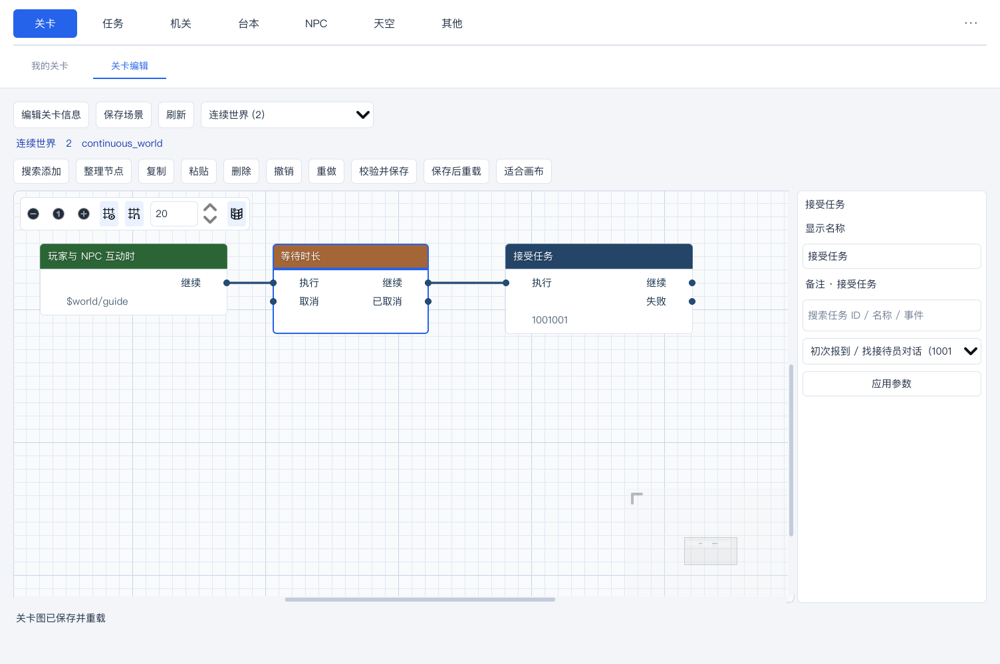
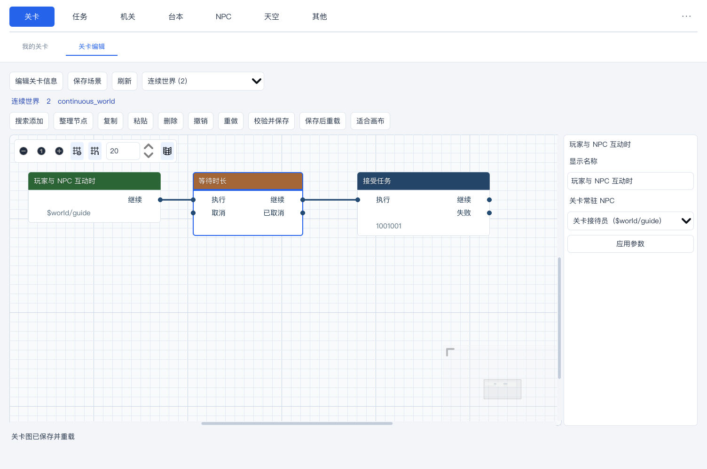

# 常驻关卡图验证

工作开始于 2026-11-15，最终复核于 2026-11-16。Godot 4.7.1，macOS，实际渲染使用 Metal Forward+。

## 已验证的行为

- 关卡编辑只显示常驻逻辑图，不再重复显示空间素材仓库、已放置列表和房间接驳模式；关卡目录、信息、天空绑定保留。
- 新图复用任务图的条件、变量、触发、操作、等待、并行及机关节点；任务生命周期和空间接驳节点不进入常驻白名单。
- NPC 选项只读取当前关卡的常驻实例，排除任务 NPC、任务区域的后代及失效对象。节点保存真实作用域 ID，不通过显示名绑定。
- 未接任务时，真实玩家进入区域和 NPC 交互可执行常驻图。NPC → ShowDialog → 对话完成 → 接受任务的链路实际运行。
- 接取首项后，后续任务自动按原顺序接续；任务接取前的事件不会提前推进任务。重复接取走失败输出，不重置进度。
- 所有任务结束后，常驻区域和 NPC 逻辑仍继续运行。常驻变量、等待与已接取任务进度可一起恢复；错误图作用域被原子拒绝。
- 实际 F6 路径自动运行常驻图、标准玩家和唯一任务服务，且没有改写源关卡文件。
- 右侧备注中的任务选择支持搜索，长名称保持栏宽且提供完整悬停提示。NPC／任务参数、连线、撤销重做、保存和重载均保留稳定 ID。

## 检查结果

| 检查 | 通过 | 日志 |
|---|---:|---|
| 常驻逻辑运行与 F6 路径 | 34/34 | [runtime.log](runtime.log) |
| 关卡图编辑 headless | 19/19 | [logic_editor_headless.log](logic_editor_headless.log) |
| 关卡图编辑 Metal 与布局 | 21/21 | [logic_editor_metal.log](logic_editor_metal.log) |
| 完整套件编辑回归 | 78/78 | [editor_headless.log](editor_headless.log) |
| 既有事件／任务运行 | 49/49 | [task_regression.log](task_regression.log) |
| 通用任务节点运行 | 90/90 | [task_nodes.log](task_nodes.log) |
| 原有独立关卡基础试玩 | 15/15 | [standalone.log](standalone.log) |

`git diff --check` 通过。最终常驻运行没有脚本错误；编辑器日志没有解析失败。编辑器退出仍出现历史已记录的 `Plugin is not attached to debugger` 和单个对象泄漏提示。Metal 启动扫描期间另出现两条没有具体资源路径的 `get_dependencies` 提示，随后全部 21 项功能／布局断言通过。它们未被记作逻辑测试通过项，也未被描述为已经修复。

旧 V2 的“恢复后重新进入触发区”失败在前一阶段已做还原对照并记录，本次没有改动该旧恢复逻辑或宣称修复；见 [旧兼容回归记录](../../godot_level_editor_suite/sandbox_levels_2026-11-15/validation.md)。

## 截图

截图使用可清理的独立关卡测试实例，未把演示逻辑安装进用户关卡。已实际查看以下图像，任务选择、常驻 NPC 限制、端口连线及整体布局正常。

## 文件与兼容

新增 `addons/godot_level_editor/runtime/level_logic_graph.gd`、`addons/godot_level_editor/level_logic_panel.gd` 和 `addons/godot_level_editor_suite/task_picker.gd`。共享改动为世界资源及进度桥、事件执行器的常驻 runner／接受任务接口、任务定义白名单、图参数自定义入口、套件托管及导出依赖收集。机关专项的公开节点／绑定／动作桥直接复用。

旧 `events/topology` 资源、配表 schema、稳定 ID、用户场景和保留光照未迁移或覆盖。临时测试场景与任务图已清理；跨聊天的轮盘、分组、机关、NPC 外观及面编辑改动保留。
