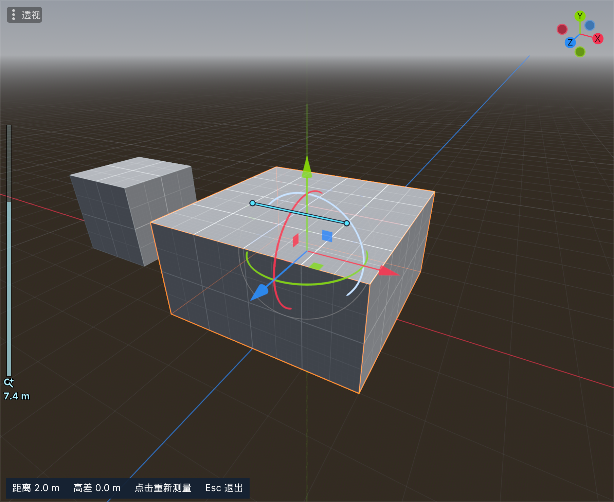

# 白盒尺寸与测距验证

2026-11-19 在独立工程副本使用 Godot 4.7.1，分别运行 headless 和 macOS Metal Forward+ 原生编辑器。测试创建临时关卡，结束时关闭并清理。实际窗口通过 Godot 窗口输入队列接收鼠标事件。

| 范围 | 结果 |
|---|---|
| 原生点线面与测距 | headless 59 项通过，Metal 59 项通过 |
| 轮盘与放置 | headless 118 项通过 |
| 尺寸与拖动 | 将 4×2×4 m 体块旋转并缩放，显示 6×1×8 m。面沿两轴移动 0.4 m 和 0.3 m，实际位移为 0.5 m。撤销、重做和原生物体轴继续工作 |
| 表面拾取 | 两次原生视口点击落在同一白盒顶面，相距 2 m；空白点击不会把端点放在虚拟地平面。第三次点击开始新一组，Esc 清空端点并保留选择及历史 |
| 操作切换 | 测距期间 Alt 镜头操作交还 Godot。启用面选择时自动收起测距并清除端点 |
| 当前术语 | 一级轮盘采用“白盒体块”“触发区域”，二级入口区分常驻和任务触发区域。保留已有类别键与编程接口 |

下图截取自 Metal 原生三维视口。选择体块时可读取宽、高、深，测量模式下显示表面端点、距离与高差。



## 复测

在隔离工程副本运行以下检查。图形入口的附加参数将图片写入本目录。

```sh
godot --headless --editor --path . -- --face-gizmo-test
godot --editor --path . -- --face-gizmo-test --capture-measurement
godot --headless --editor --path . -- --quick-add-test
```

## 空工程按钮和两扇门

从已启用插件的隔离空工程创建原生继承关卡并另存，通过轮盘的正常放置逻辑加入一个按钮和两份单开门。用现有节点选择器添加“机关交互成功时”和“请求机关执行动作”，通过场景树对象绑定处理函数选择实例，在动作下拉框选择 `open`，连接事件输出与执行输入并保存。两次使用 Godot 原生运行当前场景，子进程使用 headless。输入探针把游戏角色放到按钮交互范围，再向输入系统发送 F 按下与释放事件。

| 运行 | 图中的动作目标 | 按钮状态信号 | 门 A 最终状态 | 门 B 最终状态 |
|---|---|---|---|---|
| 第一次 F6 | 门 A | 玩家触发 1 次，进入 pressed | open | close |
| 改绑后第二次 F6 | 门 B | 玩家触发 1 次，进入 pressed | close | open |

两次启动时两扇门均为 close。第二次仅修改动作节点的门实例并保存，原按钮引用、open 动作和连线延续。早期一次采样在按钮复位后读取到 idle，因此最终探针监听实际交互及状态变化信号。上述覆盖运行路径和编辑器绑定回调，未以物理鼠标逐步执行这篇教程。退出时保留 Godot 调试器清理提示。[最终运行日志摘录](button-door.txt)
