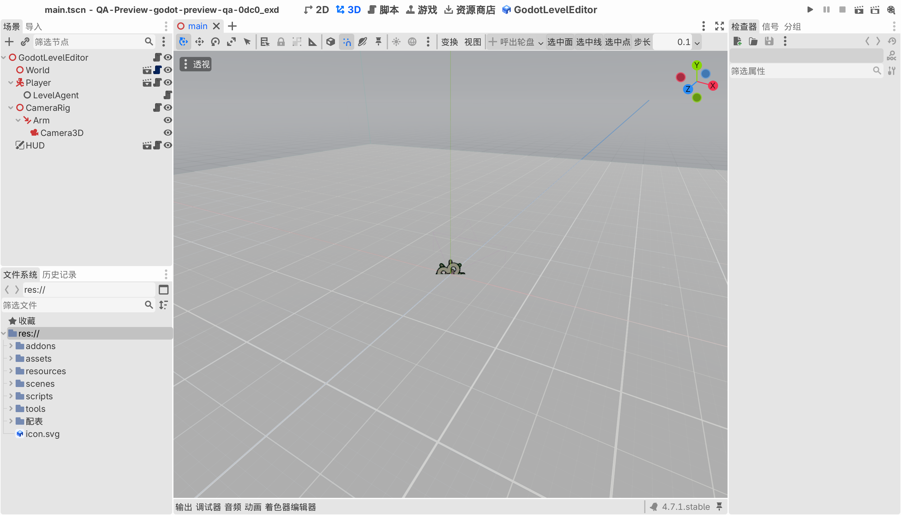

# 移除旧关卡摆放侧栏

2026-11-16，Godot 4.7.1 stable，macOS / Apple M4，实际渲染为 Metal Forward+。

## 清理范围

用户指定删除原生右侧“关卡摆放”窗口和其中旧内容。本轮删除其 Dock 注册、旧示例入口、新建／实例化房间文件对话框、白盒与旧对象卡片库、宽高深面板、隐藏调色板、自定义添加／复制／保存重载按钮及对应专用代码。

当前原生工具栏的轮盘、点线面和步长继续保留。场景树原生 Duplicate、检查器、素材拖放、自动分组、撤销和身份修正保持；新建关卡使用独立窗口的目录入口。仍被轮盘使用的白盒几何投影移至独立的 `radial_thumbnail.gd`，删除旧 `palette_item.gd/.uid`，不留隐藏侧栏。

原有用户场景、Room、机关、NPC、图、光照和工作簿不在本轮删除范围；旧示例场景文件不因取消按钮而被批量删除。用户可见名称沿用既有入口，不新增替代窗口或装饰性名称。

## 真实界面

右侧只保留原生检查器、信号与分组；上方保留轮盘、点线面及步长。



## 检查方式与结果

复用 `tools/godot_level_editor_suite/run_level_preview_test.py` 的完整临时副本与独立 `.godot` / user 数据，先 headless 导入，再串行运行编辑器测试。未关闭原工程编辑器，也未在原工程内放置测试物件。

```sh
python3 tools/godot_level_editor_suite/run_level_preview_test.py --test placement --output .validation/placement-dock-removed-2026-11-16/headless
python3 tools/godot_level_editor_suite/run_level_preview_test.py --test placement --output .validation/placement-dock-removed-2026-11-16/render --render
python3 tools/godot_level_editor_suite/run_level_preview_test.py --test drag --output .validation/placement-dock-removed-2026-11-16/native-drag-final --render
python3 tools/wiki/wiki.py check
```

- 初次 headless：117 项通过，确认不注册旧 Dock、不残留旧按钮、专用旧路径与卡片源文件已经删除；当前轮盘、常驻／任务实例、16 种白盒、吸附、检查器、撤销、保存及源素材保持检查通过。
- Metal：118 项通过。额外模拟已打开旧版本 Dock 后的热更新清理，验证旧面板与过期按钮引用被移除，当前工具栏仍完整；真实截图已人工查看。
- 原生拖放 Metal：14 项通过，覆盖出生点、白盒、Room、机关与 NPC，批量放置、撤销、原生场景树复制及实例绑定保存。复制检查采用各 NPC 实际使用的 `object_id` 或 `enemy_instance_id`，不依赖已删除的旧自定义复制入口。
- 关卡源文件及工作簿的 SHA-256 前后相同。轮盘测试还检查现有 Room、机关、NPC 和白盒源文件字节保持。
- 日志以最终完成标记、零失败汇总及进程退出码为依据。退出阶段有单个 ObjectDB 警告；中间旧 NPC 测试字段假设错误的未完成记录不作为通过依据。

原始日志、测试副本路径和哈希检查在 `.validation/placement-dock-removed-2026-11-16/`；最终轮盘及界面日志为 `verified/`，原生拖放日志为 `native-drag-final/`。Wiki 输出为该目录 `wiki-check.txt`。

旧 smoke 参数保留为当前轮盘专项入口，不再测试已经删除的旧侧栏工作流。接口见 [关卡合同](../INTERFACES.md)，当前操作见 [关卡指南](../../wiki/guides/levels.md)。
