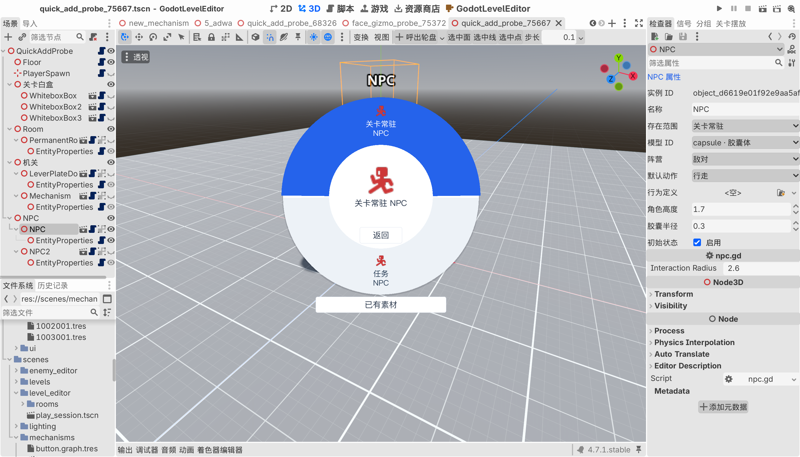
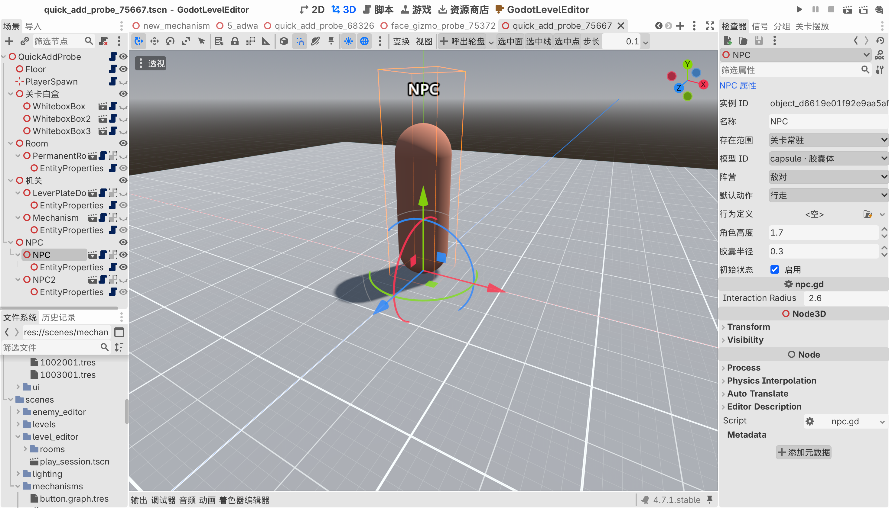

# 轮盘与实例属性 V2

更新于 2026-11-16，覆盖 V1 的长按及“放入”选择行为。

在 Godot 原生 3D 视口打开当前关卡，短按鼠标侧键（XBUTTON1）或反引号键呼出，再按一次取消。工具栏 **呼出轮盘** 也可切换，旁边下拉菜单可设置键盘呼出键。松开侧键不选择素材。

1. 悬停切换玩家出生点、Layout 白盒、Room、机关、NPC、最近使用，选中扇区变蓝并轻微外扩。
2. 点击 NPC、Room 或机关，进入“关卡常驻／任务对象”二级菜单。点击对应半圈进入放置，中心“返回”或右键退回一级。二级菜单的“已有素材”可选择已有场景；普通 NPC 默认使用胶囊体。
3. 在地面左键放置，继续点击可连续添加；R 旋转 15°，Shift+R 反向旋转，右键／Esc 结束。直接加入当前关卡的类别组织节点，不需要选择“放入”。白盒沿用工具栏当前编辑步长。
4. 结束放置后点击胶囊体，右侧原生检查器显示实例属性。修改、放置和出生点移动均支持 Godot 原生撤销／重做。

白盒滚轮切换 16 种形状，“全部”打开可搜索素材。已有玩家出生点会移动原标记。最近使用保留 12 项成功放置记录，区分常驻和任务对象。呼出、取消、悬停、二级菜单及素材列表均有短动画。

| 属性 | 用途 |
|---|---|
| 存在范围／所属任务 | 关卡常驻，或绑定当前关卡任务；任务对象仅在对应任务 active 时显示并启用，完成／失败后关闭 |
| 模型 ID／模型场景 | 默认素材、胶囊体、方块、现有标准人形，或自定义 ID 与场景 |
| NPC 阵营 | 友善／敌对；存于实例，胶囊颜色随之改变 |
| NPC 默认动作 | 待机、行走、奔跑、巡逻或自定义动作 ID |
| NPC 行为定义 | 预留状态机／行为资源引用 |
| NPC 高度／半径 | 调整占位胶囊的显示尺寸 |
| Room 宽／高／深 | 修改当前检测区域尺寸 |
| 机关场景 | 占位机关可绑定现有可复用组件场景 |
| 初始状态 | 是否启用实例 |

任务对象必须选择所属任务，未选择时检查器提示，运行时保持关闭。常驻对象无需任务。阵营字段目前用于配置保存和占位颜色；默认动作会播放模型中存在的匹配动画。巡逻路径、阵营战斗规则及行为资源的进一步执行留作后续接入。

## 保存与集成

根 metadata `godot_level_editor_entity` 持有 schema 1 配置资源。关卡拥有普通子节点 `EntityProperties`，派生模型不设 owner；保存 `.tscn` 只保存实例及配置。源 NPC、Room、机关和白盒素材保持原文件；正式实例只刷新根作用域 ID，保留内部图和对象引用。预览位于用户场景树之外。

任务对象复用 `event_director.gd` 的真实任务状态，通过 `godot_level_editor_task_directors` 组寻找同世界执行器，并检查所属关卡。适配器在未激活时同时关闭显示、处理和碰撞，进度恢复时重新同步。

本次主要文件：`asset_catalog.gd`、`radial_menu.gd`、`radial_tool.gd`、`entity_inspector.gd`、`entity_inspector_panel.gd`、`entity_gizmo.gd`、`runtime/entity_profile.gd`、`runtime/entity_binding.gd`；关卡 plugin 局部注册，事件执行器增加发现组。并行的关卡图、场景分类组织、原生素材拖入和面操作工具保留其实现。

验证命令、结果与已知边界见 [validation.md](validation.md)。V1 文档保留作历史记录。
