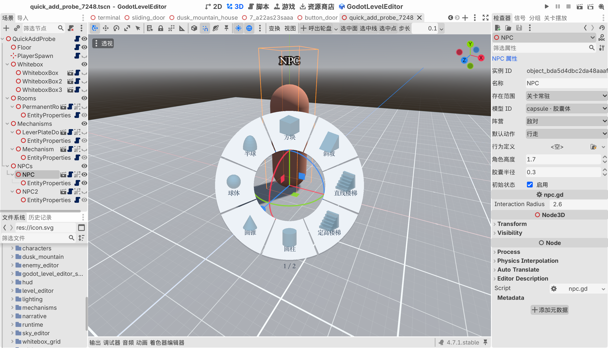
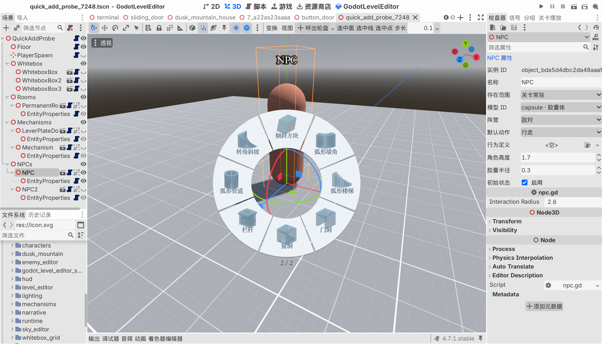
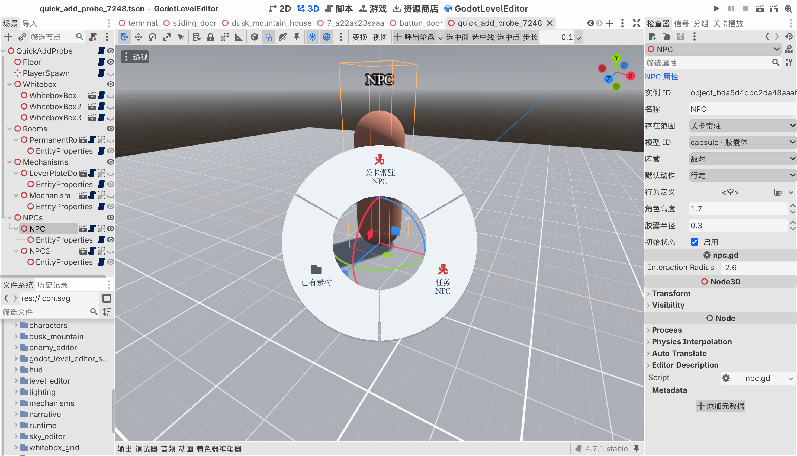
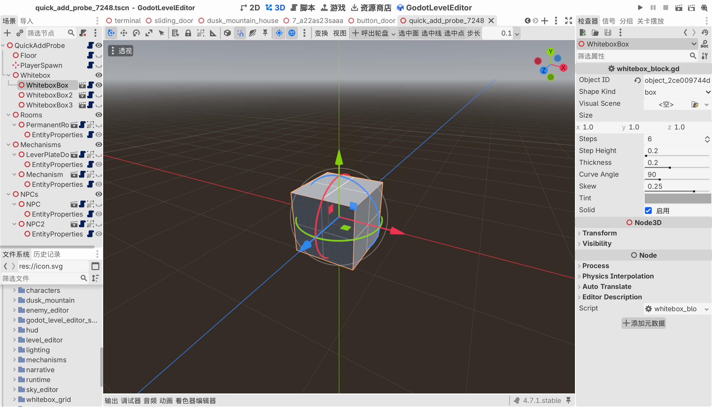

# 透明轮盘与白盒分页

当前操作统一见 [Wiki 关卡与轮盘操作](../../wiki/guides/levels.md)。本目录保存 2026-11-16 的实现变更、实测截图与验证，覆盖旧版中央预览和下方按钮行为。

- 一级轮盘保持六个分类，圆心透明。点击 NPC、Room、机关后直接进入常驻、任务、已有素材二级轮盘。
- 点击 Layout 白盒进入八扇区轮盘，16 个现有体块分两页，滚轮向上／向下翻页。每个扇区显示实际体块缩略图，点击后进入地面放置。
- 不再显示“选择类型”“全部”等下方操作框或中央返回按钮。右键返回上一级，呼出键／侧键／Esc 关闭。点击圆心不选择素材。
- 移除白盒橙色白边尺寸圆点，保留原生变换操作轴、面线点选择和尺寸参数。

本次负责 `radial_menu.gd`、新增 `radial_thumbnail.gd`、轮盘提示、`block_gizmo.gd` 的尺寸圆点移除、对应测试及文档；其他模块的并行编辑保留。未重排或改写用户场景，素材、稳定 ID、运行对象配置及存档格式保持。

详见 [验证记录](validation.md)。
