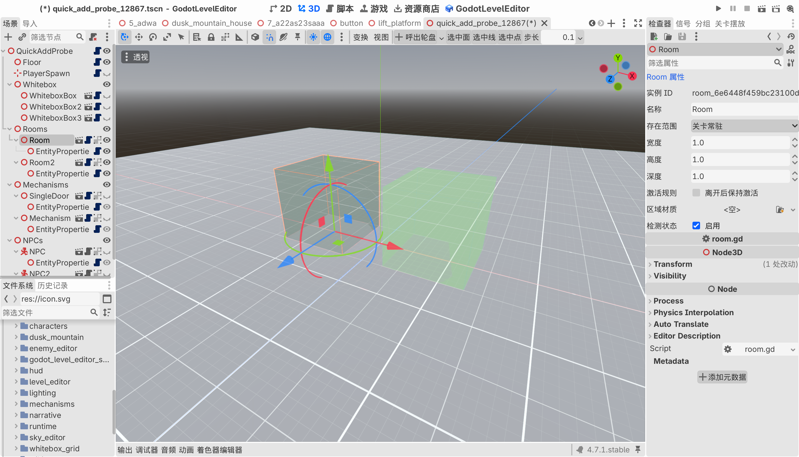

# Room 触发区域验证 · 2026-11-16

环境：Godot 4.7.1，macOS；实际编辑器渲染使用 Metal Forward+ / Apple M4。仅创建临时测试关卡与独立事件工作簿，未保存覆盖用户关卡。

| 检查 | 结果 | 记录 |
|---|---|---|
| Room 真实物理进入、状态、任务与关卡图效果 | 33 项通过，0 失败 | [runtime.txt](runtime.txt) |
| 原生轮盘、Room 检查器、放置与存盘回归，含缩略图接入 | 113 项通过，0 失败 | [editor.txt](editor.txt) |
| Metal 材质显示、透明箱面拾取及检查器，含缩略图渲染 | 117 项通过，0 失败 | [metal.txt](metal.txt) |
| 既有 NPC／Room／机关任务生命周期 | 22 项通过，0 失败 | [lifecycle.txt](lifecycle.txt) |
| Wiki 构建、链接与图片 | Room 指南已实际浏览器检查；最终全站检查有其他并行编辑文档的缺失引用 | [wiki.txt](wiki.txt) |

使用真实 CharacterBody3D 玩家和 Area3D 重叠检测，未用手工发送进入信号替代物理检测。确认空区域未激活、非玩家不触发、玩家进入激活、多个玩家占用、最后一个离开后恢复、保留激活选项、停用后清除状态。新预设碰撞与尺寸均为 1×1×1，没有实体阻挡或房间建筑；运行时不显示触发网格。

真实 EventDirector 同时运行常驻图与任务图。进入和离开分别执行 set_variable 效果，“Room 是否激活”读取实时布尔状态。任务未开始时关闭检测；开始时检测已经在箱内的玩家；引用校验拒绝缺失 Room 和另一任务的独占 Room。既有生命周期检查继续覆盖任务完成、失败、恢复、跨关卡与碰撞停用。

编辑器确认 Room 轮盘仅两种存在范围、不再列出完整房间；检查器显示尺寸、材质、检测状态与离开后规则，移除模型和拓扑选项。绿色预览不参与素材贴面拾取，原生点击透明箱面选择 Room 根对象。原生撤销重做、配置保存重开及源素材 SHA-256 检查通过。



新增 `trigger_room.tscn` 承载当前默认值，保留旧房间源文件、旧隐式尺寸与旧生成器兼容。没有批量缩小既有房间或移动用户节点。节点 kind、参数与引用为加法扩展，图 schema 仍为 1，旧 room_enter 引用继续有效。

Wiki 同步关卡指南、术语、功能地图与版本记录；模块接口同步关卡、任务及套件。命名检查使用既有 Room、激活、任务、关卡常驻等术语，未增加装饰性前缀或间隔点命名，未连带更改稳定 ID。

```sh
/Applications/Godot.app/Contents/MacOS/Godot --headless --path /Users/lanyi/branch res://tools/level_editor/test_room_triggers.tscn
/Applications/Godot.app/Contents/MacOS/Godot --headless --editor --path /Users/lanyi/branch -- --quick-add-test
/Applications/Godot.app/Contents/MacOS/Godot --editor --path /Users/lanyi/branch --resolution 1600x1000 -- --quick-add-test --capture-trigger-rooms
/Applications/Godot.app/Contents/MacOS/Godot --headless --path /Users/lanyi/branch res://tools/level_editor/test_placed_entities.tscn
python3 tools/wiki/wiki.py check
```

运行测试没有脚本错误。编辑器退出仍报告既有 1 个 ObjectDB 泄漏警告，原始记录保留；没有表述为整个项目无警告。
