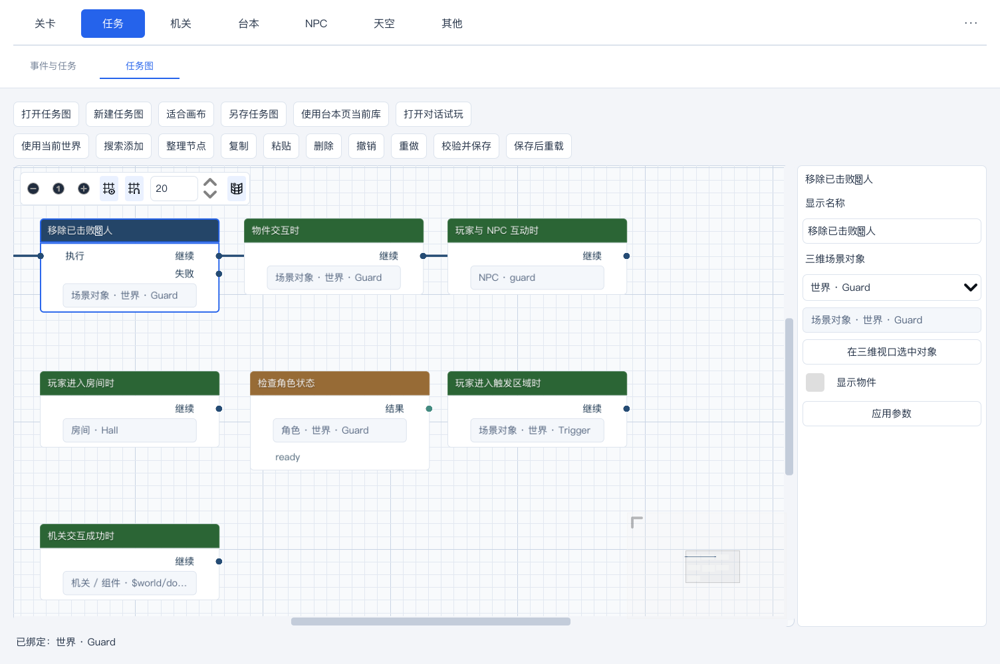

# 场景树 → 节点对象拖放绑定

日期：2026-11-16。Godot 4.7.1，macOS。

## 使用

从当前关卡的原生场景树拖一个已放置物件，到任务图／常驻关卡图卡片底部的对应对象框，或者右侧参数区的同名框。可接受时蓝色高亮，放下即提交绑定，菜单同步刷新；仍用原来的保存按钮持久化。支持 NPC、场景物件、Room、角色及机关组件字段；下拉菜单继续保留。

只改对象引用，不移动或复制场景物件。模型内部子节点识别到注册实体；管理容器、多选、错误类型、文件和其他世界拒绝。任务 NPC 保留原裸 ID，常驻 NPC 保留世界作用域及常驻过滤。多个机关组件没有明确主输出时，需要拖具体组件或用菜单选择。替换组件时不兼容的状态／动作清空，提示作者重新选择；与绑定共用一次撤销。

## 复现检查

```sh
/Applications/Godot.app/Contents/MacOS/Godot --headless --path . --editor -- --scene-reference-test
/Applications/Godot.app/Contents/MacOS/Godot --path . --editor -- --scene-reference-test --capture
/Applications/Godot.app/Contents/MacOS/Godot --headless --path . --editor -- --godot-level-editor-suite-test
/Applications/Godot.app/Contents/MacOS/Godot --headless --path . tools/narrative/test_task_nodes.tscn
/Applications/Godot.app/Contents/MacOS/Godot --headless --path . tools/level_editor/test_level_logic.tscn
/Applications/Godot.app/Contents/MacOS/Godot --headless --path . tools/level_editor/test_presentation.tscn
python3 tools/wiki/wiki.py check
```

拖放专项使用临时独立关卡与内存任务图，不改用户场景、任务图或工作簿。原生渲染检查通过 `force_drag` 发起标准场景树 payload，再由 Window 鼠标输入完成同窗口和主编辑器 → 独立窗口的实际 GUI 路由；不是仅调用数据处理函数。headless 不作为物理鼠标悬停验证。

| 检查 | 结果 |
|---|---|
| 专项 headless | 34 项，0 失败 |
| 原生窗口与渲染 | 38 项，0 失败 |
| 套件编辑器回归 | 78 项，0 失败 |
| 任务节点运行回归 | 90 项，0 失败 |
| 常驻关卡运行回归 | 34 项，0 失败 |
| 节点端口与呈现回归 | 143 项，0 失败 |

涵盖分组内对象、模型子节点、Room、NPC 两种 ID 合同、类型／世界隔离、多选与文件拒绝、旧引用保留、绑定与 dependent 参数撤销重做、图端口／位置／连线保持，以及资源保存重载。原生窗口分处不同坐标原点时，由引用输入桥转换屏幕坐标并完成绑定；鼠标悬停由同一桥控制，避免源窗口的原生 mouse_exited 通知清除目标高亮。旧呈现测试直接索引已不完整的 `GRAPH.LABELS`，更新为当前公开 `GRAPH.display_label` 后完成回归。

编辑器进程退出仍报告既有 `Plugin is not attached to debugger` 与 1 个 ObjectDB 泄漏提示；不能描述为无警告退出。专项没有脚本解析或运行错误。

日志见同目录；真实渲染结果：


