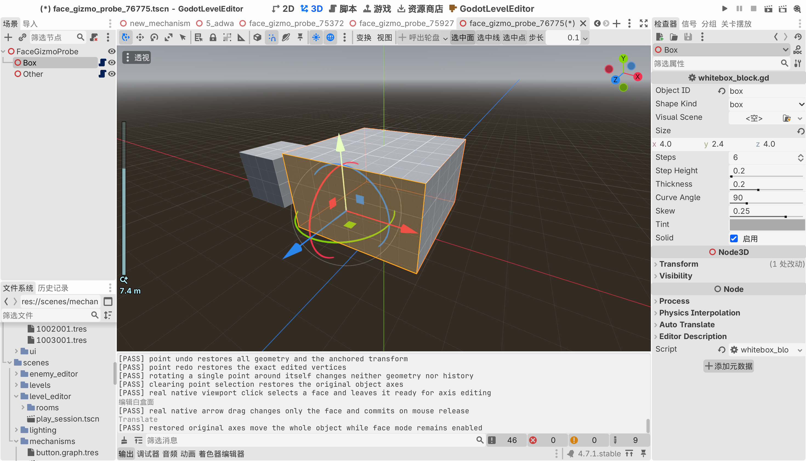
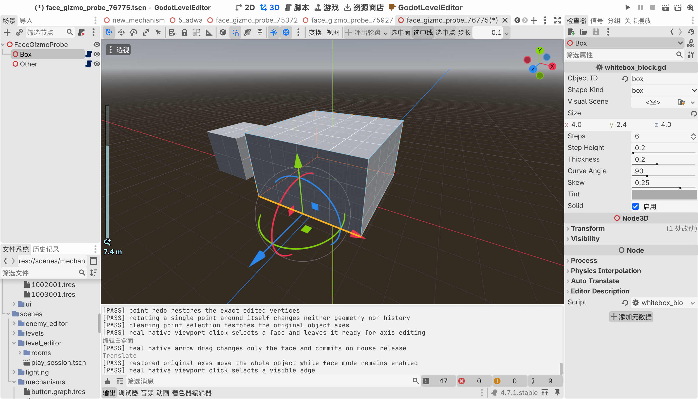
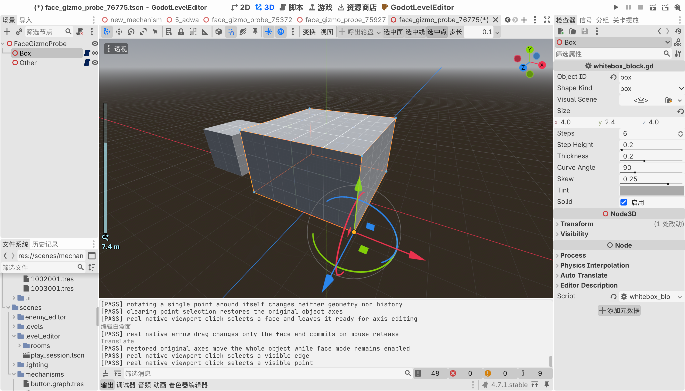
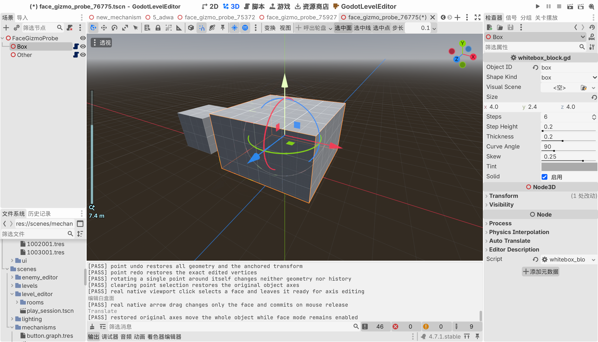

# 面、线、点选择与可填写步长 · 2026-11-16

原生 3D 工具栏为 **呼出轮盘 → 选中面 → 选中线 → 选中点 → 步长输入框及预设**。三个选择模式互斥。步长可以填写，Enter 或移开焦点应用，提供 0.1、0.5、1 三个预设；支持 0.001–1000 m，精度三位小数，保存在项目 EditorSettings metadata。它同步原生物体平移、面／线／点平移和轮盘放置，不在修改设置时重写已有几何。

切换模式后的首次点击优先选择几何元素，避免原物体轴挡住线或顶点。选中后只有一组原生操作轴，分别位于面中心、线中点、点的位置。Esc／空白取消元素选择，恢复物体原轴并可直接操作整个物体。关闭选择模式时恢复旧白盒尺寸手柄。

线只选择真实折边，不选择共面三角网格内部对角线。线和点按屏幕距离拾取，排除背面和被更近白盒遮挡的候选。移动时修改所选元素的全部共用顶点，使邻面继续连接，未选中顶点保持世界位置；面与线可绕自身中心旋转。单个点绕自身旋转不会改变位置，亦不产生网格变化或撤销记录。

## 实际渲染









## 文件归属及兼容

- `plugin.gd`：局部新增三个模式按钮、可填写步长及三个预设，配置原生平移吸附；保留并行加入的场景分组、检查器、拖放、轮盘和其他模块接入。
- `push_pull_tool.gd`：复用原面编辑的选择、变换、撤销和生命周期，扩展模式、线／点拾取、候选显示及原轴恢复。
- `mesh_elements.gd`：焊接顶点、折边与三角内对角线区分、元素中心及局部操作轴坐标系。
- `face_edit.gd`：复用已保存网格的共用顶点变换；增加实际无位移时直接返回原状态，避免单点自身旋转产生假编辑。
- `block_gizmo.gd`：统一通过元素 ID 和坐标系驱动原生 subgizmo；选择模式内隐藏尺寸手柄，使顶点不会被角点缩放柄抢先命中。
- `native_snap.gd`：接受编辑步长，更新原生平移吸附并回读校验。
- `radial_tool.gd`：按钮更名“呼出轮盘”，放置跟随统一步长；轮盘页面、动画、悬停及实例属性沿用并行修复。
- `test_face_edit.gd`、`test_face_gizmo.gd`、`test_quick_add.gd`：检查几何、原生编辑器、真实鼠标输入、步长与轮盘回归。

沿用 `mesh_edit.version=1`，保留对象 ID、父级、运行碰撞与场景撤销。没有重写用户关卡、房间、机关、NPC、光照、配表或运行玩法。白盒尺寸保护与几何归一化继续使用原合同；编辑步长控制本次位移，不批量改变已有尺寸。

## 验证结果

Godot 4.7.1，macOS；先运行 headless 导入和相关检查，再运行 Metal Forward+ 实际窗口渲染。

| 检查 | 结果 |
| --- | --- |
| 编辑器导入 | 无脚本解析／编译错误 |
| 面／线／点几何 | 35 通过，0 失败 |
| 原生选择、操作轴、步长、撤销重做及真实视口点击 | 47 通过，0 失败 |
| 轮盘、六扇区真实悬停、侧键、步长放置及实例属性回归 | 84 通过，0 失败 |
| Metal 实际窗口与四种状态截图 | 47 通过，0 失败；四张截图已逐一检查 |

编辑器退出仍有 1 个 ObjectDB instance 泄漏警告，与本次修改前导入检查观察一致。

```sh
/Applications/Godot.app/Contents/MacOS/Godot --headless --editor --path /Users/lanyi/branch --quit-after 3
/Applications/Godot.app/Contents/MacOS/Godot --headless --path /Users/lanyi/branch tools/level_editor/test_face_edit.tscn
/Applications/Godot.app/Contents/MacOS/Godot --headless --editor --path /Users/lanyi/branch -- --face-gizmo-test
/Applications/Godot.app/Contents/MacOS/Godot --editor --path /Users/lanyi/branch -- --face-gizmo-test --capture-face-gizmo
/Applications/Godot.app/Contents/MacOS/Godot --headless --editor --path /Users/lanyi/branch -- --quick-add-test
```

已打开的旧 Godot 会话需先保存自己的场景，再重新打开项目以重建工具栏。
