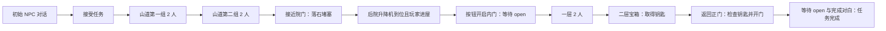
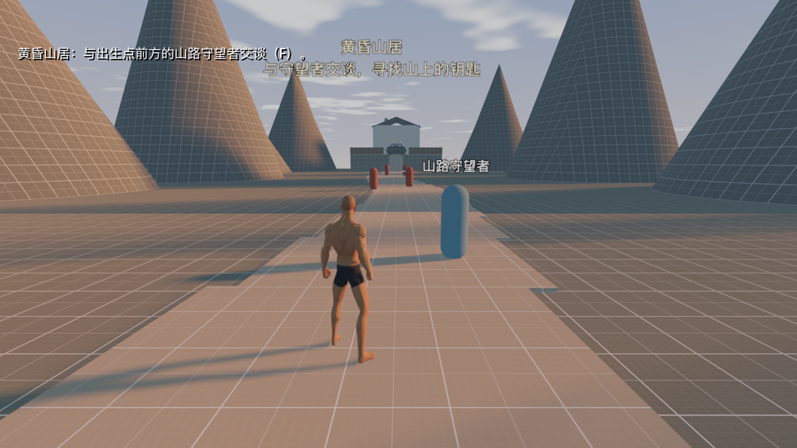
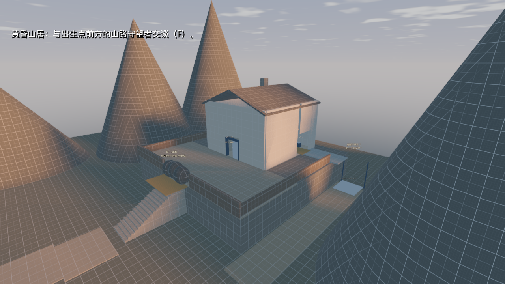

# 黄昏山居

2026-11-16，按用户流程新建的可编辑白盒关卡。入口为 `res://scenes/levels/dusk_mountain_house.tscn`，在 Godot 打开后按 F6；也可在 GodotLevelEditor → 关卡 → 我的关卡选择“黄昏山居”。

关卡 ID **6**，事件 **1003 黄昏山居 · 寻钥归途**，任务 ID **1003001–1003008**。任务页可查看八项任务及各自节点图；关卡编辑页显示 NPC 对话与接取的常驻图。

## 空间与流程

- 天空引用已有“暖色黄昏”预设，固定 17:00。
- 出生点 `(0, 0.15, 48)`，小房子中心约 `(0, 4, -49)`，平面距离约 97 m。
- 山道两组敌人各 2 名，一层另有 2 名；红色胶囊表示敌人，靠近按 F 击败。
- 院门落石保持堵塞，右侧地面小路通往后院升降机。先站上平台再按 F；台面从 y=0.22 升到 y=4，与后门平台平齐。
- 一层 y=4，二层 y=8。后门玄关的按钮打开一层内门；清敌后沿左侧楼梯上二层取金色宝箱。
- 用户已确认最后一道门为**房子正门**：宝箱给予 `dusk_front_door_key`，回到一层正门内侧按 F，检查钥匙、解锁并等待门完全打开后完成任务。

## 节点与数据来源

常驻逻辑内嵌于关卡的 `level_logic`：`npc_interact → show_dialog`，`dialog_completed → task_accept`。接取后清除初始提示，最终完成对白结束后更新完成提示。

八项任务图保存在 `resources/levels/dusk_mountain/stage_01.tres` 至 `stage_08.tres`，关卡／事件／对白分别增补到已有的 `配表/levels.xlsx`、`events.xlsx`、`dialogues.xlsx`。原有作者行保留；没有替换主入口或原有用户关卡。

每组清敌使用两个独立的 `object_interacted(once=true) → set_visibility(false)`，接入 `wait_all` 后才完成任务。升降机使用 `wait_mechanism_state(at_end)` 和真实后门 `region_enter` 汇合。按钮和正门均等待真实 `open` 状态，接受动作指令本身不算完成。

敌人、宝箱和正门锁使用本关局部适配器 `scripts/levels/dusk_mountain/task_interaction.gd`：仅在同世界的所属任务 active 时允许交互；距离、玩家身份与可见性沿用现有交互接口。脚本不管理任务顺序、奖励或开门；这些行为全部来自任务图。其余 NPC、机关、区域、背包和执行服务复用既有组件，无公共运行接口变更。

`Whitebox`、`NPCs`、`Mechanisms`、`Rooms` 为原生可编辑分类。楼梯的每级外观均可编辑，踏步关闭独立碰撞；不可见的 `ApproachWalkSlope` / `IndoorWalkSlope` 提供连续斜坡碰撞，适配现有角色移动。升降台、按钮和两扇门参数直接保存在本关实例中，机关图继续引用已有素材。`manifest.json` 记录稳定 ID 与路径，不驱动运行。

## 验证

命令与结果见 [validation.md](validation.md)。实际 Forward+ 渲染：

