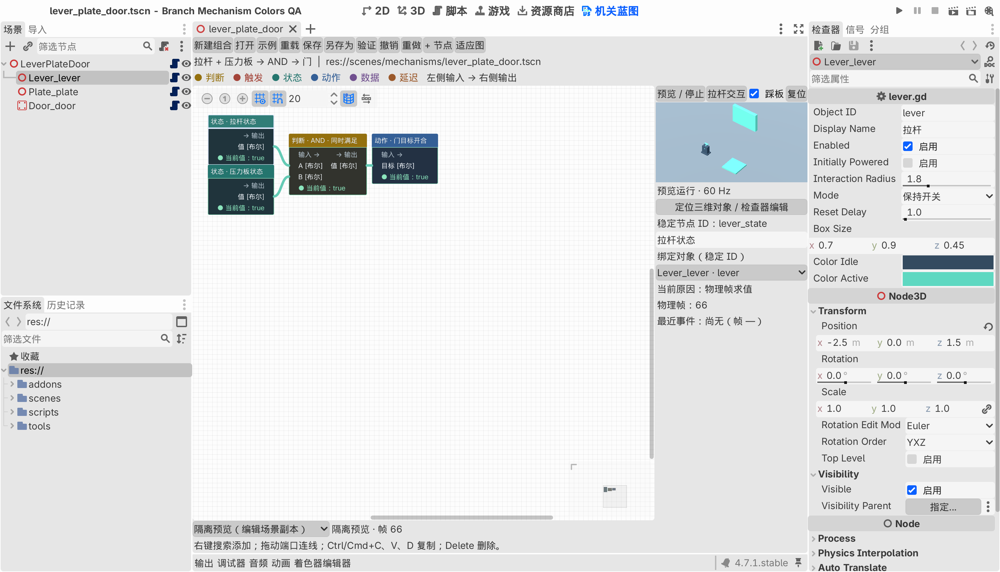

# 机关蓝图首版

当前库只保留双开门、单开门、压力板、按钮和升降台五种独立素材，新建为空白图。旧预连线组合已移除；下方涉及旧示例的内容保留为阶段记录。当前操作见 [使用独立机关](../wiki/tutorials/button-door.md)，清理与验证见 [本轮记录](independent_2026-11-16/validation.md)。


2026-11-16：新增按钮、拉杆、压力板、滑动门、旋转门、升降台、交互终端七种素材，以及命名状态、交互／状态／动作事件和任务／常驻关卡逻辑桥。显示名称不带分类前缀。使用方法、三种组合与 F6 试玩见 [第一批机关素材](whitebox_v1/README.md)。

在 Godot 顶部打开“GodotLevelEditor”，点击“机关”进入“我的机关”。单击组合卡片查看详情，双击或“进入编辑”后才显示“机关编辑”；“新建机关”位于目录卡片中。标准样例为 **拉杆状态 + 压力板状态 → AND → 门目标开合**。禁用统一套件时，模块保留原来的独立入口。

2026-11-16 QA 修复：机关页与原生保存统一检查配对文件冲突和图有效性；出现“未保存”或冲突提示时保留草稿，核对磁盘内容或另存新路径。复制粘贴使用复制时的节点及组件快照；自定义动作无当前可用转换时正常失败，按钮自定义进入 pressed 同样遵守复位时长。操作见 [Wiki 机关速查](../wiki/reference/mechanisms.md#save-and-copy)，已完成的模块专项与总控独立整合验收见 [QA 记录](../qa/bugfix_2026-11-16/validation.md)。

节点按职责配色：**判断深黄色、触发朱红色、状态青绿色、动作蓝色、数据紫色、延迟橙色**。标题同时显示分类文字，节点内明确标出左侧“输入 →”、右侧“→ 输出”。端口及连线继续按数据类型着色；运行时用绿色边框和状态文字提示活动，不覆盖分类色。

1. 右键搜索添加节点，拖动具名端口连接；布尔、数值、对象引用与一次事件使用不同类型端口。
2. 选中节点编辑显示名、绑定、常量和延迟参数；关联三维对象同步选中，尺寸、颜色、位置、检测半径在 Godot 检查器编辑。“定位三维对象”进入三维工作区；在场景树选择对象也会选中相应图节点。
3. 支持缩放、平移、多选、复制、粘贴、删除和撤销重做。复制组件节点会复制空间对象并生成新 ID；删除图节点保留空间对象，方便重新绑定。
4. 点击“预览 / 停止”，用“拉杆交互”和“踩板”模拟输入。预览固定 60 Hz，使用独立场景副本；“复位”恢复初始状态。预览窗左拖旋转、滚轮缩放。
5. 使用“保存”或“另存为”写出 `.tscn` 与同名 `.graph.tres`；“重载”重新读取磁盘，未保存内容会要求确认。缺失输入、绑定、端口错误、类型冲突、数据循环和不支持的版本会阻止保存。
6. 运行场景后，在底部选择实际游戏实例，查看当前值、活动节点、物理帧和最近执行原因；“隔离预览”与游戏实例分开显示。

独立资产：`scenes/mechanisms/lever.tscn`、`door.tscn`；可复用组合：`scenes/mechanisms/lever_plate_door.tscn`。后者引用同目录图资源，供关卡编辑器实例化；玩家主动交互、回放和公共时间线接入见 [接口文档](INTERFACES.md)。

示例本身是机关组合，未包含角色、地面和相机；在插件中预览，或由关卡组装后试玩。

验证命令：

```sh
/Applications/Godot.app/Contents/MacOS/Godot --headless --path /Users/lanyi/branch res://tools/mechanisms/test_mechanisms.tscn
/Applications/Godot.app/Contents/MacOS/Godot --headless --editor --path /Users/lanyi/branch -- --mechanism-canvas-test
```

画布验证会打开测试场景并生成 `tools/mechanisms/.canvas_test_*.tscn` 与对应图资源。建议复制工程到临时目录运行，避免改变当前编辑器工作区；运行逻辑测试使用独立测试资源，不写正式存档。

官方 API 参考：[GraphEdit](https://docs.godotengine.org/en/stable/classes/class_graphedit.html)、[EditorPlugin](https://docs.godotengine.org/en/stable/classes/class_editorplugin.html)、[ResourceSaver](https://docs.godotengine.org/en/stable/classes/class_resourcesaver.html)。

实测：运行逻辑 **48/48**、画布 **33/33**。原工程编辑器初始化通过。验收详情见 [阶段交接](HANDOFF.md) 和 [验证记录](validation.json)。


