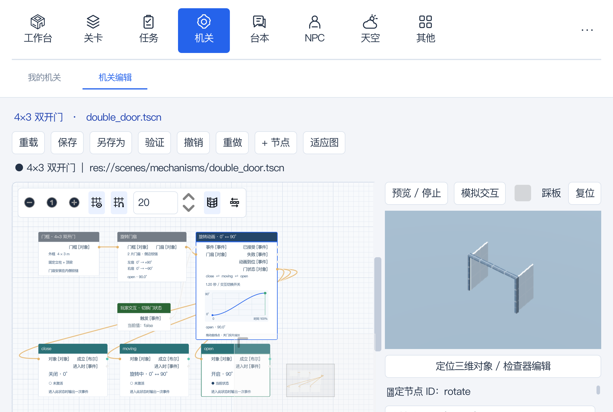
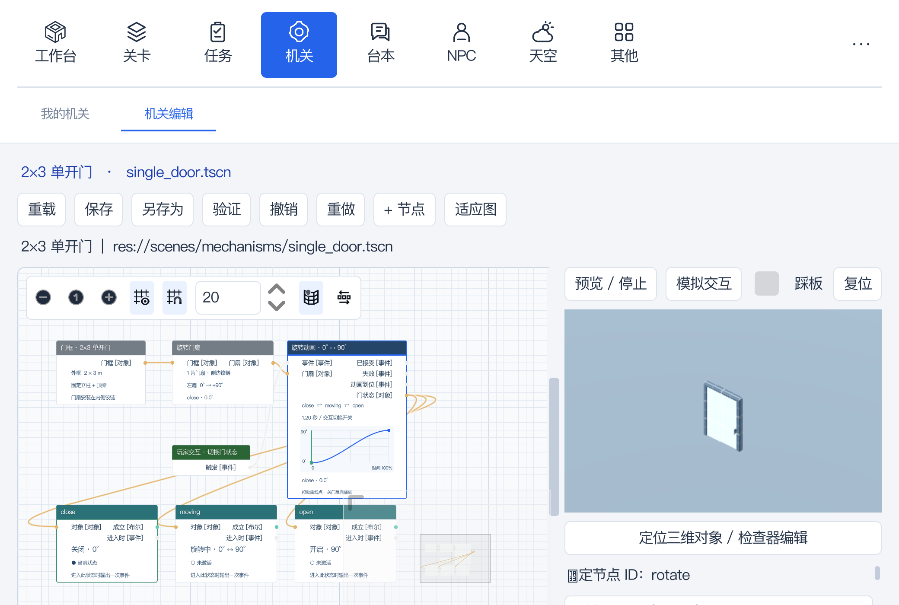

# 单开门 / 双开门节点与曲线验证

日期：2026-11-16。Godot 4.7.1.stable.official.a13da4feb，macOS，Metal Forward+；写盘与异常输入全部在 `/tmp/branch-door-v2-ofmNqH` 独立副本。

## 结果

- 新门运行专项：**46/46**，见 [运行日志](runtime.txt)。包含实际门框网格包围盒为 2×3 / 4×3、固定框体、门扇数量、三状态、曲线角度、双扇相反方向、反向取消、静默恢复、缺失曲线拒绝两文件写入、真实物理射线验证通道关闭/打开，以及任务目标与状态动作。
- 新门编辑专项：**headless 21/21、Metal 21/21**，见 [headless](editor_headless.txt)、[Metal](editor_metal.txt)。包含七节点、三状态直接呈现、共享绑定选择保持、真实曲线输入处理、撤销/重做、实时角度/播放线、到位状态、曲线保存重开、两种默认规格、旧类型搜索和整套七节点添加/撤销。
- 实际渲染逐张检查：双开门 close / moving / open、单开门 close。新增运行值后也执行节点矩形交叠断言；Metal 发现的 13 px 动画卡与状态卡交叠已通过移除重复对象 ID/布尔运行行解决，最终无交叠。
- 原有机关运行：**48/48**；原有编辑回归：**24/24**，保留四类共享绑定节点选择与任务状态节点检查。
- 前一轮 QA 保存/复制专项再次运行：**35/35**。四项 QA 原始冻结源码与结果独立保存在 `.validation/qa-fixes-2026-11-16/mechanism/`，不把本轮门规格计入旧验收快照。
- headless 导入无 Parse Error / SCRIPT ERROR；`git diff --check` 通过。Wiki 构建与检查通过：16 个当前页面、966 个本地链接、43 处图片引用，errors 为空；保留既有历史页面锚点 INFO。

同一编辑专项在 headless 与 Metal 的重复检查不当作独立新增断言相加。

## 可观察结果






图中的旋转动画直接显示 Curve、时间、角度和播放线。金色数据线表达同一实际组件的门框→门扇→动画→状态，白色事件线把玩家交互送入动画。只有当前状态卡激活；门扇及碰撞到达 90° 后才标记 open。

## 复测命令

以下 `Godot` 为 `/Applications/Godot.app/Contents/MacOS/Godot`，`PROJECT` 使用独立副本路径：

```sh
Godot --headless --editor --path PROJECT --import --quit
Godot --headless --path PROJECT res://tools/mechanisms/doors_v2/test_runtime.tscn
Godot --headless --editor --path PROJECT -- --rotating-door-editor-test
Godot --editor --path PROJECT -- --rotating-door-editor-test --capture
Godot --headless --path PROJECT res://tools/mechanisms/test_mechanisms.tscn
Godot --headless --editor --path PROJECT -- --whitebox-mechanism-editor-test
Godot --headless --editor --path PROJECT -- --mechanism-qa-fixes
python3 tools/wiki/wiki.py check
```

生成器 `tools/mechanisms/doors_v2/generate.tscn` 默认跳过已存在的同名素材。副本验证中才使用显式的 `--regenerate-owned-door-assets` 重建本轮新素材。

## 资源与执行边界

- 新增 `single_door` / `double_door` 两对场景图资源及真实三维预览图；动画曲线唯一来源在组件场景，图保存绑定、动作、状态和排版。
- 既有机关资源不转换或删除。对前一轮资源散列复查，仅 `button_door.graph.tres` 出现 UID 头与视图缩放/偏移变化，其节点、边、节点位置未变化，保留当前文件。`sliding_door.tscn` 与图的原字节保留，用户未接线 delay 仍属待完成草稿；没有为通过测试删除它，也未声称旧完整 whitebox runtime 全部通过。
- 本轮检查使用当前源工程新副本；没有依赖 QA 初始副本中的临时类型修正。其他模块最终类型修正已由其负责窗口写回。
- headless 缩略图的 texture 提示、拒绝无效 Save As 后的 Godot 文件 stat 提示，以及既有 debugger / ObjectDB 退出提示保留在专项原始日志中，没有据此忽略脚本错误或伪造通过。
- 未新增门扇受阻检测、门锁解谜、Windows 导出或全关卡通关验收；本轮只实现指定两规格、真实旋转碰撞及图和任务状态接口。

接口见 [INTERFACES](../INTERFACES.md)，操作见 [旋转门教程](../../wiki/tutorials/rotating-door.md)。
