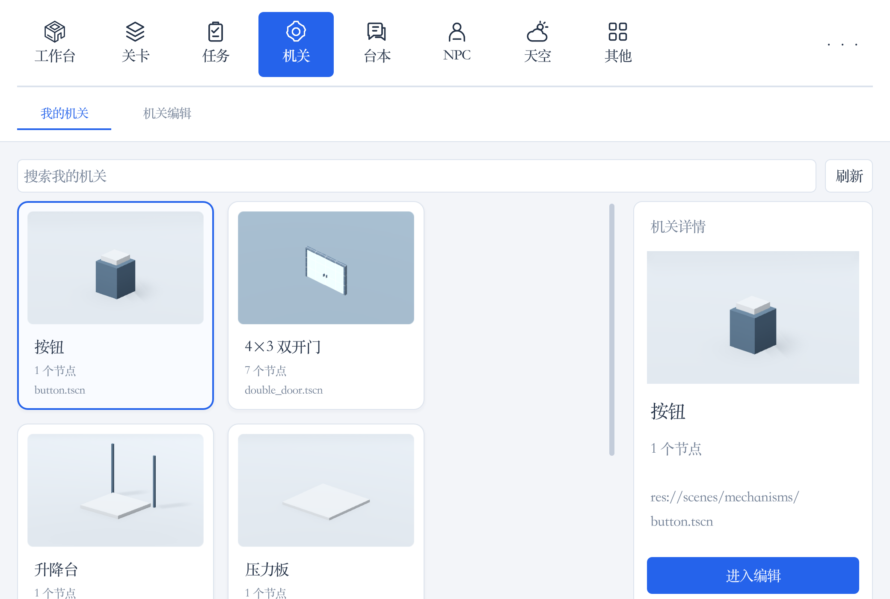

# 五种独立机关清理与验证

日期：2026-11-16。依据用户明确指定，只保留双开门、单开门、压力板、按钮和升降台。

## 保留、删除与迁移

- `scenes/mechanisms` 只剩五个源场景及同名图，共 10 个文件。五对保留资源逐字对比清理前备份，均未改写用户的配置、曲线和图数据。
- 删除旧组合、旧门、拉杆、终端、重复默认样例及相应图、缩略图和演示任务，共 40 个素材/配对文件。旧三组合目标控制器、配重箱脚本也移除；过期测试夹具移到工程外备份。
- 剧情交互点迁至 `scenes/narrative/interaction_point.tscn`，保留其原内容与测试能力，不计入机关库。
- `4_TestLevel.tscn` 的旧组合变为透明组织节点下的三个独立实例，保留父变换和原组件的摆放位置；地面、白盒、出生点与光照不动。
- `mechanism_whitebox_v1.tscn` 保留地面、光照、出生点，改为五种独立素材展示区，取消预设组合和演示目标。
- 黄昏山居的两份旧门读取图移入关卡子资源，保留用户制作的关卡和剧情组件 ID。它们不再依赖已删除的库素材，也不作为可复用素材列出。

清理前已在工程外生成并逐文件核验备份：

`/Users/lanyi/Documents/Codex/Backups/2026-11-16-mechanism-cleanup-1794815630126183000/before-cleanup.tar.gz`

原始清单位于 `.validation/independent-mechanisms-2026-11-16/manifest.json`；备份不位于 Godot 工程内，不会重新出现为素材。

## 当前行为

1. 素材和节点创建入口只提供五种组件。旧创建类型通过搜索也不会出现；兼容运行代码保留给现有关卡内部数据。
2. 新建机关使用 `Factory.blank()`，没有预连线组件。生成器只会补齐缺失的五种独立素材，不会重建旧组合。
3. 按钮改变自身 idle/pressed 并复位，压力板只报告占位。门通过自身输入和内部旋转图开关，升降台通过自身输入往返。
4. 升降台交互位置和提示跟随平台；在终点站上平台可再次按 F 返回。
5. 通用事件、状态、条件、任务接口、图编辑、复制、撤销、保存与用户自行编排联动的能力保留。

## 实际检查

环境：macOS，Godot 4.7.1，Metal Forward+。写盘与异常输入均在 `/tmp/branch-independent-mechanisms-Qv5Rtc` 独立副本。

| 检查 | 结果 |
|---|---|
| 五种独立素材运行、无交叉控制、占位、升降往返、依赖迁移 | 38/38 |
| 当前目录、旧类型不可创建、四类节点选择联动、新建空白、保存重开 | headless 16/16，Metal 16/16 |
| 旋转门曲线、碰撞、状态及任务接口 | 46/46 |
| 核心图合同（私有内存兼容夹具，不创建库样例） | 48/48 |
| 任务对象的机关显示、处理与碰撞生命周期 | 22/22 |
| 保存冲突、无效图、复制快照和跨标签保存回归 | 35/35 |
| 五种展示场景启动、当前生成器运行 | exit 0，无脚本错误 |
| 导入与差异检查 | 无 Parse Error；git diff --check 通过 |
| Wiki 构建、链接、图片与搜索 | 18 页，1165 个本地链接，49 处图片引用，errors 为空 |

运行日志：[独立组件](runtime.txt)、[headless 编辑](editor_headless.txt)、[Metal 编辑](editor_metal.txt)。

目录可滚动，完整列表共五项；实际渲染并核对了目录内容：



## 已有问题与证据边界

黄昏山居在清理前已有四个非法对象 ID：`CourtyardFence_-1`、`TerraceSide_-1`、`FrontWall_-1`、`Roof_-1`。从工程外备份在副本内重新构造旧场景，独立验证了同样四条报告，见 [清理前日志](house_before.txt)。迁移后的报告与基线完全一致，未新增缺失素材或引用错误；没有把该关卡声称为完整验证通过，也没有擅自改动其用户 ID。

headless 缩略图、拒绝无效 Save As 后文件 stat、既有 debugger/ObjectDB 退出提示保留在原始日志；新引入的测试夹具类型推断错误已经修复，最终 Metal 日志没有脚本异常。

历史验证入口 `whitebox_v1/test_runtime` / `test_editor` 已转接当前独立素材专项；旧阶段通过数不冒充本轮结果。通用测试使用当前素材，旧图合同测试在工具目录中临时构造兼容夹具，避免依赖被删除的库文件。

## 复测

```sh
Godot --headless --editor --path PROJECT --import --quit
Godot --headless --path PROJECT res://tools/mechanisms/independent_v1/test_runtime.tscn
Godot --headless --editor --path PROJECT -- --independent-mechanism-editor-test
Godot --editor --path PROJECT -- --independent-mechanism-editor-test --capture
Godot --headless --editor --path PROJECT -- --mechanism-qa-fixes
python3 tools/wiki/wiki.py check
```

操作见 [使用独立机关](../../wiki/tutorials/button-door.md)，接口见 [当前合同](../INTERFACES.md)。本轮没有提交、推送或发布网站。
