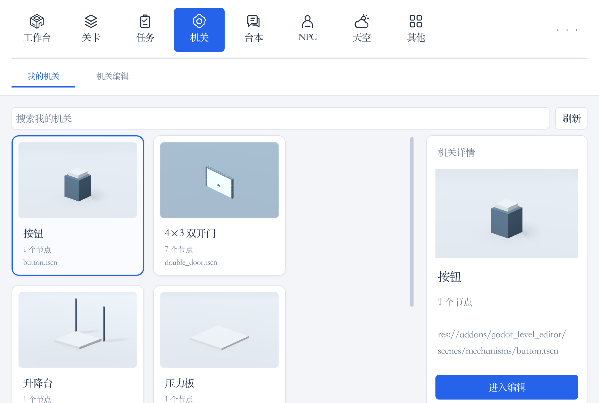

# 五种独立机关复核

日期：2026-11-17；Godot 4.7.1，macOS，Metal Forward+。

当前库仅有双开门、单开门、压力板、按钮、升降台，位于 `addons/godot_level_editor/scenes/mechanisms/`，共五个场景及五份同名图。旧组合、拉杆、终端及旧门素材没有恢复；新建为空白图，旧组件创建类型不能通过搜索或新增入口加入。

按钮按下与自动复位只影响自身；压力板只报告占位；单开门和双开门通过自身交互沿曲线旋转，状态为 `close / moving / open`；升降台通过自身交互往返。跨机关联动仍由作者显式配置，不预置“按钮打开滑动门”等组合。命名核对未出现“白盒·”“示例·”前缀。

## 本次实测

使用临时副本 `branch-five-mechanisms-iv5ta7qx`，单独项目名称隔离用户数据；未使用原工程的 `.godot`。所有创建、删除、保存和预览操作均在副本完成。

| 检查 | 结果 |
|---|---|
| 当前目录、独立组件、无交叉控制、占位、升降往返及原地图依赖 | [38/38](runtime.txt) |
| 机关目录、旧类型搜索限制、节点选择、隔离预览、空白新建及保存重开 | [headless 16/16](editor_headless.txt)，[Metal 16/16](editor_metal.txt) |
| 单/双开门规格、三状态、曲线、物理碰撞及任务接口 | [46/46](doors.txt) |
| 原始五对机关源和作者 content 文件 | 前后 SHA-256 一致，共 79 个文件 |
| 双语 Wiki 检查 | 42 页，2596 个本地链接，100 处图片引用，errors 为空 |

导入没有 Parse Error 或 SCRIPT ERROR。编辑器退出仍有既有的 debugger 未附着提示和 1 个 ObjectDB 实例退出警告；功能检查通过数不表示这些提示已修复。黄昏山居仍报告清理前已经核对过的四个非法对象 ID，本次没有新增引用错误，未改动用户 ID。

源散列、导入日志与副本路径记录于 `.validation/independent-mechanisms-2026-11-17/`。本次复核没有再删除用户作品，也没有改写机关源或配表。历史删除清单与工程外备份见 [原清理记录](../independent_2026-11-16/validation.md)。

实际目录可滚动，自动检查总数为五项；下图为本次真实渲染：

