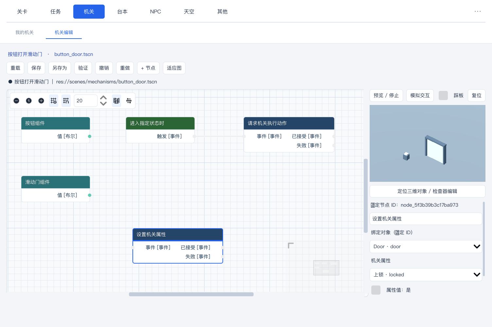

# 机关节点选择联动修复 · 2026-11-16

点击“设置机关属性”等节点时，图会同步选中绑定的三维组件。Godot 的原生选择通知可能在同步标记释放后才到达，旧逻辑随即选择第一个引用该组件的图节点，导致选择跳回“滑动门组件”。

现在原生通知对应的对象若与当前图节点绑定一致，就保留当前图节点、选中外观与参数面板；选择不同三维组件时继续原来的反向定位。只改变编辑器选择逻辑，不改节点、连线、绑定、用户场景或运行逻辑。

在独立副本 `/tmp/branch-selection-fix-PROBE` 验证：

- 修改前：四类共用组件的节点均复现选择跳回问题，24 项中 4 项失败，见 [before.log](before.log)。
- 修改后 Headless：24/24 通过，见 [headless.log](headless.log)。
- 默认 Metal 实际渲染：25/25 通过，见 [metal.log](metal.log)。
- 覆盖属性设置、执行动作、状态判断、状态变化节点保持选中，以及从三维选择其他组件、既有编辑／撤销／保存重开回归。
- 既有退出清理日志保留；没有脚本解析错误。用户正在编辑的终端及其他聊天的改动保持。

