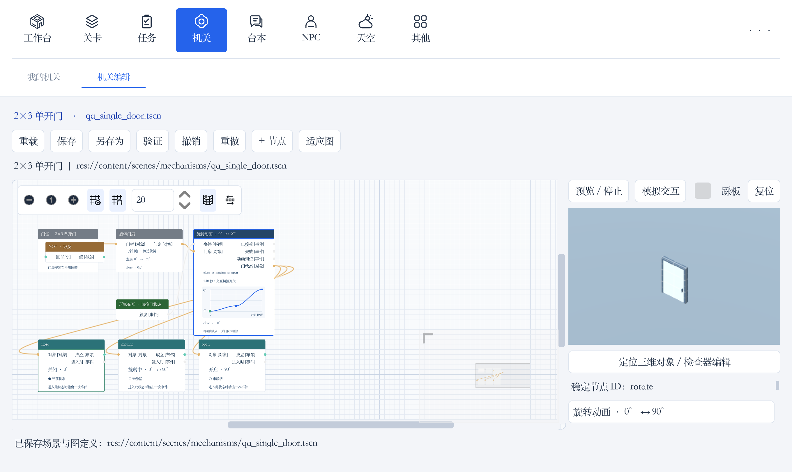
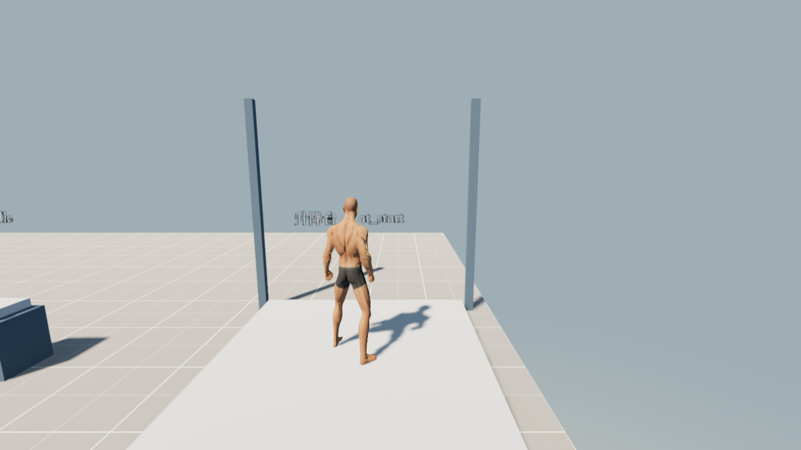

# 插件迁移后的机关编辑与保存验证

日期：2026-11-17。Godot 4.7.1，macOS，Metal Forward+。本次验证使用开发工程副本和仅复制插件的空工程，独立项目名隔离 `user://`，未运行原工程的 `.godot`。

## 确认的问题与修复

1. 在两种工程中，修改内置按钮后点击面板保存，或修改内置单开门后执行真实 `EditorInterface.save_scene()`，均改写了插件内的 `.tscn` 和 `.graph.tres`。修复为共享路径策略：内置素材首次保存提供个人路径，Store 与原生 saver 拒绝插件写入，含大小写与 `..` 的路径也受保护。
2. 成功另存后，源标签可能保留草稿；自动居中、标签恢复和布局改变产生的滚动通知又会把未编辑的内置图标成脏状态，阻止切换到下一机关。现在先安全保存个人副本，再重载源标签并打开个人原生标签；视图保存只响应用户操作。
3. 原生 Save As 被拒绝后，Godot 仍会改变根节点的场景路径；再次另存还可能留下旧拒绝提示。guard 现在恢复原身份与未保存状态，并在草稿成功保存后清除对应提示，忽略大小写定位被保护的原根节点。

开发生成器使用显式 `allow_builtin=true`，普通保存保留保护。没有重建或改名五种源素材，也没有修改运行组件的动作、物理或状态逻辑。

## 最终检查

| 流程 | 开发副本 | 插件空工程 |
|---|---|---|
| 五种内置机关浏览→改节点／属性／连线／曲线→另存→原生关闭／重开→保存→放入继承关卡→F6 | [155/155](dev_editor.txt) | [155/155](empty_editor.txt) |
| 完全替换已安装插件后，重开个人资源与关卡，再次 F6 | [15/15](dev_update.txt) | [15/15](empty_update.txt) |
| 每次真实 F6 的玩家交互、占位、门状态与曲线、承载及升降往返 | 23/23 | 23/23 |
| 替换插件前后的作品、配表及已稳定导入侧文件 SHA-256 | 86 个文件一致 | 21 个文件一致 |

保存冲突、无效图、跨标签保存与复制快照回归：[35/35](native_regression.txt)。旋转门规格、曲线、碰撞和任务接口回归：[46/46](door_runtime.txt)。最终日志没有 Parse Error、SCRIPT ERROR 或功能断言失败。

原工程作者 `content/` 的 69 个文件、五对内置机关源的 10 个文件，前后散列完全一致。原地图、配表和组件／图 ID 均保留。

双语 Wiki 检查通过：42 页、2607 个本地链接、100 处图片引用，errors 为空；`git diff --check` 通过。冻结源码散列已复核一致。

## 证据边界

编辑测试调用真实目录、图面板回调、文件对话框选择信号及 Godot 原生保存、关闭、重开、F6；连线使用连接信号，不冒充本次做过完整鼠标拖线验收。F6 使用真实默认玩家和物理组件，激活独立游戏窗口后注入 F 键事件，没有直接调用组件动作代替玩家交互。

早期三条复制断言使用了错误的旧测试节点名：内置按钮等仍保留 `button_component` 等稳定 ID。夹具已改为查找实际组件节点并显式绑定属性节点；没有因此修改产品剪贴板或资源 ID。升降台单独实机复核为 23/23，综合测试补齐窗口焦点后也通过，没有为早期焦点失败修改运行机制。

首次更新观察到 Godot 生成／更新预览图片的 `.import` 侧文件，作品图像与场景数据未变；等待进程退出、导入稳定后重复替换，空工程 21 个文件完整一致。早期工具脚本的类型／API 错误和失败尝试保留在本地原始记录，不计入最终通过数。

有意拒绝“另存到不存在的插件路径”时，Godot 仍输出文件 stat 错误；关闭编辑器时仍有 debugger 未附着提示。这些引擎诊断未声称消失，拒绝路径的两份文件均未生成，草稿、原身份与后续另存恢复已检查。

## 复现与源码

`tools/mechanisms/structure_qa/prepare.py` 创建两种隔离工程及测试插件。分别导入后，以 `--mechanism-structure-test` 启动编辑器；`update_plugin.py PROJECT` 只替换隔离工程中的插件，再以 `--mechanism-update-reopen` 启动。生成项目路径、源码散列、修复前与最终日志、内容散列及原始截图在 `.validation/structure-qa-2026-11-17/mechanism/`。

本次没有提交、推送或发布。0.1.1 由总控整合与发布，机关代码验收后冻结。

上图包含测试额外添加的布尔节点。三状态与实际旋转曲线保存在个人资源中。

