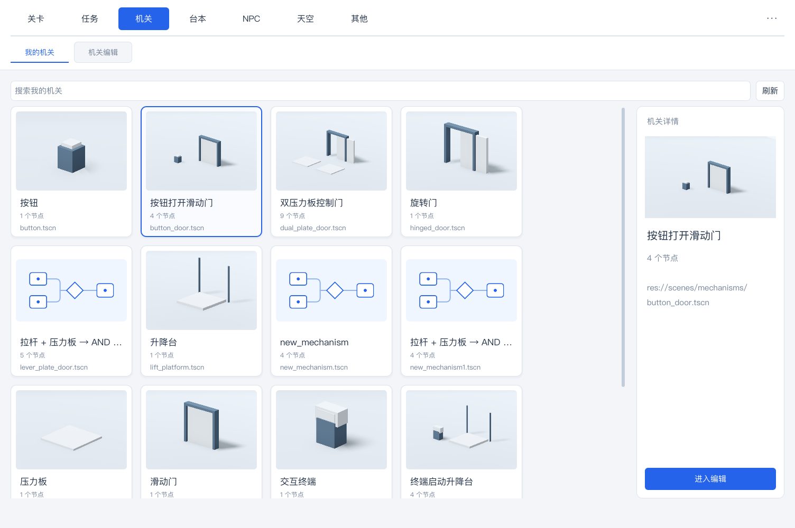

# 首批机关验证 · 2026-11-16

## 交付

- 七种基础素材：按钮、拉杆、压力板、滑动门、旋转门、升降台、交互终端。
- 三种可编辑组合：按钮打开滑动门、双压力板控制门、终端启动升降台。
- 机关图新增 20 种节点（包含七种组件），任务与常驻关卡图新增 11 种机关触发、判断、等待和动作节点。
- 支持初始状态、自定义状态及转换规则、实例与组件下拉绑定、隔离预览、真实碰撞、撤销重做、保存重开和静默状态恢复。
- 名称与生成器均去掉“白盒 ·”“示例 ·”前缀。内部稳定 ID 和已有用户资源不随显示名称变化。

## 检查结果

Godot 4.7.1 / macOS / Metal。功能验证在 `/tmp/branch-mechanisms-validation-VKdtDd` 的独立副本运行；旧版本对照在 `/tmp/branch-mechanisms-baseline-9u9hou` 运行。

| 检查 | 结果 | 日志 |
|---|---|---|
| 首批机关运行 | 74/74 | [runtime](runtime.log) |
| 新编辑器功能 Headless | 19/19 | [editor_headless](editor_headless.log) |
| 新编辑器功能与 Metal 布局 | 20/20 | [editor_metal](editor_metal.log) |
| 三个完整试玩目标 | 3/3 | [demo_metal](demo_metal.log) |
| 十份素材与组合缩略图 | 成功 | [preview_render](preview_render.log) |
| 原机关运行回归 | 48/48 | [legacy_runtime](legacy_runtime.log) |
| 原任务运行回归 | 49/49 | [task_legacy](task_legacy.log) |
| 通用任务节点回归 | 90/90 | [task_expanded](task_expanded.log) |
| 原机关画布回归 | 32/33 | [legacy_editor](legacy_editor.log) |
| 恢复本次修改前机关代码的对照 | 同一项失败，32/33 | [legacy_editor_before](legacy_editor_before.log) |

运行检查包括真实玩家交互、按钮复位与单次使用、门中途反向、升降台停止、请求与实际到位分离、状态／动作事件、两个同源实例隔离、真实玩家／配重压板、升降台实际载人、真实事件执行器、未接任务时的常驻机关逻辑、等待已达状态／超时／目标消失以及恢复不重复触发。

编辑器检查覆盖七种素材目录、三维绑定、初始状态与转换选项、组件配置与新节点撤销重做、复制组件的新 ID、隔离预览、成对保存重开、关卡组件与状态下拉框、引用校验及标准窗口布局。已人工查看 Metal 截图。

原画布失败项是 `default node layout leaves visible space for connecting wires`。使用本轮开始时备份的机关代码、同一份用户机关图，在独立副本中复现同一失败；该机关图 SHA-256 与本轮开始时一致。本轮没有为了通过断言重排用户节点。原有退出时 debugger 清理提示和单个 ObjectDB 实例清理警告保留，未计为功能失败。

运动体在编辑模式直接更新姿态，在游戏中才启用 `sync_to_physics`，确保编辑器线程正常运行，同时让真实角色跟随升降台运动。

## 资源保护

本轮开始记录的 60 份资源有 59 份保持一致；同期 `scenes/levels/5_adwa.tscn` 有外部编辑变化，保留当前内容。所有既有机关资源与用户工作簿保持一致。新增素材、任务模板、试玩关卡与预览单独写入新路径，默认主入口未改变。详见 [SHA-256 对照](resource_integrity.json)。

## 操作与截图

打开 `scenes/levels/mechanism_whitebox_v1.tscn`，F6 试玩。素材与节点操作见 [使用说明](README.md)。



[按钮开门编辑](按钮开门编辑.png) · [组件状态配置](组件状态配置.png) · [任务等待到位](任务等待机关状态.png) · [初始试玩](试玩初始.png) · [三个目标完成](试玩目标完成.png)

## 重现命令

在独立副本执行：

```sh
Godot --headless --path PROJECT res://tools/mechanisms/whitebox_v1/test_runtime.tscn
Godot --headless --path PROJECT --editor -- --whitebox-mechanism-editor-test
Godot --path PROJECT --editor -- --whitebox-mechanism-editor-test --capture
Godot --path PROJECT res://scenes/levels/mechanism_whitebox_v1.tscn -- --whitebox-demo-capture
```
