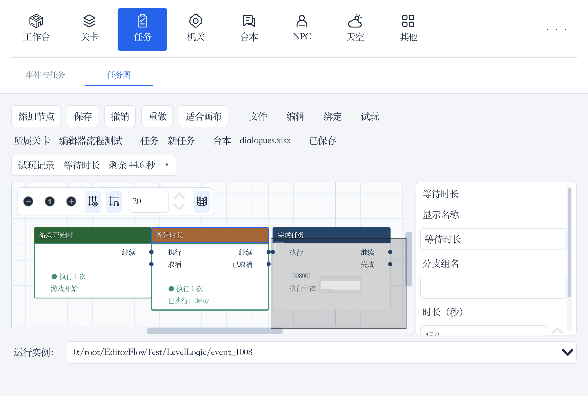

# 配表保护与任务试玩验证

2026-11-19，在 macOS 和 Godot 4.7.1 独立副本中验证。关卡、配表和测试事件使用副本或临时工作簿。

| 检查 | 结果 |
| --- | --- |
| 台本文件从界面打开、新建、保存、外改冲突及恢复 | 59 项通过。打开草稿后模拟外部写入，界面保留草稿，原文件哈希不变。点击放弃并重读可继续编辑，另存保留额外表、列及独立备注行。 |
| Excel 文档往返 | 使用 openpyxl 生成带附加工作表、单元格批注、字体、公式、数值和稀疏备注行的工作簿。对白改字并重新排序后，独立读取确认附加公式、样式、批注、数值类型和行坐标保持。原有 OOXML 文件中只有对白工作表 XML 的内容变化。再次打开旧草稿时的外部改字受到保护。 |
| 事件与关卡配表 | 两种模型分别在临时工作簿保存，附加工作表和对应记录的备注列保留。再从外部改写同一份文件，旧草稿保存受阻，磁盘版本和草稿均保留。 |
| 任务归属、工具栏、点击定位 | 34 项通过，覆盖当前关卡／任务／台本、空选择收起参数、运行记录和等待理由、定位与结束后的上次试玩记录。 |
| 任务节点、延迟与汇合 | 94 项通过，含真实等待时间、未满足的汇合输入及条件节点、执行顺序和恢复。 |
| 套件运行、旧台本兼容 | 套件运行 49 项，对话模式 34 项通过，旧表缺少对话模式列时正常读取并补列。 |

## 从另一张地图启动任务试玩

在副本中给登记的关卡建立一个验证任务，常驻图在开始时接取该任务。切到另一个原生地图标签，再从任务图启动试玩。Godot 实际 F6 子进程打开了所属关卡；运行器上传等待节点和剩余秒数。点击记录后，画布选中了对应节点，右侧显示该节点的时长参数。headless 编辑器和 Metal 编辑器都执行了此流程，测试游戏进程使用 headless，截图取自实际 Metal 编辑器窗口。

最早的临时任务夹具缺少连线 ID，运行器拒绝启动。补上合法连线 ID 并由常驻图接取任务后，完成上述 F6 和定位检查。日志仍可见既有字体静态初始化及 Godot 编辑器退出时的调试器提示。没有使用桌面 Excel 自动化，工作簿内容由独立 OOXML 读取器复核。

本次界面沿用“所属关卡”“任务”“台本”“保存”“添加节点”“适合画布”等既有中文，新增“试玩记录”“另存草稿”和“保留草稿”，节点和配表 ID 沿用原协议。
