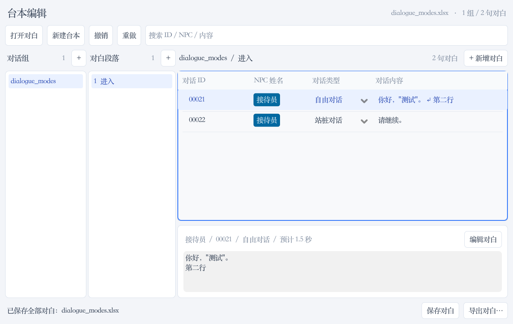
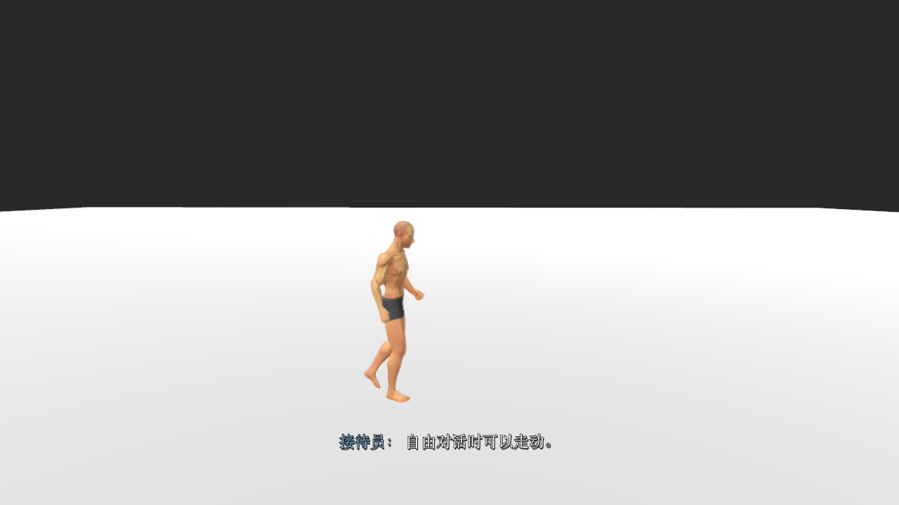
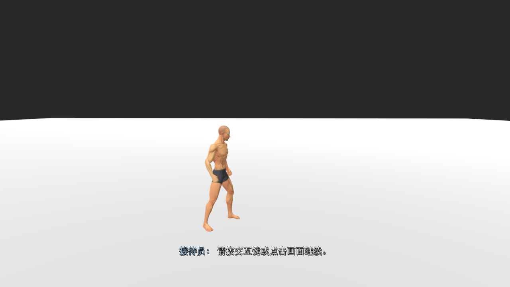

# 自由对话与站桩对话验证

2026-11-16，Godot 4.7.1，macOS。所有文件读写和运行测试均在独立工程副本及专用用户数据范围内完成，未写入真实配表、旧台本或用户关卡。

## 行为与兼容

- 台本内容前新增“对话类型”列，原生下拉可选自由对话、站桩对话；详情可修改，支持撤销／重做，ID 保持。
- 自由对话保留真实玩家移动，按阅读估算逐句自动播放；站桩对话限制玩家输入，等待 F、Enter 或点击。没有全局暂停，混合段落按每句切换输入状态。
- XLSX 的 dialogue_mode 为可选列；旧表缺列默认 free，下次保存写入。原台本分类和文本保留，导出签名包含模式变化。
- 自由对话估算按非拉丁字符／拉丁词组及标点停顿计算；2.5 秒最短，不再用 18 秒上限截断长句，已有正数时长覆盖继续有效。
- 开句输入、长按重复不跳句，末句 F 不同时触发邻近交互；结束时保留原鼠标状态，失焦不自动抢回，外部暂停不被解除。

## 实测结果

| 验证 | 结果 |
|---|---|
| 编辑器 headless，首次保存／打开、坏文件、类型、原生下拉、撤销及 XLSX 回读 | 55 项通过 |
| 原生编辑窗口 Metal 渲染，同项回归及 4 张截图 | 59 项通过 |
| 真实角色、镜头和对白播放 headless | 34 项通过 |
| 同一运行场景 Metal 渲染及两种字幕截图 | 36 项通过 |
| 既有第三人称相机回归 | 24 项通过 |
| 既有事件、任务、NPC 互动、对白完成回归 | 49 项通过 |
| Wiki 严格构建、链接与搜索检查 | 通过，无当前指南错误 |
| Chromium 实际页面，桌面及 390px 窄屏 | 标题、类型表和截图正常，无横向溢出或脚本错误 |

编辑器验证实际打开 Tree 下拉菜单并提交选项，检查模式进入编辑事务。运行验证通过 Input 事件与物理帧驱动实际角色，检查自由移动、站桩停止、自动／手动顺序和 comment 完成边界。

原生 UI 测试期间，其他窗口取得焦点会导致自由移动检查停止输入，这符合已有失焦保护。已保留失败日志；渲染测试将系统焦点变化与脚本输入回放隔离，失焦／恢复另以明确调用测试。headless 与渲染均检查失焦后不自动抢回。渲染结果不作为操作系统键鼠跨窗口测试，该次失败未归为产品逻辑缺陷。

## 复查命令

```sh
python3 tools/narrative/run_dialogue_files_qa.py --output .validation/dialogue-modes-2026-11-16/editor
python3 tools/narrative/run_dialogue_files_qa.py --render --output .validation/dialogue-modes-2026-11-16/editor-render
python3 tools/narrative/run_dialogue_modes.py --output .validation/dialogue-modes-2026-11-16/runtime
python3 tools/narrative/run_dialogue_modes.py --render --output .validation/dialogue-modes-2026-11-16/game-render
python3 tools/wiki/wiki.py check
```

完整日志位于 `.validation/dialogue-modes-2026-11-16/`。命令会创建独立副本，不占用原工程 `.godot`。术语沿用用户指定的“自由对话／站桩对话”，与原“台本分类”区分，未增加游戏内分类或状态文字。

## 实际画面






