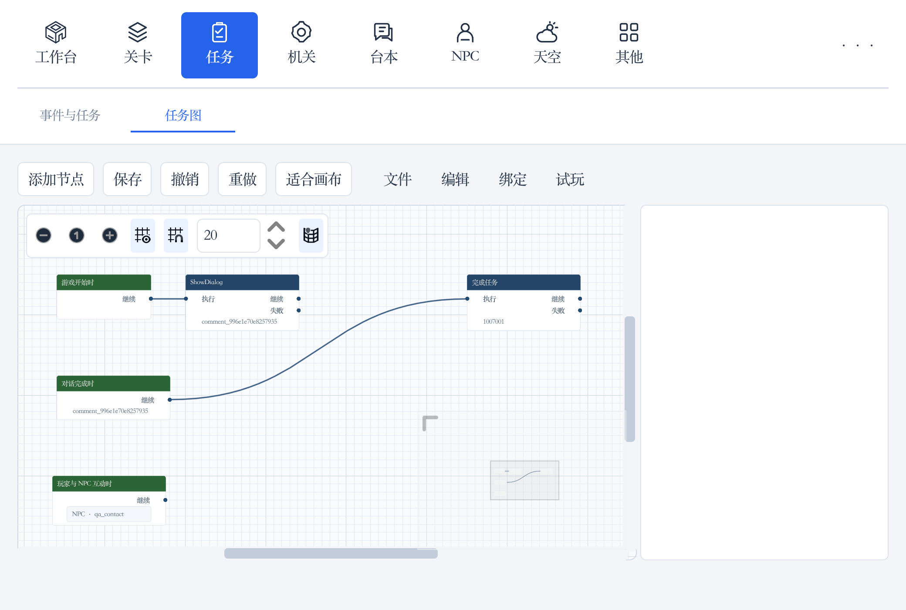

# 任务与台本结构迁移验证 · 2026-11-17

本轮验证插件完整目录结构与 Godot 原生地图工作流。未修改任务／对白执行器、玩家、镜头或作者作品；更新的是验证入口及记录。测试在开发工程副本和仅安装插件的空工程副本中串行运行，使用独立用户目录。作者原始 `content/` 的 69 个文件 SHA-256 均未改变。

## 结果与证据

| 检查 | 结果 | 证据 |
|---|---|---|
| 开发工程：新建原生继承地图、首次另存、任务地图选择、台本与任务作者流程、F6 | 31 项通过，运行态 7/7 | [开发流程](development-flow-5.txt) |
| 仅插件空工程：相同完整流程，headless | 31 项通过，实际 F6 运行态 7/7 | [空工程流程](empty-final.txt) |
| 原有 narrative smoke 入口适配 | 31 项通过，F6 7/7 | [smoke](smoke-final.txt) |
| 当前任务归属／节点矩阵 | 29/29、104/104 | [归属](owner-current.txt)、[节点](nodes-current.txt) |
| 原有配表、任务资源和地图 ID 审计 | 原有 13 个任务可载入；含 QA 共 14 个任务；21 个图无校验消息，地图 ID 一致 | [审计](migrated-audit-final.txt) |
| 原有 47 节点任务流程，实际 F6 | 11 项编辑器断言通过，12 个原录制器终态全部通过 | [流程](migrated-final-2.txt)、[运行态](development-narrative-migrated-runtime.json) |
| 关卡／机关原生窗口鼠标事件 | 56/56 | [鼠标事件](live-native-manual.txt) |
| 空工程渲染任务图与 F6 | 两条拖线、撤销重做、保存重开通过；总体 30/31，F6 接取汇总未通过 | [渲染日志](empty-metal-verified.txt)、[未通过的运行态](empty-narrative-structure-runtime.json) |

47 个节点包括常驻图 4、装备任务 12、机关任务 12、并行任务 15、子图 4。三个原任务保存前后语义哈希保持；最终十二项状态与原人工记录一致。探针只移动测试玩家并输入交互动作，没有调用任务／事件完成 API。

## 操作覆盖

先以原生继承场景另存新地图，确认稳定关卡 ID 在打开事件页之前已经登记，再通过真实表单新建台本、事件与任务。台本首次保存进入路径选择器，使用 `content/tables/` 的新 XLSX，原工作簿保持；重开后保留 comment／对白 ID 和自由／站桩模式。任务通过所属关卡选择器绑定新地图，图保存到 `content/resources/task_graphs/`。

任务图添加对白与对白完成节点、填写参数、连接端口，验证撤销重做及保存重开；先切到未登记图，再切回原任务，检查任务归属恢复。NPC 对象框走真实场景树 payload 的拖放接收函数；这项覆盖接收与持久化，不等于操作系统跨窗口拖放。

关卡／机关 56 项通过原生窗口的鼠标按下、移动、松开和点击控件执行，没有直接发射连线信号。检查事件／布尔／数值／对象端口、拒绝错误类型、修改参数、缺少必需输入时拒绝保存、撤销重做、读盘及切换原生场景后的重绑定。旧验证入口已改为原生继承地图与首次另存，保留原有断言。

headless 连线明确使用回调检查；渲染任务图及 56 项矩阵使用合成原生窗口鼠标事件。CUA 只能选中用户原有的同 bundle Godot 进程，未能独立选中 QA 进程；因此没有宣称操作系统物理鼠标拖线通过，也未操作用户正在编辑的场景。

## 未通过项与限制

空工程渲染 F6 能启动有效任务服务和正常角色，NPC 也允许交互，但首次合成 F 没有激活任务，因此后续对白和完成断言未通过。等待焦点及按正常路径点击恢复操作没有消除此现象；根因尚未确认，不能当作完整渲染链通过，也没有据此修改产品行为。headless 新建链和原有 47 节点 F6 链的通过结果单独保留。

渲染拖线的早期失败来自测试摆放过近的端口和事件时序。让卡片留出间距、按实际控件位置设置视图并等待布局后，两条原生连接请求和持久化边均出现；未修改 GraphEdit 产品代码。

日志保留字体静态初始化／远程调试启动、旧开发样例 UID 回退文本路径、退出时 debugger／ObjectDB 等警告；空工程渲染 F6 启动还有引擎 List.erase 提示。功能断言通过不代表控制台零警告。

当前开发副本与 [源文件清单](tested-source-hashes.json) 中的产品文件一致；空工程渲染副本与之后的四个共享界面文件有差异，见 [副本比较](source-copy-comparison.json)。任务／台本界面和运行源码一致。该记录不替代发布总控对最终插件包的空工程验证，也不表示穷举了所有作者任务路径。

本次新增和修改的用户可见名称沿用“关卡编辑”“台本”“任务图”“联络员”“检查任务”等已有自然中文；稳定 ID、节点 kind 和用户资源未改名。工具仅更新当前入口，不恢复历史地图卡片工作流。
