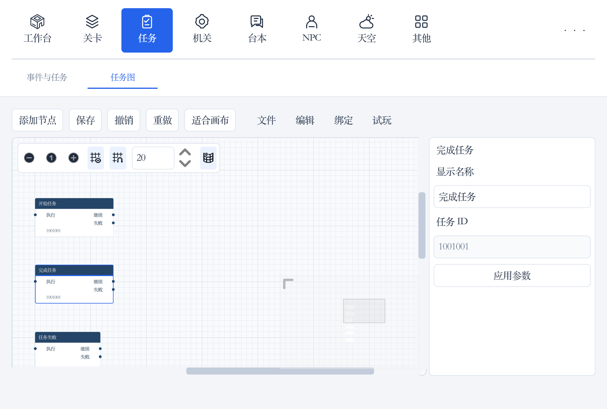
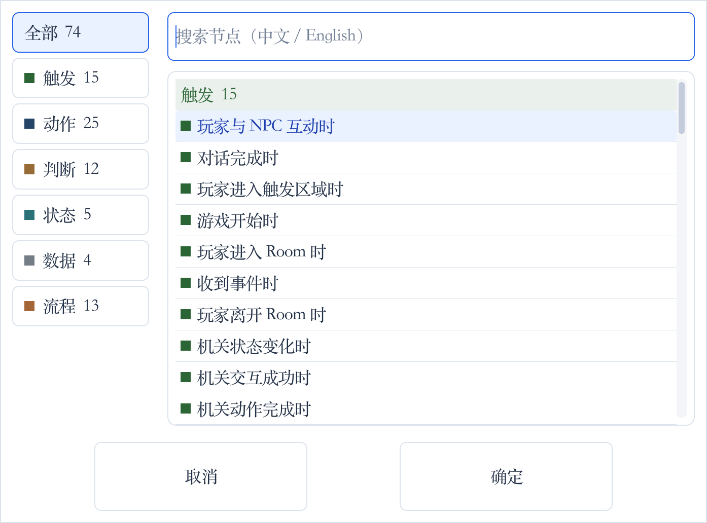
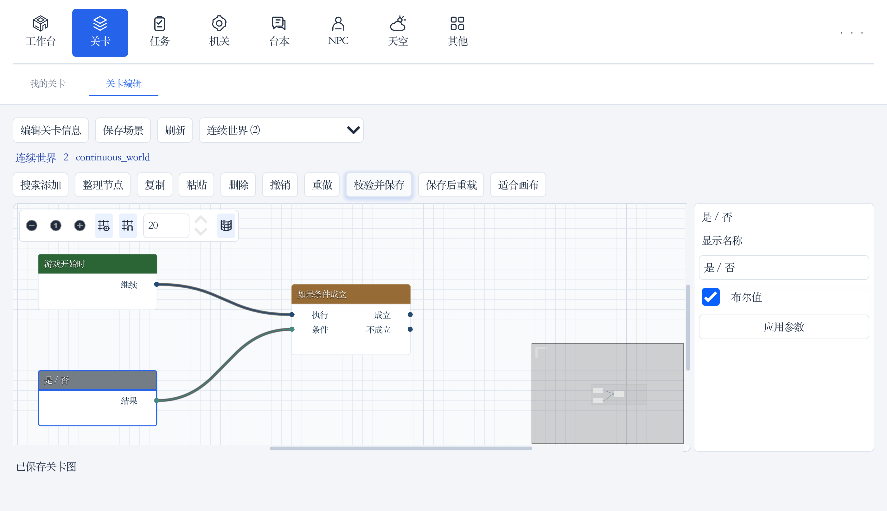
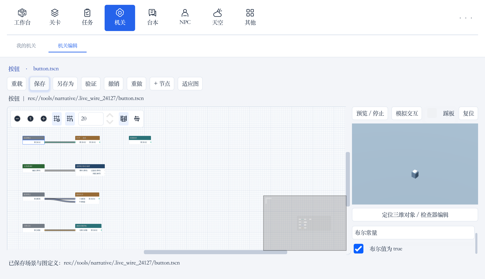
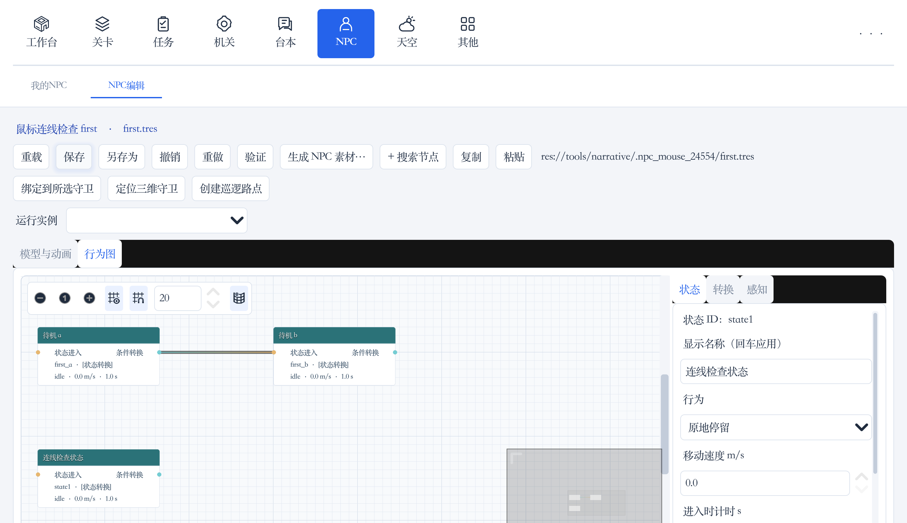

# 任务图操作、分类与所属任务校验 · 2026-11-16

本轮在 `/tmp/branch_task_owner_20261116/project` 独立副本中验证。副本拥有独立 `.godot`，临时关卡、机关和任务均为测试夹具；没有修改用户关卡、机关源文件或工作簿。未调整字体。

## 变动

- 顶部左侧保留添加节点、保存、撤销、重做、适合画布；其余入口归入文件、编辑、绑定、试玩菜单，继续调用原操作。
- 添加节点窗口改为常驻分类按钮：全部、触发、动作、判断、状态、数据、流程。全部结果分组显示，图中职责色同步用于标题和图标；支持中文、英文和 kind 搜索、双击添加，空结果不可确认。
- 已绑定任务图的五类本任务节点自动同步 `params.task`，包括粘贴和保存前检查。独立文件只按事件表中唯一匹配的路径恢复绑定；不猜测歧义归属，不改节点 ID，不自动写盘。
- 关卡图通过 `_can_offer_node` 在搜索分组前执行白名单，仍排除任务专用生命周期动作。

## 验证与证据边界

| 检查 | 结果 | 证据 |
|---|---|---|
| 任务归属、打开／粘贴／撤销重做、菜单、分类搜索 | headless 29 项通过 | [日志](owner-headless.log) |
| 同项检查及实际渲染布局 | Metal 30 项通过 | [日志](owner-metal.log) |
| 连续打开任务图、未保存处理、独立文件打开 | headless 13 项通过 | [日志](switch-headless.log) |
| 常驻关卡图回归（程序化编辑） | headless 19 项通过 | [日志](level-headless.log) |
| 机关画布、参数、撤销、保存重开及运行会话回归（程序化编辑） | headless 34 项通过；不计为鼠标连线验证 | [日志](mechanism-headless.log) |
| 关卡与机关窗口鼠标操作（解锁后完整复测） | Metal 55 项全部通过：搜索、双击创建、四种端口拖线、必填输入提示、错类型拒绝、参数、撤销重做、保存重开与切回原图 | [完整日志](mouse-complete.log) |
| NPC 状态图回归（程序化编辑） | headless 42 项通过 | [日志](npc-headless.log) |
| NPC 状态图窗口鼠标操作 | Metal 16 项通过：端口拖线、撤销重做、搜索添加行为、键盘改名、保存重开，以及第二份定义连线保存、第一份文件不被改写 | [日志](npc-mouse.log) |

早期的 [部分阶段日志](mouse-partial.log) 和 [窗口阻塞日志](mouse-blocked.log) 保留为历史证据。用户解锁后完成了 55 项完整复测。期间修正了测试脚本的滚轮释放事件和前台焦点管理，并用鼠标补齐比较节点的第二个必填输入；未据此修改机关的校验规则、运行逻辑、参数滚动区或图格式，没有复现缺少任务标识、连线不落盘或切回图后仍引用旧图的问题。

窗口检查使用 `Window.push_input` 发送鼠标按下、移动、释放和键盘事件，并从画布端口坐标拖线；不直接调用连线方法或发出 connection_request 来替代鼠标连线。场景建立、初始引用及布局属于夹具设置。机关通用对象引用预先绑定到夹具的按钮；此项不声称验证了绑定下拉框的鼠标选择。

窗口检查覆盖代表性节点和端口组合，不表示穷尽了所有用户资源或所有节点参数组合。`run_mouse_editor_checks.py` 只为本次启动的测试进程维持 macOS 前台焦点，检测到锁屏即退出；不控制其他 Godot 进程。

NPC 的既有 headless 画布检查原先依赖“上次编辑器打开的是三维样例”，在独立副本打开其他场景时只完成前半段。检查入口现明确打开 `tools/enemy_editor/fixtures/guard_blueprint_sample.tscn` 后再执行，42 项全部通过；未更改 NPC 行为、状态端口或资源格式。

退出仍出现既有 debugger 未附加和 ObjectDB 泄漏提示；功能断言通过不等于退出日志零警告。

Wiki 构建与检查通过：18 页、1189 条本地链接、49 处图片引用，错误列表为空。构建器仍提示既有专项页锚点信息，不属于本轮新增链接错误。文件哈希见 [源码记录](source.json)。

## 复现

先在独立项目副本导入资源，再运行：

```sh
/Applications/Godot.app/Contents/MacOS/Godot --headless --path <副本> --editor -- --godot-level-editor-suite-test --task-switch --task-owner
/Applications/Godot.app/Contents/MacOS/Godot --path <副本> --editor -- --godot-level-editor-suite-test --task-switch --task-owner --capture
/Applications/Godot.app/Contents/MacOS/Godot --path <副本> --editor -- --godot-level-editor-suite-test --task-switch --live-wire
python3 tools/narrative/run_mouse_editor_checks.py --project <副本> --log /tmp/mouse-check.log
python3 tools/narrative/run_mouse_editor_checks.py --project <副本> --log /tmp/npc-mouse-check.log --npc
```

最后一条要求桌面解锁并让测试 Godot 窗口取得前台焦点；无法取得焦点时返回环境阻塞，退出码 2。不要在用户资源原目录运行会创建夹具的编辑器检查。

## 实际渲染











