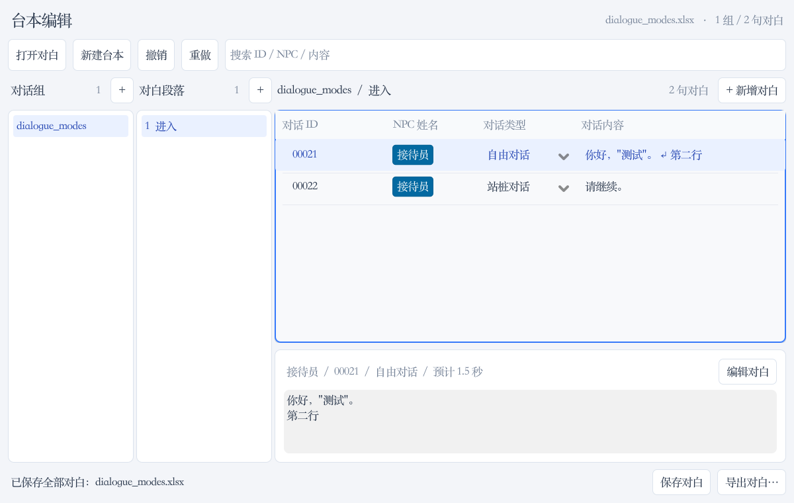

# 设置自由对话与站桩对话

准备：打开独立 GodotLevelEditor 窗口，进入 **台本**。已有 XLSX 和旧 `.tres` 台本均可打开；旧资源保存时选择 XLSX 目标。

## 选择每句的对话类型

1. 选择左侧对话组，再选择其中的对白段落（Comment）。
2. 右侧表格按 **对话 ID → NPC 姓名 → 对话类型 → 对话内容** 显示。
3. 点击“对话类型”单元格的下拉菜单，选择 **自由对话** 或 **站桩对话**。也可双击对白，在详情中修改。
4. 点击 **保存对白**。首次选择 `.xlsx` 路径，之后直接写回该文件。

| 对话类型 | 玩家操作 | 下一句如何开始 |
|---|---|---|
| 自由对话 | 可以走动、转动镜头 | 当前句达到阅读时长后自动继续 |
| 站桩对话 | 暂停玩家移动和镜头操作，场景继续运行 | 按 F、Enter 或左键点击游戏画面 |

一个段落内可以混合两种类型。切到站桩句时停住玩家，切回自由句时恢复原来的控制状态。播放到当前段落末尾后结束，不自动进入其他段落。按住交互键不会连续跳过多句，开启对话的那次输入也不会跳过第一句。

游戏字幕继续只显示 NPC 名称和对白内容。原有“引导、对白、提示”是台本分类，与这里的对话类型分别保存。

## 自由对话的时长

默认“显示秒数”为 **0**，按文字估算：非拉丁文字约每秒 5 个字符，英文与数字按词组约每秒 3 组；逗号、句号、换行等增加停顿。每句至少显示 2.5 秒，长句按实际长度延长。

详情下方可设置正数秒数，覆盖该句自由对话的估算时间。站桩对话的秒数输入禁用，始终等待手动推进，不因时间到达而结束。

## 保存与兼容

`对白` 工作表新增 `dialogue_mode` 列，`free` 对应自由对话，`stationary` 对应站桩对话。旧 XLSX 缺少该列时按自由对话读取，下一次保存会写入该列。已有 ID、顺序、角色颜色、文本和台本分类保持。

对话类型修改支持撤销与重做。打开或保存失败时，当前台本和未保存内容保留。切到编辑器后，点击游戏画面恢复控制；如果对话开始前鼠标已经释放，结束后不会自动抢回焦点。

当前实现与实际验证见 [台本接口](../../narrative_editor/INTERFACES.md) 和 [验证记录](../../narrative_editor/dialogue_modes_2026-11-16/validation.md)。
