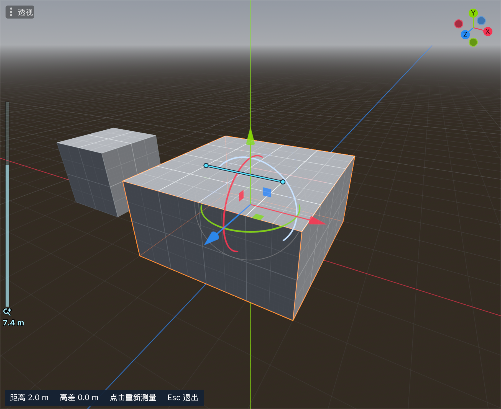

# Levels and the quick-add wheel

Maps are ordinary Godot scenes. Open, organize, save and play them using the native editor.

## Open or create a level

In the separate window, choose **关卡 → 我的关卡** (Levels → My Levels) to browse the project's native `.tscn` maps. Search by name, ID or path. Click a card to see its path, sky and existing index metadata; double-click it or choose **打开场景** (Open Scene) to build in the native 3D viewport. Use **编辑常驻逻辑** (Edit Persistent Logic) to open the map and its graph. **定位场景文件** selects the map in FileSystem.

**新建关卡** (New Level) opens an unsaved native inherited scene from the addon's empty template. Use Godot's **Scene → Save As** to save in `content/scenes/levels/` or another project directory outside the addon. The first native save registers the stable ID used by tasks. Existing unregistered map files are also browsable; open and save them to register their IDs.

**关卡 → 关卡编辑** (Level Editing) shows the current scene's persistent logic and actual bound sky name. Both secondary entries remain available on the Level page. Switching between them preserves unsaved graph edits and UndoRedo. If no valid level is open, the page provides guidance. Clicking Levels after a script update also repairs missing entries in an existing window.

Select a 3C configuration in **关卡编辑 → 玩家预设** (Level Editing → Player Preset). Save the scene and press F6. See [Player 3C presets](player.md).

## Stage a scene on the timeline {#performance}

1. Open your level in Godot and choose **关卡 → 关卡编辑 → 演出时间轴** (Levels → Level Editing → Performance Timeline). Select **新建演出** (New Performance).
2. Frame a shot in Godot's native 3D viewport, return to the timeline and choose **从视口取景** (Capture Viewport Camera). Drag the clip to change its start or drag its right edge to change its length. Shots hard-cut. The player's normal camera displays between shots.
3. Drag a placed NPC from the scene tree to the **NPC** field or pick it in **选择 NPC**. Add **设定站位**, **移动到**, **转向**, or **播放动作** (Placement, Move To, Face Toward, or Play Animation). For position and direction, click a point in the 3D viewport. Add intermediate points to steer a move around corners. The actor follows that route at the speed implied by the clip length. Choose an animation available on that NPC's model.
4. Click or drag on the ruler to preview the corresponding frame. Playback starts at the playhead, and **停止预览** (Stop Preview) closes the temporary preview. **保存关卡** (Save Level) saves the timeline with the scene.
5. In the persistent level graph or a task graph, add **播放演出** (Play Performance), choose the sequence in its parameters and apply the change. For example, connect **玩家进入 Room 时** to **播放演出**, then use **完成时** for the next action. Save and press F6.

The default player controls depend on the sequence. Shots give the performance control of the camera and lock gameplay input. NPC-only sequences leave the player in control. The original camera returns at the end, and NPCs stay where the sequence left them. Dragging and trimming snap to 0.1 seconds. Overlap is allowed between different tracks, so an action can accompany a move.

Layout, scene organization, Inspector editing, file saving and F6 remain native Godot operations. The browser reads real map files and their existing index metadata. Native saves, moves and deletions refresh the list; **刷新** also refreshes it manually. See the [level browser checks](../../godot_level_editor_suite/level_browser_2026-11-17/validation.md).

## Add objects with the wheel

1. In the native 3D viewport, click **呼出轮盘**, tap backtick, or tap the mouse side button.
2. Choose **白盒体块** (Whitebox Shapes) for geometry or **触发区域** (Trigger Area) for a player-detection volume. Whitebox pages contain eight shapes; the wheel changes pages and middle-click advances one page.
3. Choose an asset, hover the ground, then left-click to place. R / Shift+R rotate by ±15°.
4. Right-click or Esc finishes placement. In a submenu, right-click returns to the parent wheel.

NPC and mechanism categories offer persistent/task-owned objects and **已有素材** (Existing assets). Task objects need a task belonging to the current level. The recently used list reuses prior asset choices.

Choose **载具** (Vehicles) for drivable presets. Use the Inspector to change the model or save a reusable preset. See [Vehicle presets](vehicles.md).

## Draw terrain {#terrain}

Open a level and choose **呼出轮盘 → 地形** (Quick Add → Terrain), or click **地形** in the 3D toolbar. The editor opens in top view. Use **透视 / 俯视** to switch between perspective and top view in the same viewport. The bottom controls show the dimensions for the current tool in meters.

| Tool | Use |
|---|---|
| **山峰** (Peak) | Move to preview and click to place. Set the height, footprint radius and round or steep profile. Move a second peak nearby to preview a connecting ridge. |
| **河流** (River) | Click from upstream to downstream, then press Enter or **完成河流**. Set the width and bed depth. Orange segments require a deeper cut. |
| **高原** (Plateau) | Drag a rectangle and release. Set the height and width of the shoulder slope. |
| **选择** (Select) | Click and drag control points or size handles. Pick a ridge, then drag the middle square to lower or raise the saddle, or click **断开山脊**. Double-click a selected plateau edge to add a vertex. |
| **预设** (Presets) | Choose **双峰山口** (Twin Peaks) or **高原河谷** (Highland River), then move to preview and click to place. The individual controls stay editable. |

Placing the first feature creates a base surface as well. Terrain takes over collision from the untouched floor supplied by the blank level template. Other whitebox shapes can still be used to build around it. Esc cancels a draft or returns to selection. Godot's native undo and save work with terrain, and the controls remain editable after reopening.

The whitebox river is a collidable bed with a blue guide in the editor. Use F6 to play. If a raised area covers the spawn, exit the terrain tool and use **玩家出生点** in Quick Add to move the spawn onto walkable ground, then save.

## Position, dimensions and precision

Use Godot's move, rotate and scale tools. **选中面 / 选中线 / 选中点** select a face, edge or point and place the manipulator at that element. Clear the selection to restore the object manipulator.

Enter the step directly or choose 0.1 / 0.5 / 1 m. Placement and editing share the step. The metric grid shows 1 m, 0.5 m and 0.1 m divisions and retains real scale after resizing.

Select one whitebox block to read its width, height and depth at the lower left of the viewport. Dimensions follow the block’s local axes and include its own and ancestor scale. While dragging a face, edge or point, the readout also shows the world distance travelled by its centre.

Click **测距** (Measure), then click two points on visible whitebox or model surfaces. A line marks the endpoints. The readout shows straight-line distance and signed height difference in metres. Move the pointer after the first click for a live preview. A third click starts a new measurement. Press Esc or click **测距** again to exit. You can navigate the camera between picks and measure positions between grid marks.

## Edit an instance or an asset

Instance transforms, model selection, faction, default animation and task ownership are stored on the scene instance. A source asset may be reused by many instances. Save built-ins as your own assets before changing them; user mechanism/NPC libraries are scanned alongside built-ins.

## Room triggers {#room-triggers}

A new Room is a 1×1×1 m box trigger. It does not block the player. Persistent Rooms are dark translucent green in the editor; task Rooms use lighter green. Dimensions, region material and whether activation remains after exit are Inspector properties.

The player's entry activates the Room before the entry event is emitted. Leaving the final occupant normally deactivates it. Level/task graphs can observe entry, exit and the current active state. Task ownership and region activation are separate: an inactive task's Room does not detect players.

## Scene organization

New NPCs, Rooms, mechanisms and whitebox objects are organized under `NPCs`, `Rooms`, `Mechanisms` and `Whitebox`. Native duplication remains undoable and assigns independent object identities where required. Existing content is not rearranged merely by opening it.

## Duplicate, move or remove {#copy-delete}

Use Godot's native Duplicate and FileSystem operations. The plugin follows native file/folder move and removal notifications to update its level index and task-graph file references. Stable IDs are retained on a move.

If a whole-map copy reports a duplicate level ID, save it again to assign an independent one; the original remains bound to its original tasks. Before deleting a task-bound map, update or remove the affected task binding. Native deletion does not run the old catalog's deletion-protection dialog, and invalid task references are reported by validation.

## Save and play

Save with Godot and use F6. A first save registers the level ID used by tasks. Persistent logic is saved with the map; task graphs and dialogue workbooks have their own save actions.

### Level thumbnails {#level-thumbnail}

With graphical rendering available, each native save of a registered map updates its My Levels cover using a fixed oblique bird's-eye view. Maps in custom project directories outside the addon are supported. Missing previews use a placeholder. Images live in the project's `content/resources/level_previews/` and are excluded from installation ZIPs. Capturing a preview does not change the map layout or current editor view; headless checks do not generate images.
