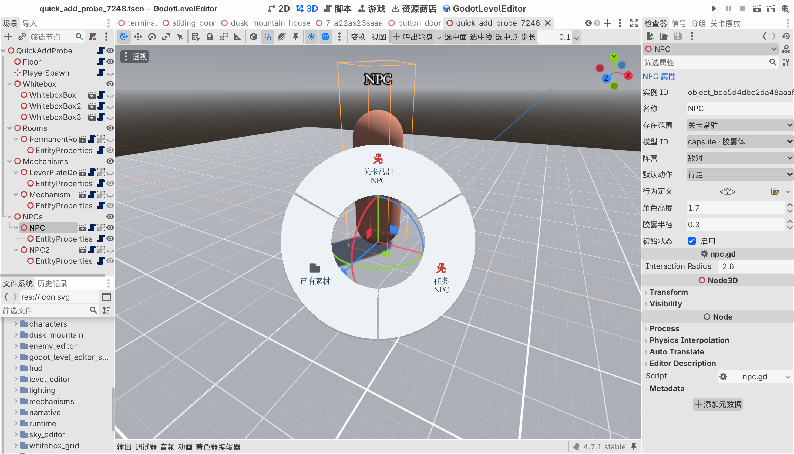
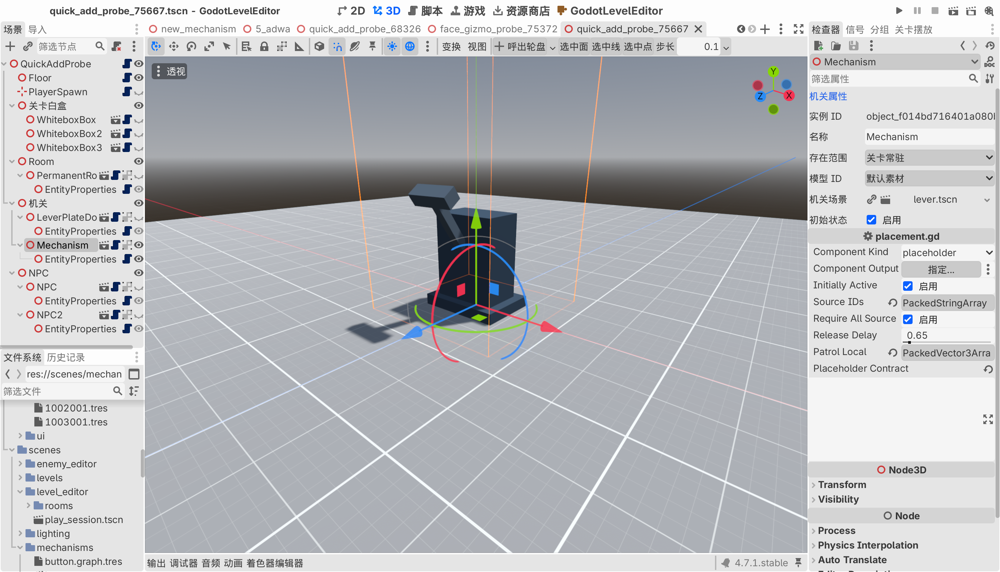

# 关卡与轮盘操作

本页用于查询日常摆放操作。第一次创建关卡请先读 [快速开始](../getting-started.md)。

原生右侧的“关卡摆放”旧侧栏已删除，其中的示例、旧房间新建／实例化、素材卡片和尺寸面板入口一并移除。现在从独立窗口管理关卡，通过原生 3D 轮盘摆放，在检查器修改参数，使用原生复制和保存；已有场景资源继续保留。实测见 [侧栏移除验证](../../level_editor/placement_dock_removed_2026-11-16/validation.md)。

## 选择当前关卡

在独立窗口点击 **关卡 → 我的关卡**，浏览项目中已有的原生 `.tscn` 地图。可按名称、ID 或路径搜索；单击卡片查看场景路径、天空和已有登记信息，双击卡片或点击 **进入编辑** 在 Godot 打开地图，并切到 **关卡编辑**。**定位场景文件** 在原生文件系统中选中地图。

**新建关卡** 打开插件空白模板的原生继承场景，随后使用 Godot **场景 → 另存为**，保存到 `content/scenes/levels/` 或插件目录以外的自选项目目录。首次原生保存登记任务使用的稳定关卡 ID；还未登记的已有地图也可浏览，打开后保存即可登记。

**关卡 → 关卡编辑** 显示当前场景的常驻逻辑图及实际天空名称。“我的关卡”和“关卡编辑”共用二级导航，切页保留图的未保存修改与撤销记录。未打开有效关卡时会显示操作提示；旧窗口更新后，重新点击“关卡”也会补齐入口。

布局、节点组织、检查器、文件保存与 F6 试玩均使用原生 Godot。浏览页读取真实地图文件及已有索引，不创建另一套地图数据。原生保存、文件移动或删除后列表同步；需要时可点 **刷新**。实际检查见 [关卡浏览验证](../../godot_level_editor_suite/level_browser_2026-11-17/validation.md)。

## 呼出轮盘并添加物件

1. 在当前关卡的原生 **3D** 视口中点击 **呼出轮盘**，或短按反引号／鼠标侧键。
2. 悬停选择玩家出生点、Layout 白盒、Room、机关、NPC 或最近使用。
3. 点击 **Layout 白盒** 进入体块轮盘，每页同时显示 8 个形状。滚轮向上／向下切换整页，点击所需体块进入放置。
4. NPC 和机关点击后，直接显示二级轮盘，选择 **关卡常驻** 或 **任务对象**；**已有素材** 打开现有场景列表，支持搜索。NPC 默认放置中体型男性模型；其他示例在已有素材中选择。Room 二级轮盘只有常驻和任务两项，直接添加触发箱。
5. 鼠标移动到放置位置，左键放置。可连续点击添加；右键或 Esc 结束放置。轮盘中右键返回上一级，再按呼出键可直接关闭。

轮盘中央透明，不显示预览圆或按钮；点击圆心不会选择素材。页码位于体块轮盘下方，也可按下滚轮切换到下一页。

| 操作 | 效果 |
|---|---|
| R / Shift+R | 放置预览正向 / 反向旋转 15° |
| 白盒轮盘中滚轮 | 翻到上一页／下一页，每页 8 个 |
| NPC／机关二级轮盘“已有素材” | 打开可搜索素材列表，使用对应编辑器已有的预览图 |
| 轮盘中右键 | 返回上一级；一级轮盘中关闭 |
| 再按呼出键 | 关闭轮盘 |
| 原生撤销 / 重做 | 撤销放置或实例属性修改 |

鼠标侧键是短按切换，松开不会自动选中素材。工具栏旁的下拉菜单可修改键盘呼出键。

轮盘素材库及“最近使用”的图片复用 NPC、机关编辑器已保存的缩略图；素材没有保存的预览图时才请求 Godot 生成预览。现有图片更新后按文件内容刷新缓存，不用通用节点图标替代已存在的素材图片。

## 调整位置、尺寸与精度

放置结束后点击物件，使用原生变换工具调整；实例配置在原生检查器中修改。工具栏步长可直接填写，也提供 `0.1 / 0.5 / 1` 预设，同步移动与轮盘放置。

白盒表面网格使用真实米制刻度：1 m 粗线、0.5 m 中线、0.1 m 细线。原生工具栏的 **选中面 / 选中线 / 选中点** 用于编辑对应元素，Esc 或空白取消子选择后恢复物体操作轴。

橙色、白边的白盒尺寸圆点已移除。调整物件使用原生移动、旋转、缩放操作轴，或检查器的尺寸参数；面、线、点选择继续可用。

## 选择素材还是配置实例

| 需求 | 在哪里修改 |
|---|---|
| 修改这一份对象的位置和朝向 | 当前关卡原生 3D 视口 |
| 修改 NPC 模型、阵营、默认动作或任务归属 | 选中实例后的原生检查器 |
| 修改这个 Room 的检测尺寸 | 实例检查器的宽 / 高 / 深 |
| 给占位机关指定组件场景 | 实例检查器的机关场景 |
| 修改可复用机关的连线与组件配置 | 机关 → 我的机关 → 对应素材 |

任务对象必须选择所属任务，且该任务属于当前关卡。只是测试按钮和门时，选择 **关卡常驻** 最直接。

## Room 触发区域 {#room-triggers}

Room 是一个检测玩家进入的箱体。新建时为 **1×1×1 m**，不带地板、墙或完整房间，不阻挡玩家通行。关卡常驻 Room 默认显示半透明深绿，任务 Room 默认显示半透明浅绿；颜色用于编辑时识别，试玩时检测区域不可见。

1. 呼出轮盘，点击 **Room**，选择 **关卡常驻 Room** 或 **任务 Room**，在地面左键放置。
2. 结束放置并选中箱体，在检查器设置名称及宽、高、深；需要时可指定区域材质。任务 Room 还需选择所属任务。
3. 在任务图或常驻关卡图中添加 **玩家进入 Room 时**，从场景树拖入对应 Room，或使用参数下拉框选择。把“继续”连到需要执行的效果，例如打开机关或显示物件。
4. 持续判断区域状态时，使用 **Room 是否激活**，将“结果”连到 **如果条件成立** 或 **等待条件成立** 的条件输入。勾选“期望已激活”检查已激活，取消勾选检查未激活。

| 节点 | 用途 |
|---|---|
| 玩家进入 Room 时 | 玩家进入箱体时发出一次事件，可设置本次运行只触发一次 |
| 玩家离开 Room 时 | 玩家离开箱体时发出事件 |
| Room 是否激活 | 读取当前状态，供条件判断和等待使用 |

默认进入后激活，最后一个玩家离开后恢复未激活；勾选实例中的 **离开后保持激活** 可在离开后保留状态。任务 Room 只有在所属任务运行时才启用检测，任务结束或失败后关闭并清除激活状态。若任务开始时玩家已经在箱内，也会检测并激活。

“启用检测”和“玩家激活”是两回事：常驻 Room 无需任务即可检测，但空箱体仍是未激活状态。缺少所属任务的任务 Room 不参与检测。已有完整房间资源保留，当前轮盘不再把它们作为新 Room 置入。

接口与实测见 [Room 触发区域验证](../../level_editor/room_triggers_2026-11-16/validation.md)。

## 自动分组

新添加的对象按类别进入场景根下的空父节点：

| 对象 | 分类节点 |
|---|---|
| NPC | `NPCs` |
| Room | `Rooms` |
| 机关 | `Mechanisms` |
| 关卡白盒 | `Whitebox` |

编辑器自动创建并复用这些父节点，已有物件保持原位。无需为了符合新分类手动迁移旧关卡。

## 复制对象与删除关卡 {#copy-delete}

选中物件使用 Godot 原生 Duplicate 与撤销重做；新实例按现有规则获得独立对象标识。地图文件的复制、移动和删除在 Godot 原生文件系统操作。

有任务绑定的地图，请先在任务表中修改或删除对应绑定。原生删除不执行旧目录的任务引用保护；任务校验会报告缺失地图。复制整张地图后如果提示 ID 重复，再保存一次可分配独立关卡 ID；原地图与任务绑定保持。

## 保存与重新试玩

使用 Godot 原生保存和 F6。新地图首次保存时自动登记任务使用的稳定 ID；地图可保存在插件目录以外的任意项目目录。常驻关卡图随场景保存，任务图与台本仍分别保存。

### 关卡缩略图 {#level-thumbnail}

有图形渲染时，已登记关卡每次原生保存后自动生成固定斜俯视角的鸟瞰图，并更新“我的关卡”封面。支持插件目录以外的自选地图目录；没有图片时显示默认封面。图片保存在项目的 `content/resources/level_previews/`，不会进入插件安装 ZIP，生成不会修改地图布局或当前视角。headless 检查不生成图片。
