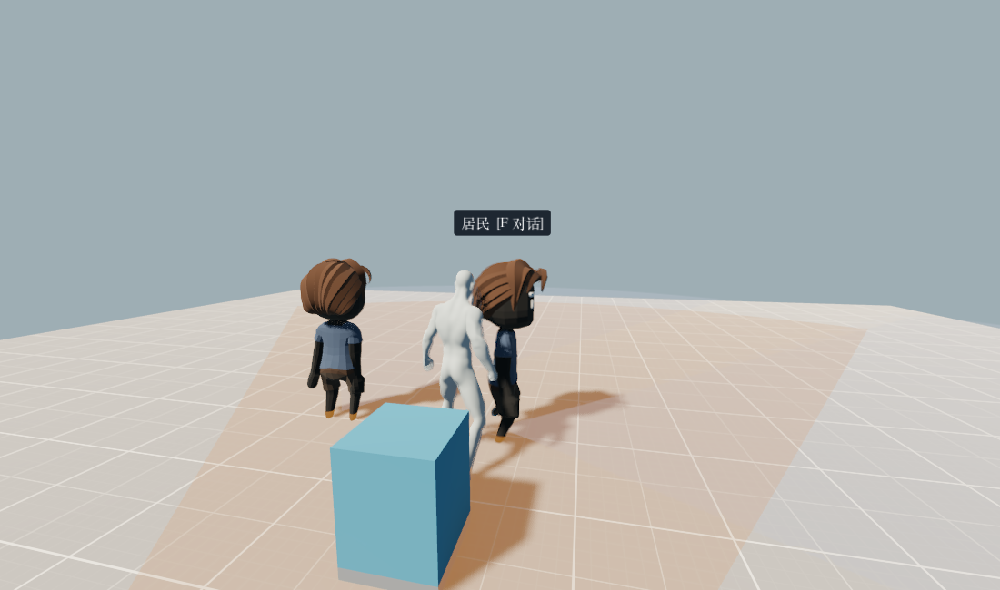

# NPC models and animation

The addon provides **13 rigged examples**: six humanoids, four animals and three monsters. Their original materials and textures are retained. The initial definitions are calm; seeing the player does not automatically trigger a chase.

## Included models

| Category | Models | Available source clips |
|---|---|---|
| Small humanoids | Male/female Goblins | 11 each, including Idle, Walk, pickup and sitting |
| Medium humanoids | Male/female Casual characters | 11 each |
| Large humanoids | Male/female Superheroes | 43 compatible Universal Animation Library clips |
| Animals | Cow, Horse | 6 each |
| Animals | Pug, Sheep | Idle and Jump; no Walk/Run in these examples |
| Monsters | Yeti, Cactus, Cyclops | 10 each |

The small characters are fantasy Goblins, not child/teen human models. All six humanoids use distinct source models. Editable example heights are 1.2 m for Goblins; 1.75/1.65 m for medium male/female; and 2.05/1.95 m for large male/female. These are convenient preview values, not anthropometric standards.

## Preview a model

Built-in NPC definitions are read-only: **Save** guides you to a personal copy under `content/resources/enemies/`. Generated placeable scenes default to `content/scenes/npcs/`, with collision and instance dimensions matching the chosen height. Imported personal models and textures are stored under `content/assets/characters/npc_imports/`; these files survive addon replacement.

1. Open **NPC → 我的NPC** and search by model name, such as Goblin, Casual, Superhero, Cow or Yeti.
2. Select a card for details; double-click or choose **进入编辑** to edit.
3. Open **模型与动画** (Model and animation). Drag to rotate and scroll to zoom. Bone display and hierarchy inspection are available.
4. Preview Idle/Walk/Run slots, choose another compatible clip or set a slot to none.
5. Use **另存为** (Save as) before changing a built-in definition. Save the definition and map before testing.

Target height belongs to that NPC appearance. Do not overwrite the original downloaded model simply to change the size of an instance.

## Poses and compatibility

Use humanoid T Pose for recognized human rigs, or natural/rest pose for animals and other skeletons. No selected clip means the preview does not allow source autoplay to take over.

Use the model's own clips or a library explicitly matched to its bone names, hierarchy and rest pose. Animation is not freely interchangeable among cattle, horses, Goblins and standard humanoids. Pug and Sheep have no walking cycle here; Jump is not used as a fake walk/run.

## Place an NPC

In the wheel, choose NPC, then persistent or task-owned scope and **已有素材**. Choose a model and left-click the ground. R / Shift+R rotate; right-click / Esc finishes. A direct persistent/task half-circle click places the medium male example.

You may also drag `addons/godot_level_editor/scenes/npcs/v1_*.tscn` from FileSystem into the native viewport. Definitions are in `addons/godot_level_editor/resources/enemies/samples_v1/`. Save personal definitions and scenes under the project's `content/` folders.

Task NPCs need a task from the same level and appear only while it is active.

## Give an NPC a route

Save a personal definition and scene first. Select the NPC root, use **绑定到所选 NPC** to bind the definition if necessary, set a state's behavior to waypoint patrol and use a positive movement speed. Create patrol points and move their `Marker3D` nodes in the native 3D viewport. Save both definition and map, then restart F6.

Movement along a route and animation playback are configured separately. Having a Walk clip does not create a route, and a route does not create a missing gait. Attack, pursuit and dialogue also require their own logic.

## Talk to a resident, then reach an exit {#first-conversation-task}

Start with a blank level saved in your project. This exercise uses a bundled resident, a trigger area and the project's default workbooks.

1. Place a persistent NPC from the 3D wheel. Select its instance in the scene tree, name it “居民” (Resident), and enable **NPC 属性 → 交互 → 允许交谈**. Place a persistent trigger area called “出口” (Exit) a few metres away. Put its box where the player can walk into it and save the scene. A resident with an existing patrol route can use the same instance.
2. In **台本**, use the default `content/tables/dialogues.xlsx`. Click **+** beside **对话组**. The new group includes a dialogue segment and its first line. Double-click the line, set the speaker to “居民”, enter a short request to walk to the exit, choose **站桩对话** and save the dialogue. Right-click the segment in the segment list and choose **复制 ID**. Keep this segment ID for the level graph.
3. In **任务 → 事件与任务** choose **新建事件** and retain the default manual start condition. Click **添加任务** on the event row. Name its first task “走到出口” and select your saved level. Save the table. Open this task's graph and connect the **继续** output of **玩家进入 Room 时** (`room_enter`) to the **执行** input of **完成任务**. Drag the Exit from the scene tree to the trigger area's field and save the graph. Reuse the completion node if it already exists.
4. In **关卡 → 关卡编辑**, connect **玩家与 NPC 互动时 → ShowDialog**. Drag the resident onto the NPC field and enter the segment ID in ShowDialog. Connect **对话完成时 → 接受任务**, use the same segment ID on the first node and choose “走到出口” on the second. Apply text parameters with **应用参数**, then save the graph and scene.
5. Press **F6**. Approach the resident, press F at **居民 [F 对话]** and press F again to finish reading. The task appears in the upper-left tracker. Walk into the exit box to complete it. When several residents are nearby, the hint identifies the one who will receive F. Use a persistent resident to offer the initial task. A task-owned NPC becomes available after its task has started.

## Troubleshooting

| Symptom | Check |
|---|---|
| Missing example | Refresh the library; check the samples_v1 definitions |
| Unexpected default model | Use Existing assets to choose a specific example |
| Preview stays still | Check the slot and available source clips |
| External animation rejected | Check skeleton compatibility |
| Animal pose looks humanoid | Use natural/rest pose |
| Task NPC is absent | Check level, ownership and active task state |
| Old behavior after editing | Save definition and map, stop play and restart |

## Sources and licenses

These examples were selected from specific Quaternius releases with retained CC0 evidence: Animated Characters Pack, Universal Base Characters Standard, Universal Animation Library Standard, LowPoly Animated Farm Animals and Textured Cute Monsters. Licensing evidence, source hashes, raw models and import snapshots are retained in `addons/godot_level_editor/assets/characters/`. The free base-character package is not treated as including paid Regular/Teen bodies.

Original [model import notes](../../enemy_editor/MODEL_IMPORT.md) and [NPC interface](../../enemy_editor/INTERFACES.md) provide the detailed contracts.
