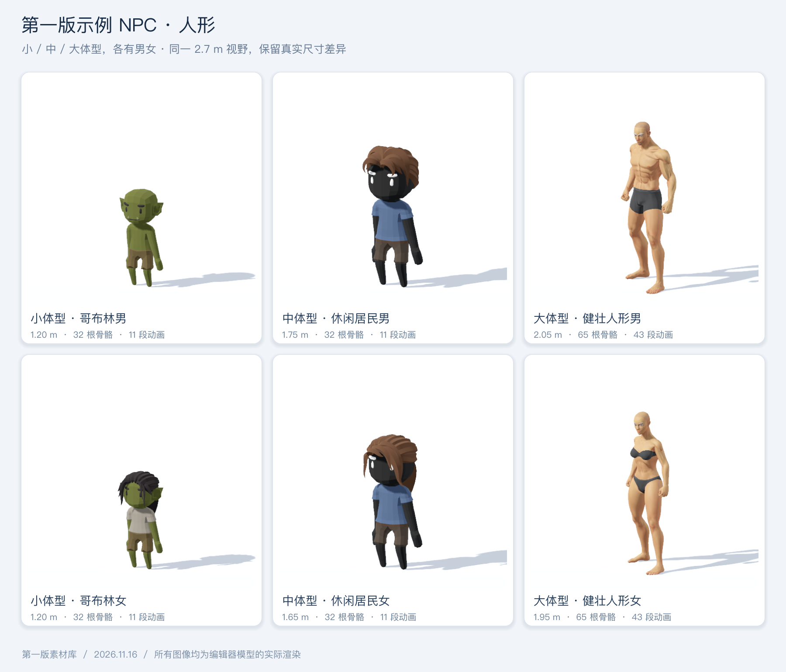
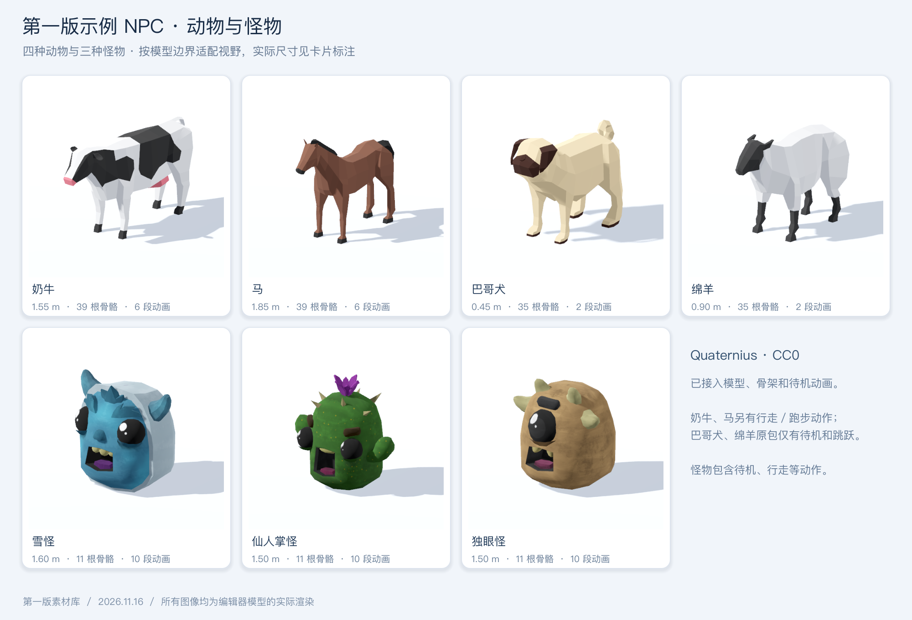

# 使用第一版示例 NPC

本批提供 **13 个带骨骼的示例 NPC**：6 个小／中／大体型的人形角色、4 种动物和 3 种怪物。准备好一个关卡场景后，可以先预览模型与动画，再把所选 NPC 放进关卡。

完成后应能看到：角色保留原材质与贴图，所选动画可以预览，保存的 NPC 场景能在关卡中重复使用。示例初始保持平静，不会因为看到玩家就自动追逐。

## 有哪些示例

| 类别 | 模型 | 可选动画来源 |
|---|---|---|
| 小体型人形 | 哥布林男、哥布林女 | 各自附带 11 个动作，含待机、行走、拾取和坐下 |
| 中体型人形 | Casual 男、Casual 女 | 各自附带 11 个动作，含待机、行走、拾取和坐下 |
| 大体型人形 | Superhero 男、Superhero 女 | 已接入 Universal Animation Library 的 43 个可用动作 |
| 动物 | Cow 牛、Horse 马 | 各自附带 6 个动作 |
| 动物 | Pug 巴哥犬、Sheep 羊 | 各自附带真实的 Idle、Jump 两个动作，没有 Walk／Run 步态 |
| 怪物 | Yeti 雪怪、Cactus 仙人掌怪、Cyclops 独眼怪 | 各自附带 10 个动作 |

小体型哥布林是幻想人形，不是普通人类的少年／少女模型。六个人形使用不同的原始模型；示例身高设为小体型男女各 1.2 m、中体型男 1.75 m／女 1.65 m、大体型男 2.05 m／女 1.95 m。这些是便于试用的可编辑值，不是人体尺度标准。

动画数量表示可以选择的来源片段数量，不表示所有动作都会自动触发。角色的移动行为、任务和对话仍需要各自配置。

行为图的“感知”页提供警觉累积、衰减、噪音初始警觉、求援半径和巡逻点停留。旧版“暴露能量惩罚”已不参与运行，因此不再显示；旧定义中的数值继续保留以兼容读取。

### 实际模型预览

人形采用同一视野展示体型差异；动物和怪物按各自边界取景，实际尺寸见卡片。

## 在 NPC 编辑器里预览

1. 打开独立 **GodotLevelEditor → NPC → 我的NPC**。
2. 在目录搜索模型名称，例如 `Goblin`、`Casual`、`Superhero`、`Cow` 或 `Yeti`。单击查看详情，双击或点击 **进入编辑** 打开资源。
3. 切到 **模型与动画**。拖动预览旋转，滚轮缩放；勾选 **显示骨骼** 可叠加查看骨架，**查看骨骼层级** 可展开骨骼树。
4. 点击 **预览待机／预览走路／预览跑步**，检查对应槽位实际选择的动画。右侧可以更换片段，也可以将它设为“无”。
5. 要修改示例时，先用顶部 **另存为** 保存自己的 NPC 定义，再继续调整并 **保存**。

模型页的 **角色身高** 控制这一份 NPC 外观的目标高度。原贴图与材质继续保留；不要为改变体型而直接覆盖下载的源文件。

### 不选动画时显示什么

**静止姿态** 有两个选项：

| 选项 | 用途 |
|---|---|
| T Pose（人形） | 人形角色在不播放动画时展开双臂；无法识别的特殊骨架会保留原绑定姿态并提示 |
| 自然静止（动物／其他） | 保留四足动物或其他骨架的自然绑定姿态，不把前肢强行展开成人形 T Pose |

本批动物和怪物已采用自然静止。未选择动画时，模型自带的自动播放也不会接管预览。

### 动画能否互换

先使用角色自己的动画，或明确匹配其骨骼的动画库。不能把牛、马、哥布林和标准人形的动作任意互套；骨骼名称、层级和绑定姿态不匹配时，需要额外适配。

小／中体型人形自带的行走片段为 `CharacterArmature|Walk`，待机为 `CharacterArmature|Idle`，没有独立 Run。Pug 和 Sheep 仅提供 Idle 与 Jump，本批没有把跳跃当作走路或跑步动画。

## 把所选模型放进关卡

### 使用三维轮盘

1. 在 **Godot 原生文件系统** 打开要编辑的关卡，切到 Godot 原生 **3D** 视口。
2. 点击工具栏 **呼出轮盘**，或短按反引号／鼠标侧键。
3. 点击 **NPC** 进入二级菜单，将指针悬停在 **关卡常驻 NPC** 或 **任务 NPC** 半圈，选定当前存在范围。
4. 点击二级菜单的 **已有素材**，再搜索并选择具体示例名称，例如“奶牛”或“小体型·哥布林男”。
5. 在地面左键放置；R／Shift+R 旋转，右键或 Esc 结束。保存当前关卡。

直接点击常驻／任务半圈会放置中体型男性示例；其他模型在 **已有素材** 中选择。旧守卫和中立胶囊已从素材列表移除，NPC 属性的模型选项只保留原模型和自定义模型。选择任务对象后，还需在实例检查器中指定属于当前关卡的任务；任务未激活时，对象不会显示或执行。

详细操作见 [关卡与轮盘操作](levels.md)。

### 从文件系统拖入

也可以在 Godot **FileSystem** 找到 `addons/godot_level_editor/scenes/npcs/v1_*.tscn`，将所需场景拖入当前关卡的原生 3D 视口，再调整位置和朝向。这些是可重复实例化的 NPC 场景，行为定义位于 `addons/godot_level_editor/resources/enemies/samples_v1/`。

只改变关卡中一个实例的位置，不会修改源模型。要让它使用另一份行为或外观定义，应先另存 NPC 定义，再绑定到该实例。

## 让示例沿路线移动

先另存自己的 NPC 定义，并保存一份自己的 NPC 场景。然后：

1. 在当前关卡的场景树中选中 NPC 根节点。
2. 打开该 NPC 的 **行为图**；需要使用新定义时，先保存定义并点击 **绑定到所选守卫**。这里的“守卫”沿用现有组件按钮名称，也用于本批 NPC。
3. 选中要使用的状态，将行为设为 **巡逻路点**，设置大于零的移动速度。
4. 点击 **创建巡逻路点**，展开 NPC 下的路线节点，在原生三维视口移动各个 `Marker3D` 路点。
5. 保存 NPC 定义和关卡，按 F6 重新试玩。

动画中的迈步和角色在关卡中的位移分别配置。拥有 Walk 动画不代表已经安排路线；配置了路线也不会自动补出缺失的步态。Pug、Sheep 若仅用移动组件改变位置，仍缺少自然行走动画，需要另配兼容的 Walk 后再用于正式行走表现。

本批怪物虽然带有动作片段，初始定义没有追逐转换；攻击或对话也不会仅因模型名称自动发生。

## 完成检查与排查

| 现象 | 检查方式 |
|---|---|
| 我的NPC 中找不到示例 | 刷新目录，搜索原模型名；确认 `addons/godot_level_editor/resources/enemies/samples_v1/` 内有对应定义 |
| 默认放出的不是想要的角色 | 在 NPC 二级菜单使用 **已有素材**，选择具体示例名称 |
| 点击预览后仍静止 | 检查对应动作槽是否为“无”；Pug、Sheep 本批没有 Walk／Run |
| 选用外部动画被拒绝 | 核对动画与模型的骨架是否匹配，优先换回该角色自己的来源 |
| 动物前肢姿态异常 | 将 **静止姿态** 设为 **自然静止（动物／其他）** |
| 任务 NPC 在试玩中不显示 | 检查所属任务、当前关卡以及任务是否已激活 |
| 修改后试玩还是旧表现 | 保存 NPC 定义与关卡，再停止并重新启动试玩 |

## 来源与许可

本批按**具体原作者发布页、所下载文件及其中的许可证据**挑选；不把作者当前整个网站的许可概括为 CC0。

| 素材 | 本批依据 |
|---|---|
| 哥布林与 Casual 男女 | [Quaternius 在 OpenGameArt 发布的 Animated Characters Pack](https://opengameart.org/content/animated-characters-pack)，发布页明确标注 CC0 |
| Superhero 男女 | [Universal Base Characters 免费 Standard](https://quaternius.itch.io/universal-base-characters)，保留原包的 CC0 许可文件；免费包不包含 Regular／Teen 身体 |
| 大体型人形动作库 | [Universal Animation Library 原作者发布页](https://opengameart.org/content/universal-animation-library)，使用免费 Standard 的可用片段 |
| 四种动物 | [LowPoly Animated Farm Animal Pack 原作者发布页](https://opengameart.org/content/lowpoly-animated-farm-animal-pack)，保留该包的 CC0 证据 |
| 三种怪物 | [Textured Cute Monster Pack 原作者发布页](https://opengameart.org/content/textured-cute-monster-pack)，保留该包的 CC0 证据 |

原模型、骨架、贴图、来源记录和许可说明保存在 `addons/godot_level_editor/assets/characters/npc_samples_v1/`，源文件目录用 `.gdignore` 避免重复导入。请保留这份来源记录，并优先在另存的定义与场景上试改。

维护依据：[NPC 模型、骨骼与可选动画](../../enemy_editor/MODEL_IMPORT.md) · [NPC 接口](../../enemy_editor/INTERFACES.md) · [轮盘与实例属性](../../level_editor/quick_add_v2_2026-11-15/README.md)。
