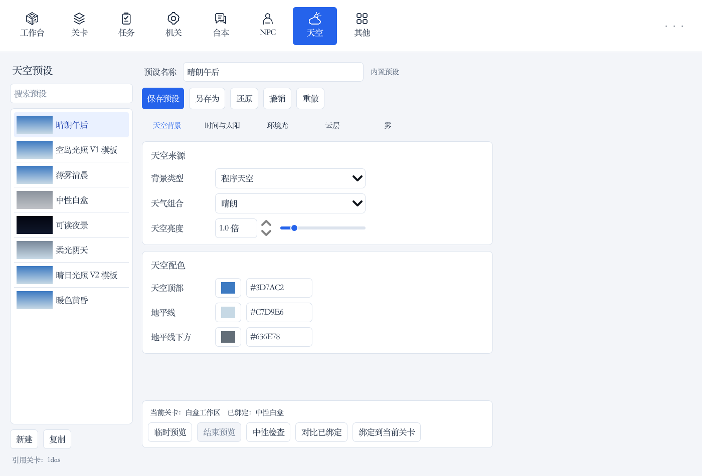
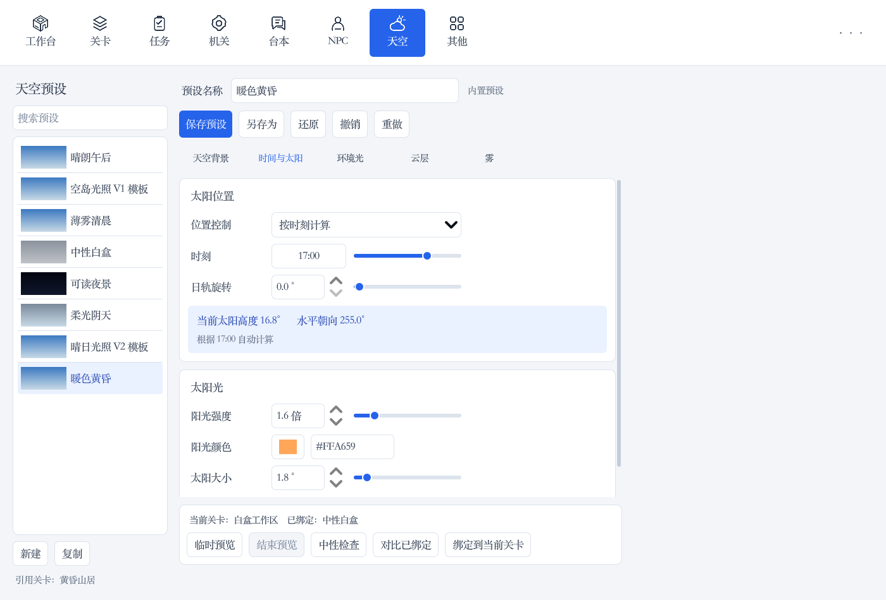

# 调整天空与关卡环境

入口：独立 GodotLevelEditor 窗口 → **天空**。左侧选择预设，右侧按五类参数编辑，底部负责临时查看与关卡绑定。

## 按想调整的效果找选项

| 分类 | 可以调整什么 | 适合解决的问题 |
|---|---|---|
| **天空背景** | 程序天空／HDRI／光照模板，天气组合、天空亮度、天空配色、HDRI 导入与旋转 | 换天空、改背景颜色或使用全景素材 |
| **时间与太阳** | 时刻、太阳角度、日轨旋转、阳光强度和颜色、太阳大小、阴影 | 改成早晨或黄昏，调整受光面和阴影方向 |
| **环境光** | 补光来源、颜色、亮度与固定曝光 | 补亮背阴处，调整整体画面亮度 |
| **云层** | 开关、云量、颜色、高度、云团大小、云形编号 | 调整程序天空中的静态云层 |
| **雾** | 开关、颜色、起止距离和浓度 | 调整远景能见度与空间层次 |

预设名称始终显示在上方，旁边区分内置预设、未保存修改与已保存状态。分类页分别滚动，切换预设时会保留当前分类。

## 直接输入与拖动

- **时刻：**输入 `07:30`、`17:00` 等时间，回车或离开输入框确认；也可拖动滑块。无效时间会恢复到上一个合法值，并显示错误原因。
- **数值：**可直接键入、点箭头，或拖动蓝色滑块。角度、米和亮度倍率显示在输入框中。
- **颜色：**点小色块打开颜色选择器，或在旁边输入 `#RRGGBB` 色值，例如 `#FFA366`。
- **云量与雾浓度：**用百分比显示。`65%` 表示 65% 的云量，不需要输入 `0.65`。

云层高度、云团大小等距离可以直接输入具体米数；箭头步长不会改变已存数值的显示。

## 按时间或手动设置太阳

在 **时间与太阳 → 位置控制** 选择：

- **按时刻计算：**编辑时刻与日轨旋转，蓝底区域显示实际计算出的太阳高度和水平朝向。这里是只读结果，不再显示另一组未使用的手动角度。
- **手动设置角度：**编辑太阳高度和水平朝向。由时间模式切换过来时，会沿用当前计算的位置，避免突然跳回旧角度；这次切换可整体撤销。

时间使用固定的示意日照路径：06:00 日出、12:00 正午、18:00 日落。太阳高度为负值时位于地平线下，太阳直射关闭。它不使用日期、经纬度或真实天文计算。

**太阳大小**影响太阳圆盘与阴影柔和程度；**环境光**中的补光主要用于背光面和阴影区域，和太阳直射分别设置。

## 只显示当前适用的设置

- 程序天空显示配色和可编辑云层。
- HDRI 模式显示素材导入、文件名与旋转；在环境光中选择是否使用 HDRI 补光。使用 HDRI 补光时，颜色来自素材，不显示无效的手动补光颜色。
- 光照模板保留原天空与后期。需要自己调色或生成云层时，选择 **使用程序天空**。
- 关闭云层或雾后，相关参数会收起，原数值保留；重新开启即可继续编辑。HDRI／模板的云层页会说明云的来源。

HDRI 中拍下的太阳和云不会按时刻重新生成；场景里的阳光方向仍在“时间与太阳”中单独设置。云层高度是程序天空参数，当前没有云海功能。

## 预览、保存并绑定到关卡

1. 在 Godot 原生视口打开要编辑的关卡。
2. 选择预设并调整参数，点 **临时预览**。预览中修改参数会实时更新视口；**结束预览**恢复关卡环境。
3. 可用 **中性检查**查看均匀补光的白盒环境，或用 **对比已绑定**查看关卡已有环境。
4. 点 **保存预设**。内置预设会进入另存为，自定义预设保存在 `content/resources/sky_presets/custom/`。
5. 点 **绑定到当前关卡**，再保存关卡场景。底部显示关卡中文名和当前已绑定的天空；未保存草稿时，先保存再绑定。

临时查看不会改写关卡绑定。也可在关卡根节点的原生检查器中修改 `sky_preset` 引用。

继承关卡未覆盖该属性时，仍沿用并显示模板的天空。原生保存或另存为后，天空页的“引用关卡”会刷新；“我的关卡”的详情和“关卡编辑”的当前场景信息也可查看实际天空名称。

HDRI 导入时，切换、新建、复制、还原与保存会暂时锁定，避免写入错误草稿。同一草稿的其他参数仍可调整，结束预览和关闭窗口也仍可用。见 [HDRI 导入说明](../faq.md#hdri-import)。

维护依据：[天空接口](../../sky_editor/INTERFACES.md)、[本次界面验证](../../sky_editor/ui_2026-11-16/validation.md)。
